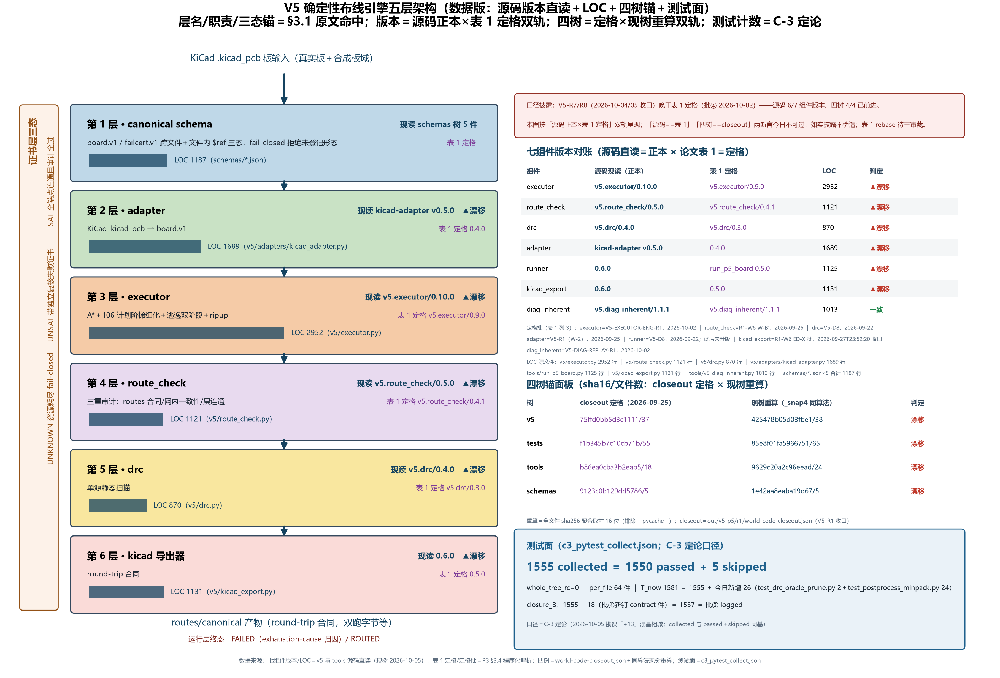
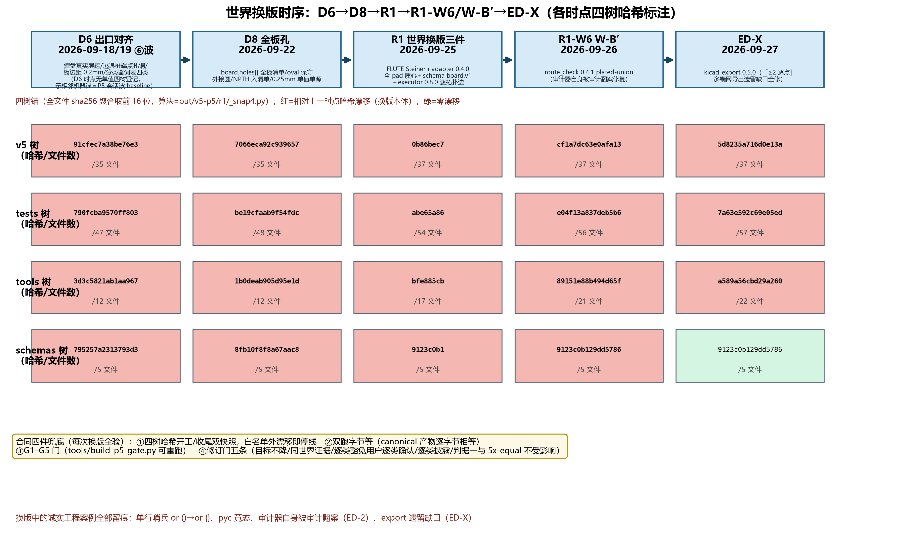
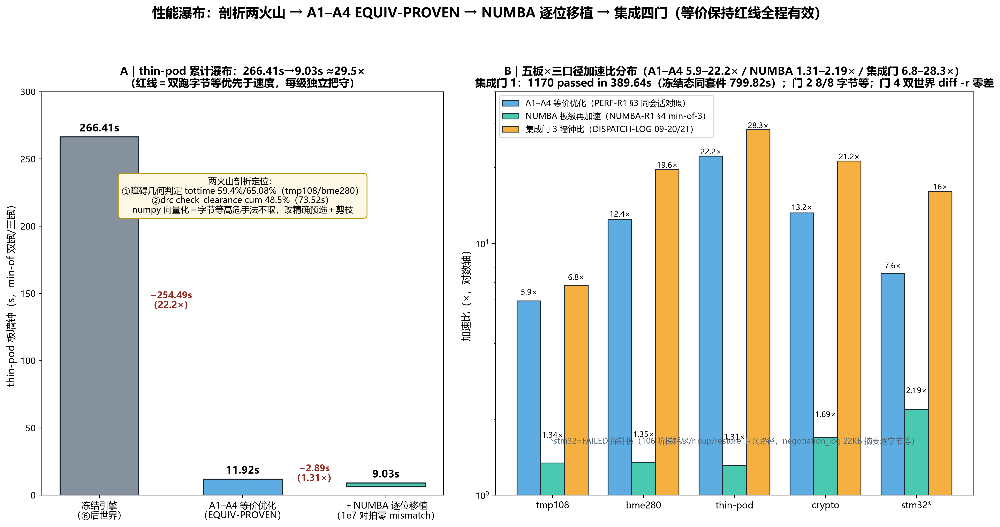
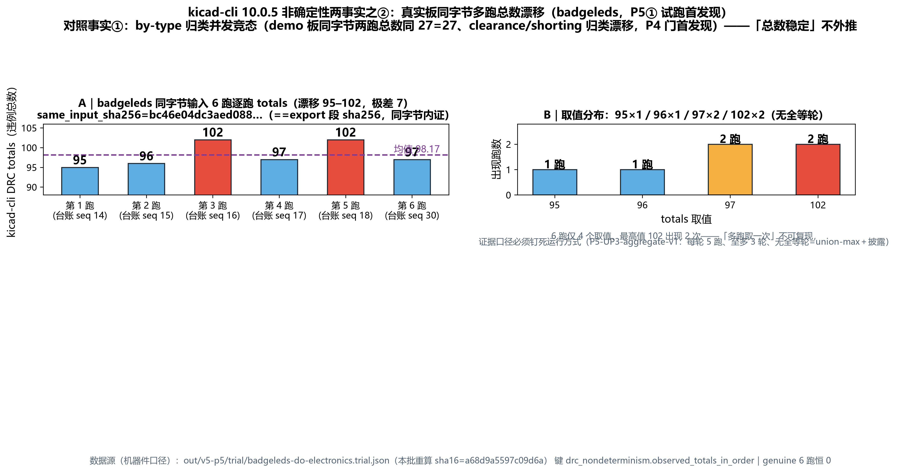
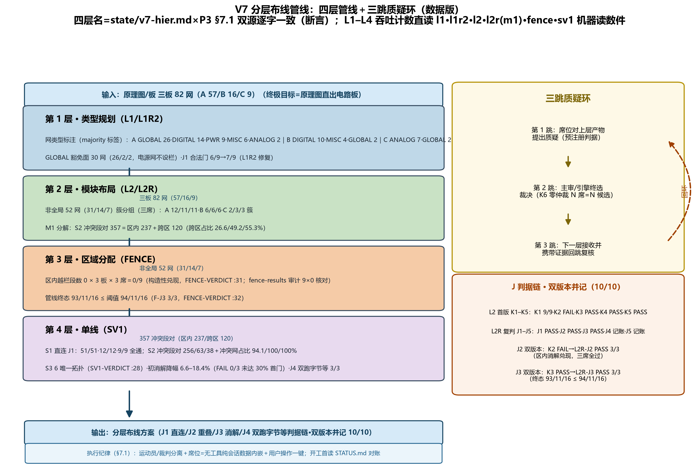
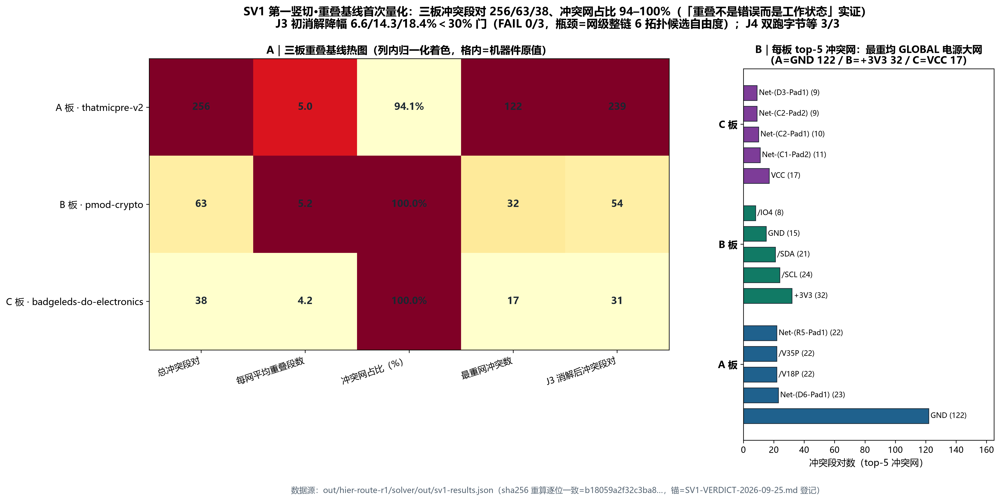
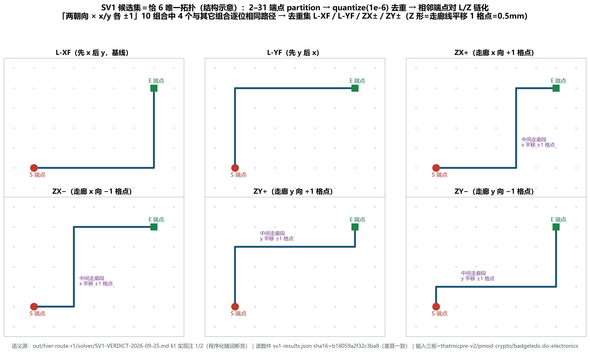

# 篇三《pcbflow V5 确定性布线引擎——世界合同、版本换血、等价性保持优化与分层管线》全文 R2

**发布说明（2026-10-30 收线归档）**：本文是 pcbflow 项目的中文技术报告（R2 内部定稿），**未经同行评审，未投稿**。文中形如 `<ENGINE_ROOT>/out/...`、`<WORKSPACE>/...` 的证据路径指向作者本机的实验证据目录，这部分没有公开；代码与核心板设计见仓库 `engine/`、`tools/`、`design/`。"主审""席位"等术语见 `TERMINOLOGY.md`。作者：赵丹琪。许可：CC BY 4.0。

- 日期：2026-10-03（R2 对账升级版；底稿=同日框架 v1，全部数字经机器件逐项对账，对账明细见 `recon/P3-RECON.md`）
- 纲领位置：PAPER-PROGRAM-R1 大纲 R2 篇三（`out/paper-program-r1/PAPER-PROGRAM-OUTLINE-2026-09-27-R2.md` §3）
- 事实源（本篇全部数字取自下列机器件，路径均为 E 盘绝对路径）：
  `<ENGINE_ROOT>/DISPATCH-LOG.md`（各批收口节）、
  `<DATA_ROOT>/.zcode/dev-experience/state/partition-judge.md`（V5 主线档案）、
  `<DATA_ROOT>/.zcode/dev-experience/state/v7-hier.md`（V7 档案）、
  各批 REPORT/LEAD-REVIEW/gate 报告（逐章脚注）。

**术语口径**（首现定义，全纲领统一；统稿依据=`<ENGINE_ROOT>/out/paper-program-r2/TERMINOLOGY.md`）：
- **证书层三态 SAT/UNSAT/UNKNOWN＋运行层终态 FAILED/ROUTED**（FAILED 非三态之一）：SAT=全端点连通且审计全过；UNSAT=带独立复核失败证书的不可能判定；UNKNOWN=资源耗尽等不可判定态（fail-closed，不折算为成功或失败）；FAILED=执行器穷举或短路后失败（附 exhaustion-cause 归因）；ROUTED=执行器全链完成布线。命名空间：本篇 G1–G5＝`tools/build_p5_gate.py` 五门（主场定义），与篇一 P1/P2 门、篇五 PILOT/SCALE/EXP 各门、篇六各 run 门同号不同物；本篇 A1–A4＝等价性保持优化件（§5.2），与篇一 P2 臂 A1、篇四 V5 诊断线批号 A1/A2/A3、篇五 selection 终选模块 A4 同号不同物；篇一「窗世界」（V4 载体冻结配置）与本篇「世界」（四树哈希合同）同词不同物（TERMINOLOGY C-1/C-2/C-3）。
- **席位**：无工具、纯会话、数据内嵌的模型参与单元（无文件系统与代码执行权，输入输出全经预注册合同）。
- **世界**：代码（v5/tests/tools/schemas 四树）+ 板集 + 门判据的冻结组合；换世界=显式换版，证据不跨世界互判。
- **(a)/(b)/(c) 三分类**：FAILED 归因分类——(a) 板固有（板设计几何封死）、(b) 引擎缺口（求解器能力不足）、(c) 规则带值（世界模型一刀切规则过粗，真实细规则可逃逸）。
- **可布域记分牌**：剔除已裁处置板（板固有/(c) 豁免）后的 SAT 比口径；与全量分母口径并记，不单值宣称。

---

## 摘要

LLM 时代布线实验的可信度瓶颈在实验基建而非模型：世界漂移、证据污染、引擎版本混淆使「哪个版本的 17 板结果」无从回答。本文给出 pcbflow V5 确定性布线引擎的完整工程交付：五层架构（canonical schema→adapter→executor→route_check→drc→导出）加 SAT/UNSAT/UNKNOWN 三态证书与失败证书独立复核；**世界合同**（代码四树哈希＋双跑字节等＋G1–G5 门＋修订门五条）把「换引擎部件而不污染证据」变成工程化操作，D6/D8/R1 三次版本换血实录全程留痕（含单行哨兵 `or ()`→`or {}`、审计器自身翻案、export 遗留缺口等诚实工程案例）；**等价性保持优化**在双跑字节等红线下完成两火山剖析（障碍几何 tottime 59–65%、drc 铜对全扫 cum 48%）、A1–A4 EQUIV-PROVEN 与 NUMBA 逐位移植（1e7 对拍零 mismatch、板级 1.31–2.19×、thin-pod 累计 ≈29.5×、缺库回落逐位一致）；**外部权威刻画**给出 kicad-cli 10.0.5 非确定性两事实（by-type 并发竞态只锚 totals、真实板多跑总数漂移 95–102→P5-UP3-aggregate-v1 聚合口径）与 TD7 Freerouting v2.3.0 资格/质量分立实测（资格 pass、质量 3 板全带新增 error、0.75× 减宽边界、JVM shared-cwd 死锁）；**V7 分层布线管线**（四层管线＋三跳质疑环）作为引擎分层扩展与原理图直出路线收入第 7 章，重叠基线首次量化（三板 256/63/38 冲突段对、冲突网占比 94–100%、2–31 端点恰 6 唯一拓扑）与序介入深度定律（主键化大杠杆 +16/+8/+5 经第 5 层完全吸收、席位序管线终局代价=0）落地。工程基建：测试 190→1550 passed+5 skipped 增长纪律、REPAIR 线 0F 恢复（3572 collected）、预注册/LEAD-REVIEW/append-only 台账与断电生效链式哈希实录。本篇贡献不是布通率，而是让「换引擎部件而不污染证据」成为可重复的工程操作。

**关键词**：确定性布线引擎；世界合同；版本换血；等价性保持优化；双跑字节等；非确定性治理；分层布线管线；预注册

## 0. 本篇定位（一句话）

贡献不是布通率，而是**让「换引擎部件而不污染证据」成为工程化操作**——世界合同（四树哈希＋双跑字节等＋G1–G5 门＋修订门五条）使每一次引擎改动要么证明等价、要么显式换版重来；V7 分层管线作为引擎的分层扩展与原理图直出路线收入第 7 章。

---

## 1 引言

LLM 时代布线实验的可信度瓶颈在实验基建而非模型：世界漂移（同一篇论文前后两次实验跑在不同代码态上而无从对账）、证据污染（审计器自身有缺陷时「SAT」不可信）、引擎版本混淆（「哪个版本的 17 板结果」无法回答）。本项目在 pcbflow V4 线（篇一）验证了表示层与治理管线之后，从零重建 V5 确定性布线引擎，把上述三类问题作为一等工程对象处理。

本篇交付一套**确定性引擎＋世界合同＋等价性保持优化方法论**，贡献清单：

1. **五层引擎架构＋三态证书**（§3）：canonical schema（board.v1/failcert.v1，fail-closed）→adapter→executor→route_check→drc→kicad 导出器；SAT/UNSAT/UNKNOWN 三态加失败证书独立复核。
2. **世界锚定与三次版本换血实录**（§4）：D6（出口对齐）、D8（全板孔）、R1（FLUTE/全 pad 质心/board.v1 schema/逐拓扑边）三次换版，每次都由四树哈希＋双跑字节等＋修订门五条兜底；换版中暴露的诚实工程案例（单行哨兵、pyc 竞态、审计器自身缺陷翻案、export 遗留缺口）全部留痕。
3. **等价性保持优化**（§5）：剖析定位两火山→A1–A4 EQUIV-PROVEN→NUMBA 逐位移植；红线=双跑字节等优先于速度。
4. **外部权威刻画**（§6）：kicad-cli 10.0.5 非确定性两事实与 Freerouting（TD7）资格/质量谓词分立。
5. **分层布线管线**（§7，V7 章）：四层管线＋三跳质疑环，重叠基线首次量化与序介入深度定律。
6. **治理基建**（§8）：测试 190→1550 增长纪律、预注册/LEAD-REVIEW/append-only 台账。

图 1（图表位）：五层架构图。表 1（§3）版本总表。（本篇图 1–7 与表 2–表 7 现均为图表位占位，图件按纲领 §E-2 图件批统一绘制、留后续批；R2 统稿批新绘六张图归篇一/二/五。）

**图 1**（`figs/FIG-P3-01-ENGINE-FIVE-LAYER-ARCH.png`；生成脚本 `figs/scripts/FIG-P3-01-ENGINE-FIVE-LAYER-ARCH.py`，数据版〔2026-10-05 示意数据化批改画，用户裁「不认可示意口径→改画数据版」〕：层名/层序=本篇 §3.1；版本面双轨=§3.4 表 1 定格值（批④，2026-10-02）×七组件源码版本常量直读＋逐文件 LOC 计数；四树面双轨=`out/v5-p5/r1/world-code-closeout.json` 登记值×现树同算法重算；测试面=`caliber-r1/c3_pytest_collect.json`（1555 collected=1550 passed＋5 skipped，C-3 定论口径）；源码/表 1 版本漂移 6/7 与四树漂移 4/4 已在图内披露条如实双轨标注（V5-R7/R8 收口晚于表 1 定格））——V5 引擎五层架构：canonical schema（board.v1/failcert.v1，fail-closed）→adapter→executor→route_check→drc→kicad 导出器，各层现役版本与三态证书（SAT/UNSAT/UNKNOWN＋失败证书独立复核）挂接点标注。

## 2 相关工作

- **确定性布线器**：KiCad 内置 push-and-shove 与 Java 系 Freerouting 是开源生态两条主线。本文对其分别做非确定性刻画（§6.1 kicad-cli）与资格/质量分立实测（§6.2 TD7）；「外部引擎质量不可默认信任」的工程佐证承篇一 §2 与 E7 差分（RP2040 上 Freerouting 布线后新增 error +648/+50，`<WORKSPACE>/tools/pcbflow/exec/PAPER-1-V4-MANUSCRIPT-2026-09-19.md` §6.4/Table 9）。
- **ML/RL 布线器**：Quilter、DeepPCB 等厂商声明不可复现（篇一 [W1][W3]），构成本文「受控对照＋全链审计」动机的对照面。
- **EDA 可复现性与工件评估**：TCAD artifact 线；本篇的贡献是把「可复现」从流程承诺降为机器可验证对象（四树哈希、双跑字节等、append-only 链式台账）。
- **分层布线经典文献**：全局/详细两阶段与区域布线（V7 章定位用）。

**本节文献口径**（2026-10-06 回写批）：以下六组条目全部取自本纲领文献检索批候选池 `<ENGINE_ROOT>/out/paper-program-r2/litsearch-r3/refs/P3-candidates.jsonl`（r2/r3 两批合并去重、按主题打分排序后分配给本篇）；题名/作者/年份/venue/DOI/arXiv 编号原样取自该池 JSON 字段，候选池未给的字段如实留空、不以记忆补写；引用标记 [R1]–[R25] 连续无重复，与本篇 References 节一一对应。原「文献检索批未跑」的自认行已由本回写批撤除，其余条目（篇一 [W1]–[W5] 口径、项目内实测证据锚）一字未改。

### 2.1 迷宫/A* 与路径搜索基础

- 过孔（via）设计规则被显式并入多层 maze 布线代价函数，是把制造规则工程化进搜索代价的经典做法 [R1]；本篇走的是同一问题族的另一端——规则**前置进入路由判决**而非加权：executor 0.9.0 的 sealed-short-circuit 事前短路以净距规则带值构造性判无解（§3.2），净距规则带值裁定见 §4.2 R1 tmp108 案。
- 布线图压缩以缩小迷宫搜索空间是提速的直接路线 [R3]；本篇走的是**等价性保持**路线（§5：候选集预选＋剪枝同族手法 A1–A4、NUMBA 逐位移植），两者互为替代而非叠加——压缩改搜索空间、等价优化不改语义。
- FPGA 硬件加速的 maze 布线内核给出了串行 A* 之外的系统级加速形态 [R2]；本篇 §5.3 明确 GPU 默认不做（A* 串行形状＋小规模＋字节等纪律风险）、板级并行（4–8× 预期）立项在案未实施——本条是该取舍的外部坐标。
- 1987 年印制板自动布线文献记录了 PCB 自动布线在栅格/代价组织上的早期工业形态 [R4]；本篇 R1 世界换血把 FLUTE Steiner 段纳入执行器（§4.2 R1），属同一问题族的当代变体。

### 2.2 协商拥塞与 rip-up-reroute（PathFinder 谱系）

- 性能驱动的 FPGA 布线算法骨架（1995，DAC）是与协商拥塞同代的奠基作 [R5]；本篇 executor 的 ripup 演化链（0.7.0 受限 ripup→0.8.0 逐拓扑边，§3.4）同属「先布后拆」族，但 §10.2 如实登记「真 ripup（阻塞集重选/联合重解级）」尚无实现。
- 改进 Pathfinder 的加速研究与岛型 FPGA 上的迭代加速给出该谱系的当代形态 [R6]；本篇在该谱系上的增量在**可判定性**而非加速——exhaustion-cause 归因出口（0.6.0 起）与 sealed-short-circuit 事前短路（0.9.0）把「穷举到底失败」与「构造性无解」在亚秒级区分开（§3.2/§3.3）。
- 时延驱动、拥塞缓解的全局布线给出了「可证紧界」的论证范式 [R7]；本篇的四树哈希＋双跑字节等＋G1–G5 门（§4.1）走另一条「可证明」路线——不是性能界而是**证据界**：换版即换世界、证据不跨世界互判。
- 过孔最小化与多策略 rip-up-reroute 结合的 3D 全局布线是协商拥塞在多层结构上的后继形态 [R8]；本篇的多层逃逸双阶段与全 pad 质心集（§3.1）面向真实板而非 3D IC 过孔最小化问题。
- 单/双层 PCB 的「路径搜索与网络序联合优化」rip-up-reroute 与本篇引擎机制最直接对应 [R9]；值得并列的是本篇 §7.4–§7.5 的序介入深度定律（主键化大杠杆经第 5 层完全吸收、席位序管线终局代价=0）——它是对「网络序作为一等优化变量」的独立复算，且给出与该文相反量级的收益。

### 2.3 FPGA 路由算法

- 受约束范数（restrained-norm）路径搜索空间处理 FPGA 难例 [R10]，与本篇「106 计划阶梯细化＋逃逸双阶段」（§3.1）同属把大搜索空间切成受限候选族的做法；差别在本篇红线是逐位等价（§5）而非搜索空间削减本身。
- 多核并行化 FPGA 全局布线且**不降质量**给出了并行化的验收口径 [R11]；本篇 §5.3 板级并行未实施、并把「双跑字节等优先于速度」写成红线——该口径与「无质量降级」互为镜像但要求更强（逐位而非统计）。
- 图嵌入做节点过滤的快速 FPGA 布线（DeepRoute）是学习式剪枝的代表 [R12]；本篇的加速全部建立在精确几何判定的等价改写上（§5.1 两火山：障碍几何 tottime 59–65%、drc 铜对全扫 cum 48%），不引入学习式过滤。
- 分层（multilevel）全局布线算法用于层次化 FPGA [R13]，是 §7 四层管线（类型规划→模块布局→区域分配→单线）的外部谱系参照；本篇 V7 的差异在**重叠基线先量化再消解**（§7.3 三板 256/63/38 冲突段对、冲突网占比 94–100%）而非自顶向下逐层放松。

### 2.4 通道路由与多层布线

- 任意方向（any-direction）走线的障碍感知长度匹配路由是 PCB 侧真实板级、与本篇最直接的算法对标 [R14]；本篇执行器为正交走廊＋逃逸的阶梯细化面（§3.1），任意角度能力不在本版实现面内。
- 复杂约束与差分对统一处理的 PCB 布线算法 [R15] 与三角栅格 PCB 全局布线算法 [R16] 代表板级布线的两条工程路线；本篇的差异化不在栅格形态，而在 §4 的世界合同与 §6 的外部权威刻画。
- 广义通道的局部拥塞缓解（UEO channel routing）把局部拥塞显式作目标指标 [R17]；本篇侧对应的是归因与构造性短路（§3.2/§3.3）——拥塞在本篇是**待归因的现象**而非优化目标，这一点与拥塞导向文献的出发点相反。
- 焊盘（pad）中心的动态多边形分区布线把引脚可达性问题显式化 [R18]；本篇 adapter 0.4.0「全 pad 质心集」世界换血（§4.2 R1）在同一关切点上做的是**入模口径**修正（最远两端→全 pad 质心），并因此触发 tmp108 首板的真模型 4 端 vs 旧世界 2 端发现。

### 2.5 开源布线器与工程对照

- 无栅格（gridless）PCB 布线开源实现 [R19] 与本文的 maze/栅格范式构成范式对照：栅格化换来了可判定的搜索空间与可穷举的失败证书（§3.2 sealed-short-circuit 的构造性前提），代价是任意角度走线能力受限。
- 基于 KiCad 的 PCB 自动布线强化学习环境 [R20] 与公开的 200 例 PCB 自动布线基准集 [R21] 为本文提供第三方可复现实验面；本篇当前的实验面为真实板集＋合成板域（§9.2，20 板，构造性可布/不可布保证），第三方基准集是尚未接入的可选增量——如实登记，不虚称已用。（两条与篇一 [W14]/篇四 PCBWorld 同源，本节按篇三候选池重登记以保本篇自洽。）
- 三条工程性坑与本篇 §6 的外部权威刻画同源：外部布线器/DRC 工具的输出必须带运行方式与聚合口径才能当证据用（kicad-cli 10.0.5 非确定性两事实、P5-UP3-aggregate-v1 聚合口径、TD7 资格/质量谓词分立），这一纪律在有/无公开基准两个面上同样成立。

### 2.6 ML/RL 辅助布线

- 世界模型强化学习＋Freerouting 集成的 PCB 自动布线是 PCB 侧学习类最新代表作 [R22]；与本篇对照的恰是篇一已登记的厂商声明不可复现问题（[W1][W3]）——学习式布线器的评测瓶颈同样落在「证据是否可重复」而非「指标是否更高」。
- Unet-Astar 用深度学习给迷宫布线做快速引导 [R23]，是「学习加速 A*」的直接形态；本篇 §5 的加速全部在逐位等价红线下取得，不引入学习组件，红线=双跑字节等优先于速度。
- 拥塞与线长的可解释共学习优化 FPGA 布线 [R24] 把两个目标放进同一学习回路，与本篇「先证明等价再谈速度」的次序相反：本篇把拥塞当待归因现象（§2.2/§3.3），不作优化目标。
- 用机器学习预测 FPGA 布线问题**难度**（PathFinder 式布线器所需迭代数）[R25] 与本篇 (a)/(b)/(c) 三分类（§3.3 与术语口径）同属「失败原因分类」问题族；差别是本篇分类判据为构造性 witness 与机器复算（consistency_rate 口径），不依赖学习模型自身的可信度。

## 3 引擎架构

### 3.1 五层与三态证书

五层：**canonical schema**（`v5/schemas` board.v1/failcert.v1，跨文件＋文件内 $ref 三态，fail-closed：任何未登记形态一律拒绝而非忽略）→**adapter**（KiCad .kicad_pcb → board.v1；0.3.0 全板孔清单版→0.4.0 全 pad 质心集版）→**executor**（A*＋106 计划阶梯细化＋逃逸双阶段＋ripup；0.2.0→0.9.0）→**route_check**（三重审计：routes 合同/网内一致性/层连通；0.4.0→0.4.1 plated-union）→**drc**（单源静态扫描）→**kicad 导出器**（round-trip 合同）。

三态证书：SAT/UNSAT/UNKNOWN 加失败证书独立复核。首例=P3 门 demo-01 全流程 UNSAT=诚实判定（三态实锚 SAT=adv-02/UNSAT=demo-01/UNKNOWN=adv-03，`state/partition-judge.md` §5 P3 节）；G2 失败证据门复算 PASS 首例=failcert C1/F.Cu 4.70>4.3（容量 4.3，证据 4.70，复算成立，P4 门节）。

### 3.2 executor 0.9.0（终版定格）

V5-EXECUTOR-ENG-R1（2026-10-02 收口，主审 LEAD-REVIEW ACCEPT，sha16 `c5919188e2c3ca09` 程序化重算一致）两项落地：

- **W-1 sealed-short-circuit 事前短路**：待布网任一端点的全部可附着点位 S(e)=S_grid(e)∪{端点精确坐标}（附着闭包三机制 M1 栅格吸附/M2 逃逸重吸附/M3 端点精确坐标）在每一信号层被不可摘除、不可豁免的板固有固定铜按 R5−EPS 封死（R5＝中心线走廊净距规则常量 0.5mm，§4.2 tmp108 案与篇四 §2.1 采样口径同常数） ⇒ 构造性无解 ⇒ 执行入口事前短路出 FAILED。效果（合成板，0.8.0→0.9.0，`out/v5-p5/exec-eng-r1/EXECUTOR-ENG-R1-REPORT.md` §3.1 逐板表）：

| 板 | 0.8.0 终态/墙钟 | 0.9.0 终态/墙钟 |
|---|---|---|
| syn-u04 | FAILED 穷举到底 / 6497.4s | FAILED 短路 / 0.5s（≈1/13000） |
| syn-u07 | FAILED 穷举到底 / 3673.5s | FAILED 短路 / 0.5s（≈1/7300） |
| syn-u09 | **4h 墙钟 TIMEOUT 无终态** | FAILED 短路 / 0.6s（无终态→亚秒终态） |

  无误杀面：合成可布域 syn-r01..r10 SAT 10/10 零回归、判定器零触发；真实三板（pmod-crypto/badgeleds/thin-pod）布通保持，violations_total 0.8.0 vs 0.9.0 逐板相等（3/8/0），canonical 几何面相等、`.kicad_pcb/.kicad_prl` 导出件字节等（E-J3）。thatmicpre-v2 论证豁免（0.8.0 实测 94074s≫4h 红线；逆否免疫定理：已 ROUTED 板必不触发短路；主审 LR-2 核准）。
- **W-2 verdict_provenance 出口字段**：selection 判定与执行终态双口径收口——23 复跑板逐板可见（7 板 `executor-renegotiated`/10 板 `execute-short-circuit`/6 板 `selection-certified`，E-J4）；「同一块板两面读数」（selection=UNKNOWN 而执行器重协商布通）的语义歧义自此可机器区分。

### 3.3 diag_inherent 1.1.1 与 witness 探针 1.1（归因工具面）

V5-DIAG-REPLAY-R1（2026-10-02 收口，LEAD-REVIEW ACCEPT，sha16 `b02c59a1bb4ca6e1` 重算一致；下文「批③」＝V5-EXECUTOR-ENG-R1、「批④」＝V5-DIAG-REPLAY-R1，双批同日收口）：`tools/v5_diag_inherent.py` 双面合同对齐（0.9.0 主锚＋0.8.0 存档忠实重放）＋`tools/r1_failed_net_probe.py` witness 探针 1.1 双口径化。终数：D-J1=14/14 板（u 族 10＋legacy 4）exit 3 零复现、全出真实三分类；D-J3=**A2 批 W3 前值 9/9 tool-failed 全消除→u 族 10/10 三分类（全 (a)）＋consistency_rate=1.0**；D-J4=pytest 1550 passed+5 skipped（+18 新钉、全为 `tests/test_diag_replay_r1_contract.py` 新文件 18 个 nodeid；原记「+13」＝1550−1537 的 passed/collected 混基相减——caliber-r1 C-3 定论，2026-10-05 勘误回写）；D-J5=四面字节等、墙钟全实测（tmp108 41.3min 最慢≪1h 门）。三翻案裁：esp32=对象更替非翻案（(b) 0.6.x/+5V 与 (a) 0.9.0/GND 并存）；tmp108/bme280 维持 09-28 (c) 裁定；(c) 判据域扩容立改进件候选挂账（DR-2）。

### 3.4 版本总表（表 1；对账正本=DISPATCH-LOG 各收口节＋各批收尾件；四树哈希=该版本定格时点值，算法=`out/v5-p5/r1/_snap4.py` 全文件 sha256 聚合取前 16 位）

| 组件 | 现役版本 | 定格批/收口日 | 定格时四树锚（v5/tests/tools/schemas） | 文件级锚（sha16，本批程序化重算一致） |
|---|---|---|---|---|
| executor | **v5.executor/0.9.0**（`v5/executor.py:323`） | V5-EXECUTOR-ENG-R1，2026-10-02 | 批③收尾整体四树无单值登记（收口件只记 drift 清单）；v5 树=868babcb86ad0f8a/37（批④白名单不含 v5 树，本对账时点现树实测） | v5/executor.py=`8133462525616f78` |
| route_check | **v5.route_check/0.4.1**（`v5/route_check.py:112`） | R1-W6 W-B′，2026-09-26 | W-6 段收尾（`r1/w6d-fourtrees-final.json`）：v5=cf1a7dc63e0afa13/37、tests=e04f13a837deb5b6/56、tools=89151e88b494d65f/21、schemas=9123c0b129dd5786/5 | v5/route_check.py=`a276e3dc3e6f1ccf` |
| drc | **v5.drc/0.3.0**（`v5/drc.py:12`） | V5-D8，2026-09-22 | D8 收口（`trial/P5-CLOSEOUT-ADDENDUM-D8-2026-09-22.md` §3）：v5=7066eca92c939657/35、tests=be19cfaab9f54fdc/48、tools=1b0deab905d95e1d/12、schemas=8fb10f8f8a67aac8/5 | — |
| adapter | **0.4.0**（`v5/adapters/kicad_adapter.py:119` ADAPTER_NAME="kicad-adapter v0.4.0"，全 pad 质心集） | V5-R1（W-2），2026-09-25 | R1 收尾（`trial/LEAD-REVIEW-R1-2026-09-25.md` 面 2）：v5=0b86bec7/37、tests=abe65a86/54、tools=bfe885cb/17、schemas=9123c0b1/5 | — |
| runner | **run_p5_board 0.5.0**（`tools/run_p5_board.py:100`） | V5-D8，2026-09-22；此后未升版 | 同 D8 行 | — |
| kicad_export | **0.5.0** | R1-W6 ED-X 批，2026-09-27T23:52:20 收口 | ED-X 收尾（`r1/LEAD-REVIEW-R1W6-2026-09-28.md` §1）：v5=5d8235a716d0e13a/37、tests=7a63e592c69e05ed/57、tools=a589a56cbd29a260/22、schemas=9123c0b1/5 | v5/kicad_export.py=`5c27b8b79ad35728` |
| diag_inherent | **v5.diag_inherent/1.1.1**（`tools/v5_diag_inherent.py:85`，批④ LEAD-REVIEW 亲验） | V5-DIAG-REPLAY-R1，2026-10-02 | 批④收尾态=现树（本对账 2026-10-03 实测）：v5=868babcb86ad0f8a/37、tests=ea503be616fd7272/62、tools=3c805dbbd5f3cda4/23、schemas=9123c0b129dd5786/5 | — |

版本链（演进史，`state/partition-judge.md` 各节）：executor 0.2.0（P4）→0.3.0（F12 缝修复）→0.5.0（⑥波 D6）→0.6.0（D8 孔禁布）→0.6.1（smallwave A3 log-only）→0.7.0（R2 ripup 深化）→0.8.0（R1 逐拓扑边）→0.9.0（短路＋provenance）；route_check 0.3.0→0.4.0（hole_violations）→0.4.1（plated-union）；drc 0.2.0→0.3.0；adapter 0.3.0（holes[]）→0.4.0（全 pad 质心）；runner 0.2.0→0.3.0（轮换重试）→0.4.0（⑥波分类器）→0.5.0（D8）；diag_inherent 1.0.0（smallwave 产品化）→1.1.0→1.1.1（批④修复轮）。

**定格披露（2026-10-05 用户裁：表 1 维持定格＋披露）**：表 1 为批④定格时点（2026-10-02）各组件**实验真实版本**——本篇全部实验数字均出自这些冻结版本。其后 V5-R7（2026-10-04 收口）与 V5-R8（2026-10-05）两个引擎写批已将七组件中六个升版：executor→v5.executor/0.10.0、route_check→0.5.0、drc→0.4.0、adapter→0.5.0、runner→0.6.0、kicad_export→0.6.0（diag_inherent 1.1.1 未变）——源码现值×定格值双轨对照见图 1 披露条与 `out/paper-program-r2/figdata-r1/VERDICT.md`。表不随现值回改：升版后版本未经本篇实验重跑，回改将造成「实验未用版本」的张冠李戴；四树哈希同理为定格时点锚（四树现值登记 `out/v5-p5/r1/world-code-closeout.json` 已于 2026-10-06 按用户裁定刷新至现值、09-25 时点锚保全于其 history 条）。

## 4 世界合同与版本换血（本篇核心章）

### 4.1 合同机制

**世界=代码＋板集＋门判据冻结组合**。锚定机制四件：
1. **四树哈希**：v5/tests/tools/schemas 四树各自聚合哈希（算法见 §3.4 表注），开工/收尾双快照，白名单外漂移即停线。
2. **双跑字节等**：同世界同输入两次执行 canonical 产物逐字节相等（executor 内建断言＋跨进程 doublerun 抽查）。
3. **G1–G5 门**（`tools/build_p5_gate.py`，可重跑）：G1 成功率门（判据一 SAT≥5＋判据二干净板）、G2 失败证据门、G3 holdout 纪律门、G4 三臂对账门、G5 理念门（PF/PU/PS）。
4. **修订门五条**（⑥波立）：目标不降/同世界证据/逐类豁免须用户逐类确认/逐类披露/判据一与 5x-equal 不受影响。

### 4.2 三次换版实录

**D6（出口对齐，2026-09-18/19 ⑥波）**——四项合同修正：焊盘真实层跨废 "all" fail-closed、逃逸桩端点扎焊盘铜（routes 不动）、板边距 0.2mm 入世界模型、分类器词表四类（padstack→contract-artifact、copper_edge_clearance 三分支）。实现件三包并行（A=export、B=executor+route_check+drc、C=runner），接口合同主审预锁（B→C 的 `edge_violations` 两派发单逐字钉死）；集成门=主审独立复跑全量 **1170 passed in 741.73s**（基线 1110＋A26＋B11＋C23 恰合）。

**D8（全板孔，2026-09-22）**——D7 停线（合同缺口：任务书前提「adapter 已读入板固钻孔」三重不符——schema 无钻孔键/adapter 有意不入模/端点-only 覆盖）→主审全板孔普查口径修正（thatmicpre=215 PTH 含 3 oval＋4 NPTH、bme280=31+2、crypto=31+0）→**用户四裁**（board.holes[] 全板清单、oval 保守外接圆、NPTH 入清单、0.25mm 单值单源）→执行完毕（D8-REPORT sha16 010a8399 重算一致）：17 板 re-convert 全成、钉值锚 3/3、**14 终态板重跑与 wave6 逐板零漂移**、三板差口全闭合（hole_to_hole 2/2/10→0/0/0）、门 1=1204 绿、门 3=**14/14 全加速 3.2×–82×**、门 4a 向后兼容逐位等。thin-pod 终解变化触发停线条款，用户裁 A 续跑收口（归因=旧解 13 处贴孔〔最近 0.002mm〕被禁布带正确驱离、kicad 违例面零漂移 [4,4,4,4,4]）→**P5 五门首次满 PASS**（判据一 6≥5 零回归＋判据二干净板 6/6）。

**R1（世界换版三件，2026-09-25）**——FLUTE Steiner 自研（用户八裁①：表段收口 3-4＋DW 在线 5-9 双实现互证）＋adapter 0.4.0 全 pad 质心集（旧「最远两端」口径入 ERRATUM）＋schema board.v1＋executor 0.8.0 逐拓扑边 DFS 序＋MST 回退。W-6 首板 tmp108 即回归：A0 网旧世界 2 端抽象、真模型 4 端——主审独立坐实 ep1=(139.196,114.046) circle ⌀0.265 在旧世界 endpoints 完全缺席；密封复算=正交邻 0.235mm/对角走廊 0.442mm vs R5=0.5mm ⇒ **(c) 规则带值类**（真实细规则可逃逸、板非人不可布）→豁免入册＋R7 对位挂账。

### 4.3 换版中的诚实工程（全部留痕，本篇方法论主张的证据面）

1. **审计器自身被审计**（ED-2 翻案，2026-09-26）：crypto 崩于层连通审计，初判 executor 层账机制三缺口；诊断段翻案——executor 无缺陷，真根因=route_check ③ 未建模 PTH 孔筒层间连通（plated union），**审计假阴性把电气连通多端网误判断链、出口击落真 SAT 候选**（割点 [168.8156,69.273]=1.0mm plated 孔筒连通 B.Cu↔F.Cu，主审自建并查独立复算坐实）。用户四裁 R-A=只修 route_check（0.4.0→0.4.1，plated 全信号层 union、NPTH fail-closed 不放松；executor 零改）。误杀重判 3/3 全中（crypto/badgeleds/thin-pod 重跑全 ROUTED）。**归因结论的可信度以审计器自身被审计为前提**（与篇四 §5 互证）。
2. **export 遗留缺口**（ED-X，2026-09-27）：R1 世界模型（多端点入模）在 kicad_export `_validate`「恰 2 端」旧合同的缺口——多端网板 R1 以来首次走到 export 才暴露。用户三裁（候选 B=最小修＋anchor 全链走查；范围含四板补跑＋四门＋收口一气呵成；W-D 完工后串行）。修复=kicad_export 0.5.0（「≥2 逐点」＋全链 12 消费面走查、残留缺口 4 处全修、route_check 零穿透）。开工门槛机制四次正确拦截提前派发（EDX-GATE-HALT 系列，W-D 未完工不开工）。
3. **单行哨兵案例**：R1+NUMBA 集成首败定位=executor.py:755 `or ()`→`or {}` 一字符之差（合同缝的最小复现；`out/v5-p5/perf/GATE1-FAILURE-DIAG-R1.md`）。
4. **pyc 竞态**：同长改动＋同秒 mtime＋同 size 会让旧 pyc 被判有效，两进程同刻启动一读旧一读新（清 `__pycache__` 自愈）；批量重跑前先清缓存立规。
5. **「验收件首败网结论不能来自截断件」**：tmp108 A0「首败」系截断件推断（完整跑首败=GND），HALT 件如实勘误。

### 4.4 R1-W6＋ED-X 收口正本与 v5-r1w6-review 复核（对账项②落账）

- **执行链终态**（`out/v5-p5/r1/R1-W6-REPORT-2026-09-26.md`，权威终态=2026-09-27T23:51:44 版）：W-B′（route_check 0.4.1 三处落码＋crypto 崩溃 doc 在线过审 31 plated holes）→W-C（新钉 5/5＋pytest **1280 passed+5 skipped/1114.82s**，15:42:09→16:00:45 双时戳=+5 恰新钉）→W-D 四板重跑**全 ROUTED**（all_endpoint_connected=true，route_check 0.4.1 语义）：pmod-crypto 56 entries/503s、badgeleds 31/4357s、thin-pod 59/12391s、thatmicpre-v2 **243 entries/57 网/94074s=26h08min**（09-25 队列 B「审计误杀候选」重判 4/4 全坐实）→ED-X 批（W-X1..W-X6）2026-09-27T23:52:20 收口：kicad_export 0.5.0、四板 export/drc 补跑全过 **genuine=0**、全量 pytest **1289 passed+5 skipped/947.38s**（+9 恰新钉）、双跑补完 2/2 canonical 字节等（crypto 240.2s＋badgeleds 2197.9s）。
- **主审复核工作流**：global 工作流 `v5-r1w6-review`（09-28 首跑；登记=DISPATCH-LOG 停止线切换补三节）：机械面七面 RECHECK（四树 close 锚 MATCH：schemas 9123c0b1/5、v5 5d8235a7/37、tests 7a63e592/57、tools a589a56c/22）＋全量 pytest 1289+5 复跑绿＋语义面 9 发现（唯一数据错=D-1 thatmicpre-v2 网数 56→57 四独立源坐实；余 D-2..D-9 口径/披露）。产物=草案 `LEAD-REVIEW-R1W6-DRAFT.md`（sha16 82a0254f）→定稿 `LEAD-REVIEW-R1W6-2026-09-28.md`（sha16 `fbe3ae40c0f5d076` 重算一致），终判 **ACCEPT**。
- **五门（r1-2026-09-27 版）**：G1 FAIL（判据一 4<5/判据二干净板 2<5，可布域 (c) 前后双口径均 4/5，域内唯一 FAILED=bme280 未处置）；G2 PASS 3/3；G3 PASS（派发域口径）；G4 PASS（时点披露=旧世界会话波产物）；G5 PF+PU+PS PASS。

### 4.5 R1-B 重定基七裁与记分牌 B 版（对账项④落账）

- **七裁**（2026-09-28 用户令「7 项全按建议」，`LEAD-REVIEW-R1W6-2026-09-28.md` §3）：①N/6 分母=三档并记、主值 4/5（A 版出值件 `R1-SCOREBOARD-REBASE-2026-09-28.json` sha16 9af2954c20e7d75d 重算一致）②bme280 维持留分母挂诊断批 ③track_dangling<0.06mm 豁免类增列=判据二干净板 2→4/5（微段 6 条 0.0369–0.0583mm 全过阈值、residual 归零）④gate 适配六处整体 ACCEPT 追认 ⑤墙钟看门狗规立（不阻塞；thatmicpre 26h08min=布通真耗时非停滞）⑥G4/G5 时点性＋7 板 convert-only 维持现状 ⑦56→57 勘误生效。
- **bme280 处置裁**（同日，用户四支呈裁答「(c) 规则带值入册（推荐）」）：pmod-bme280=rule-value-limited ruled 入册（witness 三件=`r1/bme280-diag/` 归因器+GND 几何 witness+LEAD-REVIEW-DIAG-BME280 sha16 9e19dac9；机制修正=R2/R4/D3/R5 组合约束×端点集扩张 GND 2→11，非 R5 单点密封（R2/R4/D3/R5＝v5 规则带编号，与本篇世界换版批号 R1/D6/D8 同符不同物））。gate 重跑=`p5-gate/r1-2026-09-28b/`（json sha16 db76d7965be43f67/md 3e1d60c976b2f28a）。
- **记分牌 B 版**（`R1-SCOREBOARD-REBASE-2026-09-28B.md`，本批重算 sha16=16b02a0b6490bd47/raw、B.json=fe90b8679dbeb3f5/raw；生效裁定=七裁＋bme280 入册）：**主值=可布域 (c) 后 SAT 4/4 双 PASS**（域内零 FAILED；判据一双分支均 4/4——gate 28b `criterion_1_routable_domain` 分母 4/SAT 4、note 原文「分母剔除 10 块已裁处置板（豁免入账；(c) rule-value-limited 豁免前口径）」，`criterion_1_routable_domain_c_exemption` 同 4/4〔tmp108/bme280 已在 10 板处置名册内，(c) 豁免前后分母同 4，B 版时点两口径数值相同〕）；并记：六板全量 4/6、W-D 直读 4/4 不变；判据二干净板 4/4 全净（微段豁免后）——仍 <require 5 属**结构性**（R1 世界 SAT 恰 4 板），差口不再指向任何脏板。处置名册 10 板=8 板固有（09-23 DIAG-FAILED8 锚）＋tmp108 (c)（09-25 锚）＋bme280 (c)（09-28 锚）。g1 verdict 原文（gate-report.json 28b 版）：「判据一 4<5/判据二干净板 4<5（豁免外余量 0 条〔其中 C 类 genuine 0〕）；可布域口径（(c) 豁免前）SAT 4/4 PASS…(c) 豁免后口径 SAT 4/4 PASS」。

图 2（图表位）：世界换版时序（D6→D8→R1→R1-W6/W-B′→ED-X，各时点四树哈希标注）。表 2（图表位）：修订门五条×三次换版执行对照。

**图 2**（`figs/FIG-P3-02-WORLD-RESWAP-TIMELINE-FOURTREES.png`；生成脚本 `figs/scripts/FIG-P3-02-WORLD-RESWAP-TIMELINE-FOURTREES.py` 直读 `p5-sessions/world-code-baseline.json`/`world-code-closeout.json`（D6 相邻锚）、`trial/P5-CLOSEOUT-ADDENDUM-D8-2026-09-22.md` §3、`trial/LEAD-REVIEW-R1-2026-09-25.md` 面 2、`r1/w6d-fourtrees-final.json`、`r1/edx/fourtrees-close.json`，四树哈希全部程序化解析禁手抄；断言 ED-X open==W-B′ 终值、D8/R1/W-B′/ED-X 四时点锚与本篇 §3.4 表 1 登记值逐位一致）——世界换版时序 D6→D8→R1→R1-W6/W-B′→ED-X：每个时点标注 v5/tests/tools/schemas 四树聚合锚与定格批收口日，「换引擎部件而不污染证据」的时间轴全貌；D6 时点四树无单值登记（§3.4 表注），取落地后最近机器锚并在图中如实标注。

## 5 等价性保持优化

### 5.1 剖析两火山（PROFILE-R1，2026-09-19）

cProfile 包住 execute 等价路径（tmp108 小板 60.3s/pmod-bme280 中板 151.6s 剖析样本）：**第一火山=障碍几何判定（tottime 59.4%/65.1% 两板一致）**；A* 内循环本体（0.9–2.3%）、heap（0.08–0.33%）、容量（≈0%）均否。四嫌疑之外挖出**第二火山=v5.drc 网级门/终检铜对全扫描（check_clearance cum 48.5%，polyline_polyline 1049 次全段×段）**。numpy 向量化按字节等门判为高危手法不取（np.hypot 与 math.hypot 无逐位保证，R5 阈值比较对位敏感），改走精确预选＋剪枝同族手法（`out/v5-p5/perf/PROFILE-R1.md`、`PERF-R1-REPORT.md` §1）。

### 5.2 A1–A4 EQUIV-PROVEN（PERF-R1，2026-09-19 收口）

九条手法三态裁定（`PERF-R1-REPORT.md` §2 表）：**A4 均匀网格粗筛＋提交序精判、A3 障碍按层分桶＋孔点单列、A1 via_blocked 层循环提出、A2 rect 预计算=[EQUIV-PROVEN 做]**；**A5 state_key 轻量指纹=[VETOED]**（5 消费点全为 rollback 卫兵、剖析 0.00% 不在热路径——无收益＋削弱卫兵双输不做）；A6–A9 [PROFILED→不做]（0.00% 不进 Top-30）。等价论证总式：候选集预选=纯比较超集；下界剪枝裕度 1e-12≫rect_rect_gap 舍入 ~1e-15；早退为同值分支重排；**距离原语浮点运算序列零改动**。

验收（C 段，同会话相邻对照）：五板（含 stm32 FAILED 探针板覆盖 106 阶梯耗尽/ripup/restore 卫兵路径）加速比 **5.9×/12.4×/22.2×/13.2×/7.6×**（tmp108/pmod-bme280/thin-pod/pmod-crypto/stm32），canonical routes 摘要逐板字节等 ✅×5、原型内双跑自查 5/5。两级实施各自通过（第一级剪枝版 thin-pod 仅 1.47×，二级段网格后 22.2×，两级均字节等——等价门在每一级独立把守）。

### 5.3 NUMBA 逐位移植（NUMBA-R1，2026-09-19；集成落地 09-21）

问题：numba 内建 math.hypot 与 CPython 逐位不等（探针 8431/50000 分歧），字节等门下不可用。解法：取源 CPython 3.12 mathmodule.c（ghproxy.net＋gitee 双镜像逐字节一致，132,777 B 固化 `_data/`），在 njit 内**精确移植 vector_norm 运算序列**（Veltkamp split＋Dekker twoProduct＋Neumaier 补偿和；关键事实修正：3.12 的 hypot 已非 3.8–3.11 的旧 m_hypot）。红线：仅 cache=True、禁 fastmath/parallel、运算序列与 C 逐行对应。

对拍门（`NUMBA-R1-REPORT.md` §2 表）：**T1 随机 10,000,000 对零 mismatch**＋T2 对抗 15,673 对＋T3a 全域 1,000,000＋T3b 引擎量纲 2,000,000＋T4 回退路径 1,015,673＋**T5 njit twoProduct 对 Fraction 精确积 250,000 例零违例（subnormal 误差域 154 例跳过如实披露）**＋T6 生产内核 3,160,000 全零（T1–T6 六门齐全）；逐位门抓到 1 个移植 bug（`max` 初值语义，(inf,nan)/(±0) 组合 4 例）——常规千万级随机暴露不了的边角正是逐位门价值。五验收板 frozen==numba==prenum sha 逐位三重一致（与 R1 存档跨日互证）；**缺 numba 回落路径 440,000 例逐位一致**。

板级收益（D 段 min-of-3）：**1.34×/1.35×/1.31×/1.69×/2.19×**（tmp108/bme280/thin-pod/crypto/stm32）——**1.31–2.19×**；FAILED 板（drc 门/终检占比最高）收益最大。**相对冻结引擎累计：thin-pod 266.4s→9.0s ≈29.5×**。微基准：segment_rect_distance 19.31×/segment_segment 6.89×/point_segment 2.45×（裸 _hypot 0.68×=njit 标量 dispatch ~0.18µs 税如实披露）。

**集成四门换血**（2026-09-20/21，主审亲历；单行哨兵诊断翻案后重换血）：门 1 全量 **1170 passed in 389.64s**（对照冻结态同套件 799.82s）；门 2 **8/8 板字节等**（5 验收板 pre6 输入 sha 跨日一致＋post6 扩样 3 板双引擎同 sha；双跑自查 16/16 equal）；门 3 墙钟比 **tmp108 6.8×/bme280 19.6×/thin-pod 28.3×/crypto 21.2×/stm32 16.0×**；门 4 双世界 tmp108 全链 **diff -r 全部工件零差**（导出 sha 与 wave6 批件逐位一致）。**红线=双跑字节等优先于速度**：每级优化、每次换血都被字节等门独立把守，无一手法在门下幸存侥幸。

板级并行（4–8× 预期）立项在案未实施；GPU 默认不做（A* 串行形状＋小规模＋字节等纪律风险）。

### 5.4 E5R3/R55 链的引擎侧教训（v4 树）

`ripup_count` 恒 0 硬编码（v4 executor :414/:479）——顺序布线一锤子买卖，合同声明的 ripup 从未实现。承篇一 §6.7；本篇视角：**等价门能守住「没变」，但发现「从未实现」需要诊断批**——合同声明与实现不符的检测是等价保持的盲区，V5 的 exhaustion-cause 归因出口（0.6.0 起）与 sealed-short-circuit 事前归因（0.9.0）即为此设计的正面应答。

图 3（图表位）：性能瀑布（两火山→A1–A4→NUMBA→集成四门墙钟分布）。

**图 3**（`figs/FIG-P3-03-PERF-WATERFALL-EQUIV-PRESERVED.png`；生成脚本 `figs/scripts/FIG-P3-03-PERF-WATERFALL-EQUIV-PRESERVED.py` 直读 `out/v5-p5/perf/PROFILE-R1.md`（两火山：障碍几何 tottime 59.4%/65.1%）、`PERF-R1-REPORT.md` §3（A1–A4 五板加速比 5.9×–22.2×、canonical 逐板字节等）、`NUMBA-R1-REPORT.md` §4 D 段（板级 1.31×–2.19×）、DISPATCH-LOG 2026-09-20/21 集成四门节（门 1 全量 1170 passed/389.64s、门 3 墙钟比 6.8×–28.3×））——等价性保持优化性能瀑布：剖析定位两火山→A1–A4 EQUIV-PROVEN→NUMBA 逐位移植→集成四门墙钟分布，每级加速均在双跑字节等红线下取得（红线=双跑字节等优先于速度）。

## 6 外部权威刻画

### 6.1 kicad-cli 10.0.5 非确定性两事实

1. **by-type 归类并发竞态**：同字节输入两跑总数同 27=27 但 clearance/shorting 归类漂移（P4 门首发现）→证据只嵌 totals，by-type 落台账标注。
2. **真实板同字节多跑总数漂移**：badgeleds 同字节 6 跑 totals=95/96/102/97/102/97（P5① 试跑首发现）——P4「总数稳定」不外推。→口径钉死 **P5-UP3-aggregate-v1**：每轮 5 跑、至多 3 轮、无全等轮=union-max＋披露（升级件③实证并发三路控制面全无；两板 15 跑无全等轮→nondeterministic-disclosed，genuine 15 跑恒 0）。

结论：外权威判据必须钉死运行方式；本引擎对 kicad-cli 的依赖走「非确定性治理」而非「消除」。

### 6.2 TD7：Freerouting 资格/质量分立实测

**资格批（v2.3.0，pcbflow V3-TL4 线）**：三真实板档（large pcbbm-bm1 99 网/mid makerspace-emonth-load-box 41 网/small launchxl-f28027 12 网，选板规则预注册）×四轴谓词（安全纪律/记录完备/输出验证链/可复现性）**verdict=pass**（`out/v3-td7/gate-record-td7.json`：TD7-QUAL-G result=pass；`qualification-report.json` verdict_reason=「四轴谓词全 pass」）。
**质量实况（quality_facts 独立记录、不进资格谓词——谓词分立即 TD7 制度设计）**：三板全部 pipeline_status=blocked 且布线后新增 error **109/18/61**（large=solder_mask_bridge 76＋track_width 33；small=clearance 17＋track_width 1；mid=clearance 24＋hole_clearance 7＋track_width 30）——不满足「零新增 error」工程标准；连通改善真实（未连通 195→46/24→1/122→7）。**0.75× 减宽实证**：pcbbm-bm1 布线后最小线宽 0.1524mm vs 参考态 0.2032mm=恰 0.75×（neckdown 细线重试低于板 netclass 最小线宽，引擎边界非参数化承诺面）。**非确定性**：同输入 7 跑 distinct raw SES sha=7/normalized=6，deterministic=False 如实记录。篇一 E7 差分同坐实（RP2040 +648/+50）。
**坑清单五条**（`out/canvas-toolchain/dsn-lane/TD7-PITFALLS.md`，随 DSN 导出器交付）：①0.75× 减宽=对照合同须钉死宽度规则 ②per-net 规则注入须往返验证 ③**JVM 隔离 cwd**（shared-cwd 0/8 vs isolated 6/6 死锁先例；探测数字出自裁定件所引探测批、未在 baseline-r1 树复存——如实披露）④SES oval 焊盘兼容性（DipTrace 旧案；输出侧 2.4.1 无破损、回导未验）⑤资格谓词与质量谓词分立（v2.3.0 资格 pass 而质量拒收；对照臂要外家意见不要外家精品）。
**2.4.1 资格重开**（V4-EXEC P00 先例口径，如实引用不复跑）：freerouting-baseline-r1（另批外部基线臂）8 板全链（strip→DSN→无头→SES 回导→kicad-cli DRC）全通、6 板零未连通、双跑 SES 字节等；Lane-DSN 冒烟追加 relaxed 7/9 布通（忠实模式 9/9 停滞=ViaRule.viaCount NPE 级失效、SES 0 字节、rc 仍 0——「指标全 0」会被误读为正常零值的新坑）。

⚠ 对账注记：大纲/框架所写「质量 9/9 拒收」的「9/9」字面未在机器件定位到（资格批实数=3 板/3 run、质量面 3/3 板全带新增 error）；本节按机器件读数改写为「3 板质量面全不满足零新增 error 标准」，对账明细记 gap。

图 4（图表位）：kicad-cli 漂移直方图（95/96/102/97/102/97）。表 3（图表位）：TD7 资格矩阵（三板×四轴谓词 pass＋质量实况并列）。

**图 4**（`figs/FIG-P3-04-KICADCLI-DRIFT-HIST-BADGELEDS6.png`；生成脚本 `figs/scripts/FIG-P3-04-KICADCLI-DRIFT-HIST-BADGELEDS6.py` 直读 `out/v5-p5/trial/badgeleds-do-electronics.trial.json` 键 `drc_nondeterminism.observed_totals_in_order`=[95,96,102,97,102,97]、`n_runs`=6，断言 totals 与任务书锚值逐位一致、`same_input_sha256`==stages.export.sha256（同字节输入内证））——kicad-cli 10.0.5 真实板 badgeleds 同字节 6 跑 DRC totals 漂移直方图（值域 95–102、无全等轮）：「P4 总数稳定」不外推，证据只嵌 totals、口径钉死 P5-UP3-aggregate-v1（§6.1）。D-1 口径落定：主审候选域未定位的六跑 totals 正本经扩域全仓扫描定位成功，按机器件口径成图、无需降级。

## 7 分层布线管线与原理图直出（V7 章）

### 7.1 形态与执行纪律

四层管线（类型规划→模块布局→区域分配→单线）＋三跳质疑环；终极目标=原理图直出电路板。执行形态=**运动员/裁判分离**（主审写任务书不亲跑席位）＋**席位=纯会话数据内嵌**＋**用户操作一键**（ORCHESTRATOR-PROMPT 三件套）。开工第一步=读 `out/hier-route-r1/STATUS.md` 对账（双窗口事故立规）。事实源=`state/v7-hier.md`（09-28 刷新版）。

### 7.2 早期批次

**pretest**：J2 82/82 PASS（数据面可行性·三席）。**L1/L1R2（类型标注）**：C 板全局网无解→D-L1-001；L1R2 v2 豁免复跑（J5 SPLIT 同分母口径）。**L2（簇分组）**：K2 FAIL→结论=多候选＋引擎终选。

### 7.3 SV1 第一竖切：重叠基线首次量化

- J1 直连 3/3（构造性）；**J2 重叠基线**：三板 **256/63/38** 冲突段对、冲突网占比 **94–100%**、最重网均 GLOBAL 电源大网；**2–31 端点 partition→quantize(1e-6) 去重→恰 6 唯一拓扑**（L 两朝向＋走廊 ±0.5mm 平移 Z 形）。
- **J3 消解 0/3 的候选自由度归因**：降幅 6.6/14.3/18.4%<30% 门；**解除早停烧满 12 轮终态不变**⇒瓶颈=网级整链 6 拓扑候选自由度、非停机判据。
- J4 双跑字节等 3/3。VERDICT=`out/hier-route-r1/solver/SV1-VERDICT-2026-09-25.md`。

### 7.4 SV2A 与第 2 层（L2R）

**SV2A（第 5 层单线优化）**：主冲突对 **256→94/63→11/38→16**；GND 硬核 **122→54**；A 板 600 轮预算截断未收敛（CONTRAST-R1 证=截断噪声：自然收敛 79/80<93）。VERDICT 829829ef。
**V7-L2R-R1（第 2 层接入，09-28 收口 ACCEPT）**：J1 双跑 9/9、J2 区内消解 3/3（**188→183/32→28/17→11**）、J3 分层不劣化主判据 3/3（A 93<94 严格<、B 11≤11、C 16≤16）；M1 首次分解 357=区内 237＋跨区 120（跨区占比 26.6/49.2/55.3%）、正主验证 3/3（头名跨区网均 GLOBAL 电源类）；C 板 group_pos 并列打破=首次阳性介入但被 SV2A 吸收。VERDICT a838926e（读数件 b7f2f9f4）。

### 7.5 K6 与序定律（CONTRAST 两批）

**K6（三席簇序候选×引擎终选，09-28 收口 ACCEPT）**：J1 双跑字节等 9/9、J2 三席并列 239/54/31（−6.6/−14.3/−18.4%=onS3 轨复现）、**J3 阴性**（distinct=1/engaged=0——S3 深度＋冲突数主导选网键下簇序无杠杆）；双口径=机制面兑现（零仲裁 N 席=N 候选首测跑通）/分辨力面阴性如实呈报。VERDICT 2fdbbc35（读数件 aea60cbb）。
**V7-CONTRAST-R1**：C1 序主键对照（+16/+8/+5 主键化劣化=**序介入深度定律**钉死 K6 阴性边界）、C2 B 板 GLOBAL 入池（54 字节级追平全网 S3、视野假说成立）、C3 A 板预算解除（自然收敛 79/80<93）；三 r2 销账。VERDICT da91b9a2。
**V7-CONTRAST-R2（09-28 收口 ACCEPT）**：**C4 序定律四级闭环——主键化大杠杆 +16/+8/+5 经第 5 层完全吸收**（Δ_pipe −1/0/0、A 板过吸收至 main 吸引子 79 终段集字节等、席位序管线终局代价=0）；C5 全板化=入池恒达全网 S3 解、收益符号板间分歧（A 反受损 +7、GG 治理应专项另寻机制——GG＝V7 线全局网对（GLOBAL 族）治理面指标、A 板 GG=147，FENCE 批勘误「GG⊂intra」，定义与读数见 `state/v7-hier.md` 布局批节）；C6 七起点谱宽 6、「分层不劣化 +1」降级路径噪声；C7 确定性 bbox 零增量下界 >1.5mm；C8 围栏收敛 80≤81。VERDICT e180fef9。

### 7.6 布局批与围栏

**V7-FENCE-R1（几何围栏，09-28 收口 ACCEPT）**：**F-J2 区内越栏 0×3 板×3 席构造性**（候选生成即裁剪＋assert＋逐段审计三重——正典「重叠限制在规划区域内」严格几何形式在区内网子集首次成立）；F-J3=93/11/16 且**三板全席终段集与 L2R 逐字节同**（席位余量 1.0–2.5mm 下零裁剪零消解力代价）。VERDICT ea9e8279。
**V7-LAYOUT-R1（b 全板重规划首批，09-28 收口·L-J2 主判据 FAIL 附证据）**：A 板新布局 99/103/99 vs 臂 93（+6 超±2 带）；**布局自由度实测：pinned 率 A 91.2/89.5/91.2%、B 87.5%、C 100%**（可动器件 A 5–6/B 2/C 0）——端点粒度合法门下「全板重规划」实测为「稀疏微重规划」；GG 147 未松反恶化（147→159/154/159）；负读数限锚点聚类平移族不外推。VERDICT 40ba6beb。

### 7.7 排序三臂探针与仪器代际教训

**仪器代际 1**：7/9 臂被 route_check ③ 审计误杀击落（09-26 翻案=plated-union 缺口同源，引擎大概率已布通到出口）→route_check 0.4.1 后全 9 臂重跑解锁（**归因结论的可信度以审计器自身被审计为前提**，与 §4.3.1、篇四 §5 三处互证）。复跑（仪器代际 2，pid 20112 真脱离）在飞，PROBE2-VERDICT 后交叉对照。
**S1 单字符笔误（跨项目教训）**：relax.py 判定文本漂移一个字符（`h["hi"]` vs `v["hi"]`）→S3 零接受→J3 假 FAIL；肉眼复核两次未检出，靠增量 vs 全量对拍→同进程双实现分叉→AST dump 定位。对策：同一判定逻辑只留一份权威实现；数值可疑先做对拍；「同文本不同结果」级矛盾直接上机器 diff。

### 7.8 挂账（对账项⑤落账；截至 2026-10-03 口径）

大纲 09-27 所列「V7 挂账三裁（正典开放点 1/2/3、SV2A 下游顺序、K6 二轮探针）」**已于 09-28 由用户三裁落账**（DISPATCH-LOG 09-28 v7-hier-advance 呈裁节，均按主审建议）：开放点 2=第 4 层维持最小首步不单独加深；开放点 1=随第 2 层立项在 L2R 任务书内裁毕（现役板零器件位移不介入布局侧、布局耦合留布局批新决策件）；开放点 3=质疑权量化**维持挂账**。SV2A 下游=**b 第 2 层接入先行立项**（已执行=L2R 收口）；K6 二轮探针=派发（已执行=K6 批收口）。SV2A-r2/K6-r2/L2R-r2 三 r2 已销账。**当前仍在挂账**：开放点 3（质疑权量化）待用户裁；布局线后续三选项（R2 扩算法族/换低密度板/挂起等 PROBE2 合流；主审建议=挂起）待裁；(c) 判据域扩容改进件候选（DR-2）待裁——均以「截至 2026-10-03 待用户裁」口径如实呈现，不代裁。

图 5（图表位）：四层管线图。图 6（图表位）：三板重叠热图。图 7（图表位）：6 唯一拓扑示意。

**图 5**（`figs/FIG-P3-05-V7-FOUR-LAYER-PIPELINE.png`；生成脚本 `figs/scripts/FIG-P3-05-V7-FOUR-LAYER-PIPELINE.py`，数据版〔2026-10-05 示意数据化批改画〕：四层名/锚词=`state/v7-hier.md`×本篇 §7.1 双源断言；每层吞吐计数直读 `l1/READINGS-L1.json`＋`l1r2/READINGS-L1R2.json`（三板网数 57/16/9、GLOBAL 26/2/2）、`l2/READINGS-L2.json`＋`solver/out/l2r/m1-baseline.json`（M1 分解 357=区内 237＋跨区 120，逐板算术断言）、`FENCE-VERDICT-2026-09-28.md`×`fence/fence-results.json`（越栏 0×3 板×3 席、终态 93/11/16≤阈值）、`sv1-results.json`×`SV1-VERDICT`（S2 冲突段对 256/63/38、6 唯一拓扑）；判据双版本 K1–K5/L2R-J1..J5 共 10 项全数入图）——V7 分层布线管线四层结构：类型规划→模块布局→区域分配→单线＋三跳质疑环；运动员/裁判分离、席位=纯会话数据内嵌、用户操作一键的执行纪律标注。

**图 6**（`figs/FIG-P3-06-SV1-THREE-BOARD-OVERLAP-HEATMAP.png`；生成脚本 `figs/scripts/FIG-P3-06-SV1-THREE-BOARD-OVERLAP-HEATMAP.py` 直读 `out/hier-route-r1/solver/out/sv1-results.json`（SV1 J2 三板冲突段对/冲突网占比））——SV1 重叠基线三板热图：A/B/C 板冲突段对 256/63/38、冲突网占比 94–100%，最重网均 GLOBAL 电源大网——分层管线要消解的重叠底色首次量化（§7.3）。

**图 7**（`figs/FIG-P3-07-SV1-SIX-UNIQUE-TOPOLOGIES.png`；生成脚本 `figs/scripts/FIG-P3-07-SV1-SIX-UNIQUE-TOPOLOGIES.py` 直读 `out/hier-route-r1/solver/SV1-VERDICT-2026-09-25.md` 与同目录 `out/sv1-results.json`（三板板名互证、sha 锚同图 6））——SV1 候选集恰 6 唯一拓扑示意：2–31 端点 partition→quantize(1e-6) 去重→L 两朝向＋Z 形走廊 ±0.5mm 平移（去重前 10 组合中 4 组逐位相同路径）——J3「网级整链 6 拓扑候选自由度」归因的几何面（§7.3）。

## 8 工程基础设施与治理

- **测试增长纪律**（每版本收口必附主审独立复跑数字与时戳，D-4 立规首兑现=09-25T19:13:57 落盘时戳）：190（P0）→598（P2）→988（P5③）→1010→1019→1063→1110→**1170（⑥波）**→1204（D8）→1237（smallwave）→1247→1264→1275+5→1280+5（W-C，时戳 2026-09-25T19:13:57 与 09-26 双时戳）→1289+5（W-X4，947.38s）→**1537 收集/1532 passed+5 skipped**（executor 0.9.0 V5 面，1537=1499 开工+38 新钉）→**1550 passed+5 skipped**（批④，+18 新钉＝contract 新文件 18 钉〔R1 期 16＋syn-u02 密封域回归钉 2〕；diag-replay 报告 D-J4 判读席与收尾席双跑读数原文均含 5 skipped。口径注〔caliber-r1 C-3 定论，2026-10-05 回写〕：批③ 1532 passed+5 skipped＝1537 收集、批④ 1550 passed+5 skipped＝1555 收集；真增量＋18＝collected 1555−1537＝passed 1550−1532 双面一致，原「+13 新钉」＝1550−1537 混基相减、差 5＝两批恒定 skipped 计入收集基数所致，非测试面事件）。
- **REPAIR 线**（pcbflow 仓测试基建修复线，独立于 V5 引擎主线）**fail-open 审计与 0F 恢复**：baseline 3572 collected/0F/0E/EXIT=0（R-24 尾批）；known_open 撤账治理；「登记类哈希串禁手抄必须程序化注入」立规。
- **预注册/LEAD-REVIEW/append-only 台账**：p5_holdout_ledger 链式哈希、断电生效（主机死机 102 分钟后 69 事件 verify ok 实录；R1 段 490 事件两进程并行 append 实测无碰撞）；DISPATCH-LOG 开工探盘制度（防双窗口事故——V7 双窗口覆盖事故后 STATUS.md 现态件制度立规）。
- **token 纪律演化**：预估值→会话实测（诊断批 10.84M/smallwave 12.86M 两超支教训，子智能体对累计计费零可见）→**可自测代理**（工具调用数上限 ≤60/批参考＋单次回读上限＋引擎长任务优先纯 Bash 驱动脚本或拆多短命子智能体；V2 按 prompt 计次=回合数才是真金）。
- **工作流载体**（09-27 停止线切换）：V5 新批从起点用动态工作流（判停对账→机械面复算→全量 pytest→语义面→独立确认→LEAD-REVIEW-DRAFT 留主审定稿；正式收口件恒留主审）。首跑教训=workspace 相对路径不拼仓目录前缀、artifact.file 恒包 try/catch（v5-r1w6-review/v8-batch-review 两工作流同雷事故，二次发布零 token 重付收口）。

表 4（图表位）：测试增长×版本对照。表 5（图表位）：治理机制清单。

## 9 评测

### 9.1 17 板全链与 G1–G5 门演化

P5 两阶段执行＋17 板全量重跑（wave6）；门复现器 `tools/build_p5_gate.py` 可重跑。G1 演化：**SPLIT**（09-21 收档态：判据一 6≥5 PASS/判据二 3/6 差口 14 条 genuine）→**D8 首次满 PASS**（09-22：判据一 6≥5 零回归＋判据二干净板 6/6）→**R1 后重定基**（09-28 七裁＋bme280 入册→B 版主值**可布域 4/4 双 PASS**、并记 4/6/4/4、判据二干净板 4/4 全净、<5 结构性；§4.5）。G2–G5 终态（28b 版）：G2 PASS/G3 PASS/G4 PASS/G5 PF+PU+PS PASS。承篇四 §6 详表（本篇只引结论与正本路径）。

### 9.2 合成板域（A2-SYNTHBOARD）

生成器 v0（`boards/build_synth_boards.py` 43KB，旋钮可控＋可布性构造保证=可布板参考路径先铺后障碍/不可布板 all-layer-pad-seal；`tests/test_synth_boards.py` 205 passed）＋20 板。读数：J1 schema **20/20**；J2 构造可布板 SAT **10/10**（单板 11–38s）；J3 构造不可布板 **10/10**（**执行终态口径 0.9.0**；syn-u09=FAILED sealed-short-circuit 0.6s，run/execute/replay 三件互证——`exec-eng-r1/run/syn-u09.json` wall_s=0.6＋`boards/syn-u09/execute.json` verdict_provenance=execute-short-circuit:sealed-short-circuit＋`diag-replay-r1/replay/syn-u09.json` 归因 (a)/consistent=true）。J3 读数沿革如实：A2 正本 9/10（0.8.0 世界、u09 TIMEOUT-4H 历史定格零回改）→2026-10-03 用户批字「随 u09 新终态刷新」=10/10。**合成素材通道自此可用**（后续批次可按同构造面扩产；synthetic-r1 素材域独立记分行，真实板分母零变化）。正本=`out/synthboard-r1/`（USER-RULINGS-2026-10-01 sha16 1543dfc803c510c4 重算一致）。

表 6（图表位）：17 板终态矩阵（R1-B 口径；处置名册 10 板＋分母 4＋弃 3）。表 7（图表位）：合成板域三判据（J1/J2/J3 双版本口径并记）。

## 10 讨论与局限

**局限**（如实）：
1. **板规模上限**：SAT 面全为小板（D8 时代〔2026-09-22 判据二干净板 6/6〕6 SAT 板中最大 thatmicpre-v2 57 网；R1 世界〔2026-09-28 现行〕SAT 恰 4 板——§4.5。口径随世界换版变动，读数须带日期锚）；ice40 96 网单候选超线性 ≥30× 墙钟（vs esp32 72 网 434s）与 thatmicpre 26h08min 属同族「无上界方差」——换板/加板批（V5 中等规模主战役）在队待排期（用户处待裁，任务书 §F-4）。
2. **executor 无「真」ripup（联合重解级）**（口径调和：executor 0.7.0 起的 ripup 深化＝attempt 预算内的受限 ripup〔318 attempts 全灭机理见篇四 §3.1〕；「真 ripup」指阻塞集重选/联合重解深度——esp32 (b) 缺口面，尚无实现；v4 树 `ripup_count` 恒 0〔篇一 §6.7(d)〕系另一引擎，勿混读）。
3. **世界换版成本**：每次换版=14–20 板全链重跑（D8 量级）；修订门五条是治理成本也是节奏约束。
4. **kicad-cli 依赖其非确定性治理而非消除**（§6.1）；TD7 v2.4.1 质量面沿 E7 差分口径仍未满足零新增 error 标准。
5. **V7 半边**：LAYOUT-R1 主判据 FAIL（布局自由度被 pinned 率结构性限死）；开放点 3 与布局线后续三选项挂账（§7.8）。
6. **对账缺口**（本批如实登记）：框架所写 TD7「质量 9/9 拒收」的 9/9 字面未在机器件定位（§6.2 注记）；`P5-CLOSEOUT-ADDENDUM-D8` 现件 sha16（ab952f60）与 state 档 09-22 登记值（35c6bf21）不符、改动时刻无日志可考（对账明细 gap 条）。

**与各篇接口**：归因体系消费本篇世界合同（篇四）；导引批消费本篇席位挂具（篇五 threearm/run_ledger）；直接操作批消费本篇 drc/验证原语（篇六）。附录资产层（语料/许可、预注册/LEAD-REVIEW/双跑/四树/token 台账）本篇主引。

## 11 Conclusion

本篇交付一套「证据不被引擎改动污染」的工程方法论，全部主张以机器件收口：**世界合同**使每次引擎改动要么证明等价（双跑字节等）、要么显式换版重来（D6/D8/R1 三次实录＋R1-W6/ED-X 收口＋R1-B 重定基七裁），换版中暴露的诚实工程案例全部 append-only 留痕；**等价性保持优化**证明性能收益可以在逐位等价红线下取得（A1–A4＋NUMBA，红线=双跑字节等优先于速度）；**外部权威的非确定性被治理而非消除**（kicad-cli 聚合口径、TD7 资格/质量谓词分立）；**V7 分层管线**给出重叠基线量化、候选自由度归因与序介入深度定律，布局批主判据 FAIL 如实入档。v4 树 `ripup_count` 恒 0 的教训反哺为 exhaustion-cause 归因出口与 sealed-short-circuit 事前短路（0.9.0）。局限（板规模上限、「真」ripup 缺位、换版成本、V7 布局批）如 §10 所列，负结果与正结果同权重披露；挂账项（开放点 3、DR-2、换板批排期）截至 2026-10-03 待用户裁。

## References

**[R1]–[R25]＝本篇 §2 引用条目**（题名｜作者｜年份｜venue｜DOI/arXiv｜链接；全部标识符原样取自检索批候选池 `litsearch-r3/refs/P3-candidates.jsonl`，未手工补写、未凭记忆写 ID；候选池未给 DOI/arXiv 或 PDF 直链者如实标注，不以推测填补；r2/r3 两批同一条目的重复行已去重，取字段完整者）：

- [R1] Cong J., Fang J., Khoo K.-Y. 1999. VIA design rule consideration in multi-layer maze routing algorithms. International Symposium on Physical Design｜DOI 10.1145/299996.300084｜https://dl.acm.org/doi/pdf/10.1145/299996.300084（§2.1）
- [R2] Jiang X., Wang J., Lin Y., Zhang Z. 2022. FPGA-Accelerated Maze Routing Kernel for VLSI Designs. ASPDAC 2022｜DOI 10.1109/asp-dac52403.2022.9712533｜https://yibolin.com/publications/papers/ROUTE_ASPDAC2022_Jiang.pdf（§2.1）
- [R3] Kennings A. 2018. Simple FPGA routing graph compression. arXiv preprint｜arXiv 1811.04749（候选池未给 DOI）｜https://arxiv.org/pdf/1811.04749（§2.1）
- [R4] Goto S. 1987. Automatic routing algorithms for PWB. Circuit Technology｜DOI 10.5104/jiep1986.2.110｜https://www.jstage.jst.go.jp/article/jiep1986/2/2/2_2_110/_pdf（§2.1）
- [R5] Alexander M. J., Robins G. 1995. New performance-driven FPGA routing algorithms. ACM/IEEE Design Automation Conference (DAC)｜DOI 10.1145/217474.217589｜https://dl.acm.org/doi/pdf/10.1145/217474.217589（§2.2）
- [R6] Zapletina M. A., Zheleznikov D. A. 2022. The Acceleration Techniques for the Modified Pathfinder Routing Algorithm on an Island-Style FPGA. IEEE Conference of Russian Young Researchers in Electrical and Electronic Engineering (ElConRus)｜DOI 10.1109/elconrus54750.2022.9755536（§2.2；候选池未给 PDF 直链）
- [R7] Samanta R., Raha S. 2014. A provably tight delay-driven concurrently congestion mitigating global routing algorithm. Applied Mathematics and Computation｜DOI 10.1016/j.amc.2014.11.062｜http://eprints.iisc.ac.in/51440/1/app_mat_com-255_92_2015.pdf（§2.2）
- [R8] Zhang P., Yao P., Li X. 2024. V-GR: 3D Global Routing with Via Minimization and Multi-Strategy Rip-up and Rerouting. IEEE ASP-DAC 2024｜DOI 10.1109/asp-dac58780.2024.10473939（§2.2；候选池未给 PDF 直链）
- [R9] Zhu Z. 2026. Joint Optimization of Path Search and Net Sequencing with Rip-up and Reroute for Single and Double-Layer PCB Routing. International Conference on Mechanical, Electronics and Electrical and Automation Control (METMS)｜DOI 10.1109/metms70800.2026.11705924（§2.2；候选池未给 PDF 直链）
- [R10] So K. 2007. Solving hard instances of FPGA routing with a congestion-optimal restrained-norm path search space. International Symposium on Physical Design｜DOI 10.1145/1231996.1232026（§2.3；候选池未给 PDF 直链）
- [R11] Farkish A., Jahanian A. 2011. Parallelizing the FPGA global routing algorithm on multi-core systems without quality degradation. IEICE Electronics Express｜DOI 10.1587/elex.8.2061｜https://www.jstage.jst.go.jp/article/elex/8/24/8_24_2061/_pdf（§2.3）
- [R12] Liu Y., Xiong W. 2025. DeepRoute: A Fast FPGA Routing Algorithm Using Graph Embedding for Node Filtering. Electronics｜DOI 10.3390/electronics14234572｜https://www.mdpi.com/2079-9292/14/23/4572/pdf?version=1763790217（§2.3）
- [R13] Zhu L., Bian J., Zhou Q., Hong X. 2008. Multilevel Based Global Routing Algorithm for Hierarchical FPGA. Joint Conference on Information Sciences (JCIS)｜DOI 10.2991/jcis.2008.18｜https://www.atlantis-press.com/article/1683.pdf（§2.3）
- [R14] Fang W., Guo L., Lin J., Xiong S. 2024. Obstacle-Aware Length-Matching Routing for Any-Direction Traces in Printed Circuit Boards. DAC 2024 (61st ACM/IEEE Design Automation Conference)｜DOI 10.1145/3649329.3655915｜arXiv 2407.19195：https://arxiv.org/pdf/2407.19195（§2.4；本条按候选池 r3 会议记录著录作者四人，r2 同题 arXiv 预印本记录另含第五作者 Huan He，字段未合并）
- [R15] Lin T.-C., Merrill D. J., Wu Y.-Y., Holtz C., Cheng C.-K. 2021. A Unified Printed Circuit Board Routing Algorithm With Complicated Constraints and Differential Pairs. Asia and South Pacific Design Automation Conference (ASP-DAC)｜DOI 10.1145/3394885.3431568｜https://dl.acm.org/doi/pdf/10.1145/3394885.3431568（§2.4）
- [R16] Chen J., Zhou Y., Liu Q., Zhang X. 2023. A Novel Global Routing Algorithm for Printed Circuit Boards Based on Triangular Grid. Electronics｜DOI 10.3390/electronics12244942｜https://www.mdpi.com/2079-9292/12/24/4942/pdf?version=1702036574（§2.4）
- [R17] Wang Z., Nakayama H., Shimoda M. 2025. UEO Channel Routing Algorithm to Alleviate Local Congestion for Generalized Channels. IEICE Transactions on Fundamentals｜DOI 10.1587/transfun.2024eap1144｜https://www.jstage.jst.go.jp/article/transfun/E108.A/9/E108.A_2024EAP1144/_pdf（§2.4）
- [R18] He Y., Li H., Luo G., Bao F. S. 2024. A Pad-Focused PCB Routing Algorithm Using Polygon-Based Dynamic Partitioning. IEEE Access｜DOI 10.1109/access.2024.3386921｜https://ieeexplore.ieee.org/ielx7/6287639/6514899/10496097.pdf（§2.4）
- [R19] Huang W. 2026. WenjieHuang0106/PPDT-Routing (open-source gridless PCB router). GitHub (C++)｜候选池未给 DOI/arXiv，亦未给直链（§2.5）
- [R20] LGAI-Research. 2026. LGAI-Research/PCBWorld (RL environment for PCB autorouting on KiCad). GitHub (Python)｜候选池未给 DOI/arXiv，亦未给直链（§2.5）
- [R21] tscircuit. 2026. tscircuit/autorouting-dataset-01 (200 tscircuit autorouting benchmark problems). GitHub (benchmark dataset)｜候选池未给 DOI/arXiv，亦未给直链（§2.5；同篇一 [W14]）
- [R22] Liao Y.-C., Pan S.-X., Chiang P.-J. 2026. Automation of PCB autorouting via world-model reinforcement learning and freerouting integration. Expert Systems with Applications｜DOI 10.1016/j.eswa.2026.131424（§2.6；候选池未给 PDF 直链）
- [R23] Yin S., Jin M., Chen G., Gong G., Mao W. 2023. Unet-Astar: A Deep Learning-Based Fast Routing Algorithm for Unified PCB Routing. IEEE Access｜DOI 10.1109/access.2023.3323589｜https://ieeexplore.ieee.org/ielx7/6287639/6514899/10274949.pdf（§2.6）
- [R24] Liu W., Xing Y., Cai S., Li W., Xiong X. 2025. Optimizing FPGA Routing with Explainable Co-Learning of Congestion and Wirelength. ACM Transactions on Design Automation of Electronic Systems｜DOI 10.1145/3728467｜https://dl.acm.org/doi/pdf/10.1145/3728467（§2.6）
- [R25] Gunter A. D., Wilton S. J. E. 2023. A Machine Learning Approach for Predicting the Difficulty of FPGA Routing Problems. IEEE International Symposium on Field-Programmable Custom Computing Machines (FCCM)｜DOI 10.1109/fccm57271.2023.00016（§2.6；候选池未给 PDF 直链）

**未入表说明**：候选池其余条目按三类排除——（i）网络/ vehicular/云迁移等非布线域命中（VANET、SDN、云 VM 迁移等）；（ii）与篇一 [W6]–[W14]、篇四已登记条目重复的代码原生 EDA 与基准条目；（iii）与本篇引擎主题相关性 score 偏低（≤7 且无 PCB/FPGA 布线机制内容）者。池内重复行（同一条目在 r2/r3 两批各出现一次）已去重，取字段完整者，未做合并改写。

**r4 中文轴补充条目（2026-10-06 litsearch-r4·浏览器批回写）**：以下 [C1]–[C20] 为中文文献编号，与本篇既有文献编号命名空间并行（同号不同物，承 r3 批同类声明）。条目全部取自 r4 中文候选池 `litsearch-r3/refs/P3-r4-cn.jsonl`（源＝《计算机辅助设计与图形学学报》站点检索接口题录，r4 批 60 检索词枚举 1762 条去重后按轴打分唯一分配；PDF 全部落盘、sha16 逐件对账、fitz 首页题名核验 OK/OK_PARTIAL，52 件 CMap 损坏件未入池待 OCR）；题名/作者/年份/卷期页原样转录池字段（题名含期刊平台 HTML 标记者去标记、文字不变），池未给 DOI 者如实标注、不造标识符。

**组一·经典与通用布线算法（通道/区域/Steiner/总体/详细）**——1992 年双层四边通道布线专家系统是本批最早中文布线文献（规则驱动通道布线的算法史原点）；蚁群（2002）、模拟退火层分配（2004）、粒子群绕障 Steiner（2015）等元启发式布线与 §2.6 英文学习线互补；多重掩模/三重曝光详细布线（2024）为先进工艺约束下的详细布线现役工作。
- [C1] 徐宁, 朱小科, 刘良萍, 虞厥邦. 2002. 用于两端线网布线的蚁群系统方法[J]. 计算机辅助设计与图形学学报, 2002, 14(5): 410-412.｜DOI：候选池未给｜https://www.jcad.cn/cn/article/exportPdf?id=3bc63dc5-a71d-4620-a3ac-ac2b3e3d0c31（r4 中文轴）
- [C2] 马坤, 齐子阳, 周强, 蔡懿慈. 2014. 矩形Steiner最小树布线灵活度[J]. 计算机辅助设计与图形学学报, 2014, 26(10): 1909-1914.｜DOI：候选池未给｜https://www.jcad.cn/cn/article/exportPdf?id=56e4ffd3-8fbc-487b-a645-30b496f3811e（r4 中文轴）
- [C3] 武洁, 吴皓莹, 徐宁, 张亚东. 2024. 多重掩模场景详细布线算法[J]. 计算机辅助设计与图形学学报, 2024, 36(4): 591-597.｜DOI：10.3724/SP.J.1089.2024.20074｜https://www.jcad.cn/cn/article/exportPdf?id=97d90e31-1e47-4af0-aa36-5494cac3537b（r4 中文轴）
- [C4] 杨柳, 洪先龙, 蔡懿慈, 周强. 2006. 带有引线端预处理的区域布线算法[J]. 计算机辅助设计与图形学学报, 2006, 18(1): 69-74.｜DOI：候选池未给｜https://www.jcad.cn/cn/article/exportPdf?id=7358df3a-83bd-4da3-add7-6d34754f605d（r4 中文轴）
- [C5] 梁小宇, 孙若涵, 徐宁, 张亚东. 2024. 面向三重版图曝光约束的详细布线算法[J]. 计算机辅助设计与图形学学报, 2024, 36(4): 575-581.｜DOI：10.3724/SP.J.1089.2024.20072｜https://www.jcad.cn/cn/article/exportPdf?id=fc142989-3ca0-4731-bf15-b479919a7155（r4 中文轴）
- [C6] 唐茂林. 1992. 一种基于规则的双层四边通道布线专家系统原型[J]. 计算机辅助设计与图形学学报, 1992, 4(3): 56-61.｜DOI：候选池未给｜https://www.jcad.cn/cn/article/exportPdf?id=5a2c466e-aebd-4615-bc1d-c5445eb9c547（r4 中文轴）
- [C7] 周强, 周毅, 蔡懿慈, 洪先龙. 2004. 拥挤度驱动的总体布线层分配算法[J]. 计算机辅助设计与图形学学报, 2004, 16(7): 1005-1009.｜DOI：候选池未给｜https://www.jcad.cn/cn/article/exportPdf?id=c328893f-233a-4120-9002-fc34dc6defcf（r4 中文轴）
- [C8] 刘耿耿, 郭文忠, 陈国龙. 2015. X结构下VLSI多层绕障Steiner最小树算法[J]. 计算机辅助设计与图形学学报, 2015, 27(3): 523-532.｜DOI：候选池未给｜https://www.jcad.cn/cn/article/exportPdf?id=e8d23fba-3b55-4cea-8c38-c10c0d63f711（r4 中文轴）

**组二·FPGA 布线族（含布线上游布局邻域）**——层次式 FPGA 可布性布线（2010）的「拆线重布＋禁忌搜索」与本篇 ripup 缺位教训（v4 树 ripup_count 恒 0、exhaustion-cause 归因出口）同题；整数规划层次式布线（2010）、连接盒信息熵结构（2009）、轻量化路径搜索（2023）与快速布线（2014，对 VPR 运行时间 −95.19%）构成 FPGA 布线中文面；两条布局条目（1999/2009）为布线上游邻域（题录级）。
- [C9] 刘洋, 杨海钢, 黄志洪, 刘峰, 罗杨. 2014. 一种减少重复搜索的FPGA快速布线算法[J]. 计算机辅助设计与图形学学报, 2014, 26(6): 1015-1024.｜DOI：候选池未给｜https://www.jcad.cn/cn/article/exportPdf?id=f820b1d8-b012-42b1-a144-649587d73244（r4 中文轴）
- [C10] 王德奎, 张丽丽, 陆旭. 2023. 轻量化FPGA布线路径搜索算法[J]. 计算机辅助设计与图形学学报, 2023, 35(5): 789-795.｜DOI：10.3724/SP.J.1089.2023.19420｜https://www.jcad.cn/cn/article/exportPdf?id=1ec077cf-358b-48e5-84eb-81d79fb1dad9（r4 中文轴）
- [C11] 周强, 张星星, 蔡懿慈. 2010. 层次式FPGA快速可布性布线算法[J]. 计算机辅助设计与图形学学报, 2010, 22(4): 682-688.｜DOI：候选池未给｜https://www.jcad.cn/cn/article/exportPdf?id=7aad453f-3a83-4981-ba2a-94cd8cca719b（r4 中文轴）
- [C12] 陆维娜, 胡瑜, 叶靖, 李晓维. 2018. 面向卷积神经网络加速器吞吐量优化的FPGA自动化设计方法[J]. 计算机辅助设计与图形学学报, 2018, 30(11): 2164-2173.｜DOI：10.3724/SP.J.1089.2018.17039｜https://www.jcad.cn/cn/article/exportPdf?id=f1fd50fd-a871-4dab-be42-4347d68eb4ff（r4 中文轴）
- [C13] 隋文涛, 董社勤, 边计年. 2009. 岛式FPGA线长驱动快速布局算法[J]. 计算机辅助设计与图形学学报, 2009, 21(9): 1275-1282.｜DOI：候选池未给｜https://www.jcad.cn/cn/article/exportPdf?id=902f3f11-7afc-4c54-9910-b418f270540a（r4 中文轴）
- [C14] 周锋, 童家榕, 唐璞山. 1999. 一种带时延约束的FPGA布局算法[J]. 计算机辅助设计与图形学学报, 1999, 11(4): 304-308.｜DOI：候选池未给｜https://www.jcad.cn/cn/article/exportPdf?id=172fbcec-ab33-4e1f-94e7-877983beec5c（r4 中文轴）
- [C15] 李威, 杨海钢, 龚萧. 2009. FPGA连线连接盒中基于信息熵优化的结构设计[J]. 计算机辅助设计与图形学学报, 2009, 21(2): 203-208.｜DOI：候选池未给｜https://www.jcad.cn/cn/article/exportPdf?id=be1da459-0cd5-4ebb-afad-b90616f4509e（r4 中文轴）
- [C16] 朱利民, 边计年, 周强, 蔡懿慈. 2010. 基于整数规划的层次式FPGA布线算法[J]. 计算机辅助设计与图形学学报, 2010, 22(10): 1687-1694.｜DOI：候选池未给｜https://www.jcad.cn/cn/article/exportPdf?id=ed891fd8-6460-4ea1-9ee5-ece9c01a6b22（r4 中文轴）

**组三·特殊载体与约束布线**——模拟电路线网分类布线器（2008，A*＋迷宫——与本篇 §2.1 迷宫引擎同构）、柔性电路通道布线（2022，非刚性载体最近邻）、时钟树零时滞虚拟通道（2003）与串扰优化详细布线（2005，约束驱动）。
- [C17] 金剑松, 周丽丽, 赵文庆, 曾璇. 2003. GHz零时滞时钟树物理布图的虚拟通道布线算法[J]. 计算机辅助设计与图形学学报, 2003, 15(6): 656-661.｜DOI：候选池未给｜https://www.jcad.cn/cn/article/exportPdf?id=67a6d7f0-8d5e-453c-9d1f-ae68be5cbab6（r4 中文轴）
- [C18] 冯刚, 马光胜, 杜振军. 2005. 信号相关的串扰优化详细布线[J]. 计算机辅助设计与图形学学报, 2005, 17(5): 1074-1078.｜DOI：候选池未给｜https://www.jcad.cn/cn/article/exportPdf?id=08d6447f-337a-459e-91cf-4966e35e0ddb（r4 中文轴）
- [C19] 杜昶旭, 蔡懿慈, 洪先龙, 梁军. 2008. 基于线网分类的模拟电路自动布线器[J]. 计算机辅助设计与图形学学报, 2008, 20(4): 417-424.｜DOI：候选池未给｜https://www.jcad.cn/cn/article/exportPdf?id=2f3295a6-820c-4b85-a192-4be194cc27c2（r4 中文轴）
- [C20] 马博宇, 徐宁, 吴皓莹, 刘明玉, 孙社军. 2022. 面向柔性电路通道区的自动布线算法[J]. 计算机辅助设计与图形学学报, 2022, 34(8): 1179-1185.｜DOI：10.3724/SP.J.1089.2022.19465｜https://www.jcad.cn/cn/article/exportPdf?id=29810da5-e27a-42a9-b979-fb1962505521（r4 中文轴）

**r4 加厚补充条目（2026-10-06 litsearch-r4b，用户裁「全面加厚」）**：[C21]–[C64] 续接上段编号；题录全部原样取自增量池 `litsearch-r3/out/r4b-additions.jsonl`（镜像 `refs/P3-r4b-cn.jsonl`；阈值 2.0、封顶上调后的最优轴唯一分配；题名含平台 HTML 标记者去标记、文字不变，未给 DOI 如实标注）；verdict=OK_OCR 者为 r4 批 CMap/扫描件经本地 RapidOCR 题名对账（覆盖度≥0.75）升级件。

**组一（续）·经典与通用布线算法**
- [C21] 甘骏人. 1991. 一种连通孔最小化的通道布线算法[J]. 计算机辅助设计与图形学学报, 1991, 3(4): 1-7.｜DOI：候选池未给｜https://www.jcad.cn/cn/article/exportPdf?id=747b2b05-02ad-49d6-8543-7d5f6e104a90（组一（续）·经典与通用布线算法）
- [C22] 刘耿耿, 裴镇宇, 徐宁. 2024. 基于多阶段优化的高质量总体布线算法[J]. 计算机辅助设计与图形学学报, 2024, 36(4): 607-614.｜DOI：10.3724/SP.J.1089.2024.19956｜https://www.jcad.cn/cn/article/exportPdf?id=bcc28de0-cdf7-49cb-b702-3f9a54bbe278（组一（续）·经典与通用布线算法）
- [C23] 郝睿, 蔡懿慈, 周强, 王锐. 2021. DrPlace: 基于深度学习的可布线性驱动布局算法[J]. 计算机辅助设计与图形学学报, 2021, 33(4): 624-631.｜DOI：10.3724/SP.J.1089.2021.18566｜https://www.jcad.cn/cn/article/exportPdf?id=b385e420-3118-44b3-baee-cf2e89db4384（组一（续）·经典与通用布线算法）
- [C24] 薛新建, 戈以荣. 1991. 求解迷宫布线问题的人工智能图搜索产生式系统[J]. 计算机辅助设计与图形学学报, 1991, 3(2): 61-66.｜DOI：候选池未给｜https://www.jcad.cn/cn/article/exportPdf?id=531184e3-de42-4685-b586-f5cbc52d1795（组一（续）·经典与通用布线算法）
- [C25] 王雨田, 贾小涛, 蔡懿慈, 周强. 2016. 考虑设计规则的引脚分配算法[J]. 计算机辅助设计与图形学学报, 2016, 28(11): 2009-2015.｜DOI：候选池未给｜https://www.jcad.cn/cn/article/exportPdf?id=f59d2b70-1843-4331-aa0e-3bdea9910441（组一（续）·经典与通用布线算法）
- [C26] 黄林, 赵文庆, 唐璞山. 1998. 一种含浮动端点的斯坦纳树的构造算法[J]. 计算机辅助设计与图形学学报, 1998, 10(6): 559-565.｜DOI：候选池未给｜https://www.jcad.cn/cn/article/exportPdf?id=f67383c8-3072-46a5-8406-3c77097d036e（组一（续）·经典与通用布线算法）
- [C27] 杨旸, 经彤, 洪先龙, 朱祺, 王垠. 2005. 考虑障碍的多端点最小直角Steiner树构造算法[J]. 计算机辅助设计与图形学学报, 2005, 17(2): 223-229.｜DOI：候选池未给｜https://www.jcad.cn/cn/article/exportPdf?id=4c15106d-f83f-4e3e-a21e-4d8320daca6a（组一（续）·经典与通用布线算法）
- [C28] 朱予涵, 黄鸿斌, 林泓星, 陈伟斌, 刘耿耿, 徐宁, 黄兴. 2022. 连续微流控生物芯片下基于序列对的流层物理设计算法[J]. 计算机辅助设计与图形学学报, 2022, 34(4): 535-544.｜DOI：10.3724/SP.J.1089.2022.19445｜https://www.jcad.cn/cn/article/exportPdf?id=5c721319-e656-44c0-adda-6ded401a16b9（组一（续）·经典与通用布线算法）
- [C29] 程佳文, 梁文杰, 李凌劼, 喻文健. 2022. 基于割线法的显示面板定阻值布线方法[J]. 计算机辅助设计与图形学学报, 2022, 34(3): 325-331.｜DOI：10.3724/SP.J.1089.2022.18899｜https://www.jcad.cn/cn/article/exportPdf?id=e49b9abb-4b81-4ed1-953f-61fe1b8d05e9（组一（续）·经典与通用布线算法）
- [C30] 卢先兆. 1993. 印制板布线的最佳路径快速通道分配算法[J]. 计算机辅助设计与图形学学报, 1993, 5(3): 211-218.｜DOI：候选池未给｜https://www.jcad.cn/cn/article/exportPdf?id=4a2668c1-15d9-4573-baf7-67a2ad960abf（组一（续）·经典与通用布线算法）
- [C31] 刘耿耿, 江列湫, 李泽鹏, 吴若昕, 徐宁. 2024. 先进制程下基于多策略融合的时延优化层分配算法[J]. 计算机辅助设计与图形学学报, 2024, 36(4): 625-635.｜DOI：10.3724/SP.J.1089.2024.19948｜https://www.jcad.cn/cn/article/exportPdf?id=8cfa4c25-3cd3-4c9a-8324-42ef206e7d34（组一（续）·经典与通用布线算法）
- [C32] 李春辉, 范明钰, 庄昌文, 虞厥邦, 黄劲. 2000. 一般图拓扑的电源/地线线宽优化设计[J]. 计算机辅助设计与图形学学报, 2000, 12(10): 731-735.｜DOI：候选池未给｜https://www.jcad.cn/cn/article/exportPdf?id=60047121-211e-4698-8544-302d51d547f2（组一（续）·经典与通用布线算法）
- [C33] 方娟, 姚治成. 2015. 无缓存片上网络中偏转感知的拥塞控制方法[J]. 计算机辅助设计与图形学学报, 2015, 27(3): 542-547.｜DOI：候选池未给｜https://www.jcad.cn/cn/article/exportPdf?id=ec55e2cd-6601-443b-b08b-089496d0c56c（组一（续）·经典与通用布线算法）
- [C34] 胡君, 徐宁, 喻文健. 2016. 基于随机行走电容提取且保证准确度的线网时延计算方法[J]. 计算机辅助设计与图形学学报, 2016, 28(1): 188-196.｜DOI：候选池未给｜https://www.jcad.cn/cn/article/exportPdf?id=0cffbde2-9c8b-4fa8-9701-b5038bae5735（组一（续）·经典与通用布线算法）
- [C35] 宋明烨, 喻文健. 2022. 纳米工艺下大规模线网的快速随机行走电容提取技术[J]. 计算机辅助设计与图形学学报, 2022, 34(4): 491-498.｜DOI：10.3724/SP.J.1089.2022.19449｜https://www.jcad.cn/cn/article/exportPdf?id=3042a753-c2cf-423d-b7b6-8a7824c2157f（组一（续）·经典与通用布线算法）
- [C36] 黄钢, 洪先龙, 乔长阁, 蔡懿慈. 1999. 带软模块的VLSI布图规划优化设计[J]. 计算机辅助设计与图形学学报, 1999, 11(2): 134-138.｜DOI：候选池未给｜https://www.jcad.cn/cn/article/exportPdf?id=3e5fbf32-6de0-498b-8e0a-0280a3442677（组一（续）·经典与通用布线算法）
- [C37] 侯申, 李景龙, 刘海龙, 李少青, 郭阳. 2021. 轻量级可配置强物理不可克隆函数设计[J]. 计算机辅助设计与图形学学报, 2021, 33(10): 1627-1634.｜DOI：10.3724/SP.J.1089.2021.18744｜https://www.jcad.cn/cn/article/exportPdf?id=bba18d49-7d66-4431-9851-31589984b446（组一（续）·经典与通用布线算法）
- [C38] 王霄, 刘会霞. 2001. PCB数控钻孔最佳走刀路线的建模与求解[J]. 计算机辅助设计与图形学学报, 2001, 13(7): 590-593.｜DOI：候选池未给｜https://www.jcad.cn/cn/article/exportPdf?id=8dad1862-cf2d-465e-977c-27acae68a528（组一（续）·经典与通用布线算法）
- [C39] 周军, 张强, 于晓洲. 2011. 利用层次任务图和多种群遗传算法的可重构计算任务划分[J]. 计算机辅助设计与图形学学报, 2011, 23(3): 508-513.｜DOI：候选池未给｜https://www.jcad.cn/cn/article/exportPdf?id=34fe3cb7-78e2-4282-8f5b-072a7aa65be3（组一（续）·经典与通用布线算法）
- [C40] 梁敬弘, 洪先龙, 经彤. 2008. 消除拥挤的多层总体布线新流程[J]. 计算机辅助设计与图形学学报, 2008, 20(3): 374-377.｜DOI：候选池未给｜https://www.jcad.cn/cn/article/exportPdf?id=8d45d85e-0feb-429a-9829-88d9fb4c054c（组一（续）·经典与通用布线算法）
- [C41] 唐茂林. 1994. 双层布线的受限通孔最小化问题[J]. 计算机辅助设计与图形学学报, 1994, 6(3): 192-198.｜DOI：候选池未给｜https://www.jcad.cn/cn/article/exportPdf?id=dce9b44c-c2fe-4f28-b596-623a780c298d（组一（续）·经典与通用布线算法）
- [C42] 黄娟, 杨海钢, 李威, 谭宜涛, 崔秀海. 2010. 可编程逻辑阵列减少毛刺的低功耗布线算法[J]. 计算机辅助设计与图形学学报, 2010, 22(10): 1664-1670.｜DOI：候选池未给｜https://www.jcad.cn/cn/article/exportPdf?id=237857c1-abf8-422d-94e6-f80b0ce0805f（组一（续）·经典与通用布线算法）
- [C43] 杨瑞元. 1992. 多层印制电路板的线探索布线[J]. 计算机辅助设计与图形学学报, 1992, 4(3): 62-67.｜DOI：候选池未给｜https://www.jcad.cn/cn/article/exportPdf?id=08e4fd93-f4ab-474c-83a1-a309418f6763（组一（续）·经典与通用布线算法）
- [C44] 何江安, 于泓涛, 洪先龙. 1989. 双层门阵布线系统中的端点分配算法[J]. 计算机辅助设计与图形学学报, 1989, 1(2): 5-9.｜DOI：候选池未给｜https://www.jcad.cn/cn/article/exportPdf?id=97571379-220f-4cf3-9ffe-391f8e172856（组一（续）·经典与通用布线算法）
- [C45] 刘耿耿, 魏凌, 徐宁. 2022. 考虑总线时序匹配的多策略层分配算法[J]. 计算机辅助设计与图形学学报, 2022, 34(4): 545-551.｜DOI：10.3724/SP.J.1089.2022.19446｜https://www.jcad.cn/cn/article/exportPdf?id=0fbf8614-2741-490d-9122-0480eaa863fc（组一（续）·经典与通用布线算法）
- [C46] 申瑞民, 洪先龙, 王尔乾. 1992. 一个宏单元门阵上不等距网格的STEINER树算法及其实现[J]. 计算机辅助设计与图形学学报, 1992, 4(4): 63-67,25.｜DOI：候选池未给｜https://www.jcad.cn/cn/article/exportPdf?id=a24df6e6-a92f-4ab3-a9af-8a0bab4144e7（组一（续）·经典与通用布线算法）
- [C47] 梁敬弘, 洪先龙, 经彤. 2008. G-Tree:基于引力指向技术减少拐弯的Steiner树算法[J]. 计算机辅助设计与图形学学报, 2008, 20(2): 144-148.｜DOI：候选池未给｜https://www.jcad.cn/cn/article/exportPdf?id=fe1ba328-2c77-488a-b9e9-c5c5370d0699（组一（续）·经典与通用布线算法）
- [C48] 杨成, 杨骏, 张亚东. 2023. 利用命题逻辑最大可满足性的冗余通孔最优插入方法[J]. 计算机辅助设计与图形学学报, 2023, 35(7): 1132-1138.｜DOI：10.3724/SP.J.1089.2023.19482｜https://www.jcad.cn/cn/article/exportPdf?id=77c73fe9-773a-47e8-a909-607575df5b17（组一（续）·经典与通用布线算法）
- [C49] 杨铭, 来金梅, 唐璞山, 胡欣, 曾璇, 童家榕. 2007. LowTARP:低温交替改善的模拟退火布局算法[J]. 计算机辅助设计与图形学学报, 2007, 19(6): 692-697.｜DOI：候选池未给｜https://www.jcad.cn/cn/article/exportPdf?id=eff83cd2-4108-4af1-8e8f-4fd76193cf85（组一（续）·经典与通用布线算法）
- [C50] 孙奥林, 徐奇, 陈松. 2017. 暗硅多核系统芯片资源调度算法[J]. 计算机辅助设计与图形学学报, 2017, 29(6): 1145-1154.｜DOI：候选池未给｜https://www.jcad.cn/cn/article/exportPdf?id=e50d1b00-aaae-473c-a1d0-0f2dc79ad4e7（组一（续）·经典与通用布线算法）
- [C51] 张碧霞, 顾华玺, 杜克明, 丁慧. 2013. 胖树型片上网络的低能耗映射算法[J]. 计算机辅助设计与图形学学报, 2013, 25(9): 1427-1432.｜DOI：候选池未给｜https://www.jcad.cn/cn/article/exportPdf?id=774b044c-e1de-43c0-a6f2-6ef059e0069e（组一（续）·经典与通用布线算法；OK_OCR）
- [C52] 李佳骏, 许浩博, 王郁杰, 肖航, 王颖, 韩银和, 李晓维. 2023. 面向高能效加速器的二值化神经网络设计和训练方法[J]. 计算机辅助设计与图形学学报, 2023, 35(6): 961-969.｜DOI：10.3724/SP.J.1089.2023.19461｜https://www.jcad.cn/cn/article/exportPdf?id=2310d4b6-1a1d-4777-81a7-4913824739f8（组一（续）·经典与通用布线算法）

**组二（续）·FPGA 布线族（含布局邻域）**
- [C53] 隋文涛, 董社勤, 边计年. 2011. 力驱动三维FPGA布局算法[J]. 计算机辅助设计与图形学学报, 2011, 23(10): 1665-1671.｜DOI：候选池未给｜https://www.jcad.cn/cn/article/exportPdf?id=b841c279-26a9-462f-b27a-65df2b5db42f（组二（续）·FPGA 布线族（含布局邻域））
- [C54] 李鹏, 兰巨龙, 李立春. 2011. 统一关键路径时延为基准FPGA模拟退火布局算法[J]. 计算机辅助设计与图形学学报, 2011, 23(3): 521-526.｜DOI：候选池未给｜https://www.jcad.cn/cn/article/exportPdf?id=85f13c90-e209-455a-9d93-8d57e7dbeed5（组二（续）·FPGA 布线族（含布局邻域））
- [C55] 徐健, 黄维康, 黄志军. 1999. 一个有效的用于确定SRAM型FPGA容错布线中预留线的算法[J]. 计算机辅助设计与图形学学报, 1999, 11(4): 328-331.｜DOI：候选池未给｜https://www.jcad.cn/cn/article/exportPdf?id=72b3340b-71aa-4d3f-a229-fa8a0404f54f（组二（续）·FPGA 布线族（含布局邻域））
- [C56] 李鹏, 兰巨龙, 杨梅樾. 2011. 网线吸收和端口占用分析驱动的FPGA装箱算法[J]. 计算机辅助设计与图形学学报, 2011, 23(9): 1621-1628.｜DOI：候选池未给｜https://www.jcad.cn/cn/article/exportPdf?id=4f876a60-4f12-4df8-b927-885f5644d29b（组二（续）·FPGA 布线族（含布局邻域）；OK_OCR）
- [C57] 吕宗伟, 林争辉, 张镭. 2001. 基于动态标记的FPGA延迟优化算法[J]. 计算机辅助设计与图形学学报, 2001, 13(9): 851-854.｜DOI：候选池未给｜https://www.jcad.cn/cn/article/exportPdf?id=b8a7da14-3ba1-4e92-8f43-90c43a453925（组二（续）·FPGA 布线族（含布局邻域））
- [C58] 高文超, 周强, 吕勇强, 闫海霞, 钱旭. 2011. 应用于大规模FPGA的解析式布局算法[J]. 计算机辅助设计与图形学学报, 2011, 23(11): 1944-1948.｜DOI：候选池未给｜https://www.jcad.cn/cn/article/exportPdf?id=beadbd2b-1c27-4100-8a6b-65022b96c45d（组二（续）·FPGA 布线族（含布局邻域））
- [C59] 黄俊英, 林郁, 张超, 杨海钢. 2017. 基于垂直扩散的FPGA温度优化布局算法[J]. 计算机辅助设计与图形学学报, 2017, 29(1): 189-195.｜DOI：候选池未给｜https://www.jcad.cn/cn/article/exportPdf?id=9bc15120-764a-46f1-ab8e-eecccd687255（组二（续）·FPGA 布线族（含布局邻域））
- [C60] 周发标, 杨海钢, 秋小强, 王飞. 2011. FPGA测试配置完备性的分析评价方法[J]. 计算机辅助设计与图形学学报, 2011, 23(10): 1672-1679.｜DOI：候选池未给｜https://www.jcad.cn/cn/article/exportPdf?id=caaf9734-bf73-45dc-a71a-47538592e235（组二（续）·FPGA 布线族（含布局邻域））
- [C61] 路宝珠, 杨海钢, 郝亚男, 张茉莉, 崔秀海. 2012. 基于区域重组的异构FPGA工艺映射算法[J]. 计算机辅助设计与图形学学报, 2012, 24(8): 1027-1037.｜DOI：候选池未给｜https://www.jcad.cn/cn/article/exportPdf?id=bad11294-ca66-437b-bc7d-4ec8e3d7c19c（组二（续）·FPGA 布线族（含布局邻域））
- [C62] 陈苑锋, 唐璞山, 来金梅, 童家榕. 2006. 通用的层次化FPGA划分算法[J]. 计算机辅助设计与图形学学报, 2006, 18(5): 661-666.｜DOI：候选池未给｜https://www.jcad.cn/cn/article/exportPdf?id=12bb0813-309c-47a2-abdf-620304d9db82（组二（续）·FPGA 布线族（含布局邻域））
- [C63] 戴晖, 周强, 边计年, 曾祥智. 2010. 层次式FPGA快速布局算法[J]. 计算机辅助设计与图形学学报, 2010, 22(9): 1455-1462.｜DOI：候选池未给｜https://www.jcad.cn/cn/article/exportPdf?id=15a639fa-da4d-4fe5-9604-45baceb5bfd2（组二（续）·FPGA 布线族（含布局邻域））

**组三（续）·特殊载体与约束布线**
- [C64] 段炼, 许浒, 王逵, 程旭. 2008. 给定偏差约束下的时钟布线局部拓扑构造优化算法[J]. 计算机辅助设计与图形学学报, 2008, 20(4): 452-458.｜DOI：候选池未给｜https://www.jcad.cn/cn/article/exportPdf?id=34f509a4-8cfd-4044-8ebc-42d6bd37044b（组三（续）·特殊载体与约束布线）

---

## AI 参与披露段（本篇线；口径承 `<WORKSPACE>/tools/pcbflow/out/v4-exec/paper-ai-disclosure-r4.md` 现行 v4 结构：执行模式窗表＋token 统计＋事故/勘误台账＋负结果同权重披露）

**执行模式声明**：本篇覆盖的 V5 引擎主线（P0→P5→D6/D8/R1→R1-W6/ED-X→批③④）与性能件（PERF-R1/NUMBA-R1）为**纯 Python 工具链批**——执行体为子智能体或动态工作流（判读席/复核席/工程席），全程零 LLM API 外呼、零模型判读；全部数字出自机器件（REPORT/audit JSON/pytest log/gate json）。LLM 参与仅限以下三类：
1. **V7 线席位批**（第 7 章）：席位=无工具纯会话数据内嵌（pretest 三席/L1/L2/K6 三席/L2R 三席/FENCE 三席/LAYOUT 三策略席）；判读全部经预注册判据与引擎终选（K6 零仲裁 N 席=N 候选机制），席位 token 逐批台账见 `out/hier-route-r1/` 各 VERDICT（未聚合入本篇正文，附录资产层统一）。
2. **主审复核工作流**（v5-r1w6-review 等）：复核=机械面程序化复算＋全量 pytest 复跑＋语义面独立确认员（LLM 席），发现（D-1..D-9 等）全部程序可验证。
3. **本论文批本身**（PAPER-PROGRAM-R2）：席位=对账升级席（本件），数字全部打开机器件核对、sha256 程序化重算（见 recon/P3-RECON.md 逐条登记），零编造。

**事故与勘误台账**（本篇线，负结果与事故同权重披露）：ED-2 审计假阴性翻案（§4.3.1）；ED-X export 遗留缺口与四次开工门槛拦截（§4.3.2）；pyc 竞态与「截断件结论」教训（§4.3.4/4.3.5）；双醒并行事件（W-D 完工信号两会话双醒，合并超替中间终稿，R1-W6-REPORT 头部披露）；工作流 artifact 前缀事故（二次发布零 token 重付收口）；tmp108 A0「首败」勘误与 thatmicpre 56→57 网数勘误（LEAD-REVIEW-R1W6 §4）；TD7「9/9」字面与 P5-CLOSEOUT-ADDENDUM sha 漂移两 gap（§10.6）；批③ E-J1 机械面 FAIL 如实留档（canvas 并行线漂移非本批缺陷，不粉饰）。

**token 口径**：本篇线工具链批零 LLM 外呼；V7 席位批与主审复核工作流 token 台账见件（未在本篇聚合单值——如实，避免无实测依据的聚合宣称）。全纲领 token 聚合口径（六篇多口径并记、「total=分项加总」硬校验全录、gap 清单）见 `<ENGINE_ROOT>/out/paper-program-r2/TOKEN-LEDGER-AGGREGATE.md`（本篇线 DIAG-FAILED8 10.84M/SMALLWAVE 12.86M harness 会话累计口径与其 §4/§9-G6 一致）。

---

*本件数字对账明细（机器件绝对路径＋键/行号＋判定）=`<ENGINE_ROOT>/out/paper-program-r2/recon/P3-RECON.md`；对账时点 2026-10-03。*

## 统稿批注记（2026-10-03，纲领 R2 统稿席）

统稿动作（数字零改动）：①头部术语句改分层口径（证书层三态＋运行层终态，原句将 FAILED 与三态同列，按 TERMINOLOGY §1.1 修正）并挂接 `TERMINOLOGY.md`；②术语句补命名空间主场声明（本篇 G1–G5=build_p5_gate 五门、A1–A4=等价优化件；与他篇同号不同物；篇一「窗世界」辨析）——TERMINOLOGY C-1/C-2/C-3 落地；③披露段 token 口径挂接全纲领 token 聚合总表。本篇世界合同定义、修订门五条、kicad-cli 非确定性两事实与 TD7 读数经统稿对 TERMINOLOGY/聚合总表复核一致。
- 读审处置批追加（同日，独立读审 44 条中涉本篇 9 条全部处置）：①§4.5 (c) 前/后括注按 gate 28b 机器件重写（判据一双分支分母均 4、tmp108/bme280 已在 10 板名册内，原「再剔」括注自相矛盾已撤）；②§3.3/§8 pytest 批④读数改「1550 passed+5 skipped」（diag-replay 报告双跑原文；勘误〔caliber-r1 C-3，2026-10-05〕：真增量＋18、原「+13」＝混基相减、差 5＝恒定 skipped——处置记录原文留痕）；③§10 局限 1 加日期锚（D8 时代 6 SAT 板/R1 世界 4 板）；④§10 局限 2 措辞调和（0.7.0 受限 ripup vs「真」ripup=联合重解级 vs v4 树 ripup_count=0）；⑤R5/R2-R4-D3-R5 规则号/批③④/REPAIR 线/GG 首现定义或消歧；⑥§5.3 补 T5（NUMBA 报告 L53：250,000 例零违例）；⑦§1 图表位行注明图件批归属；⑧补摘要＋关键词＋§11 结论＋References 占位节（结构补齐，零新数字）。
