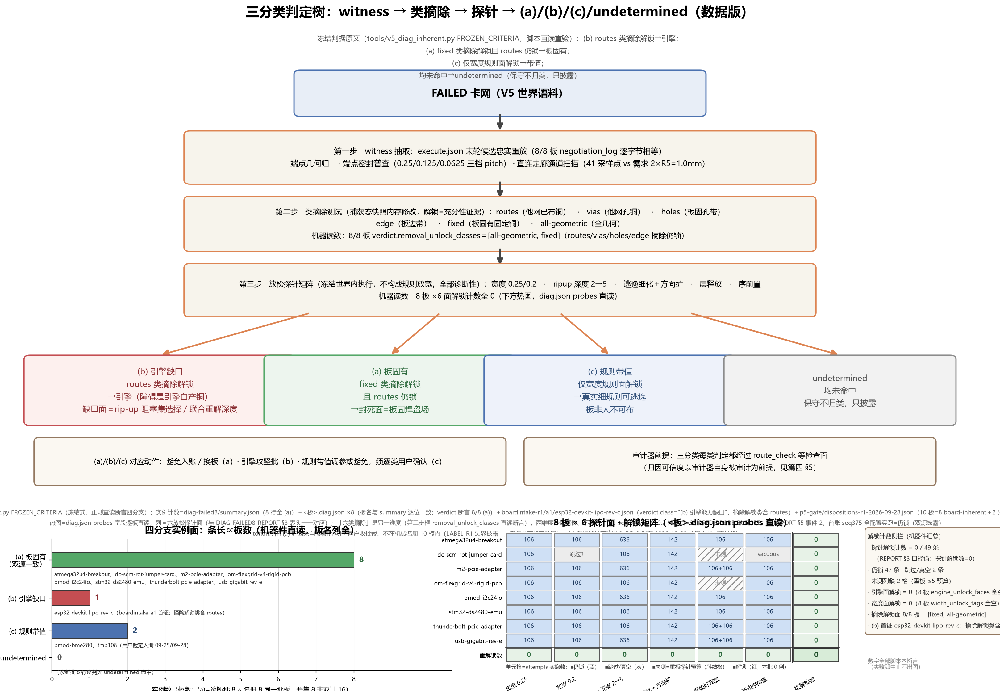
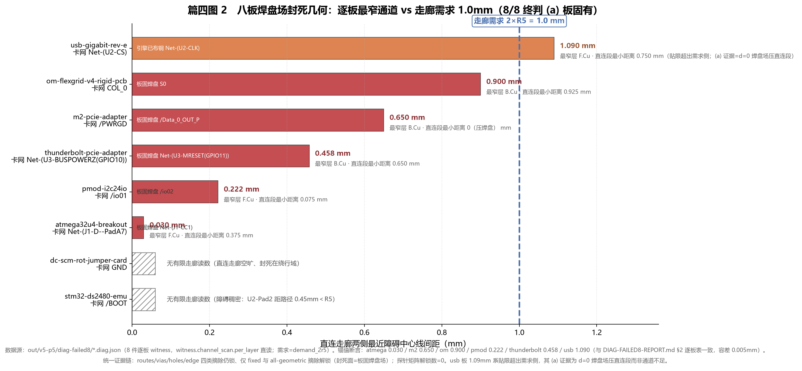
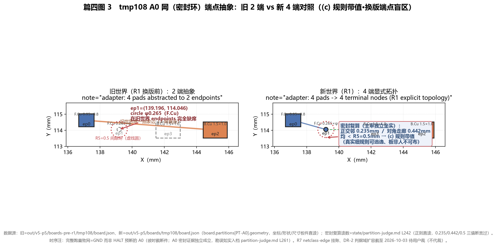
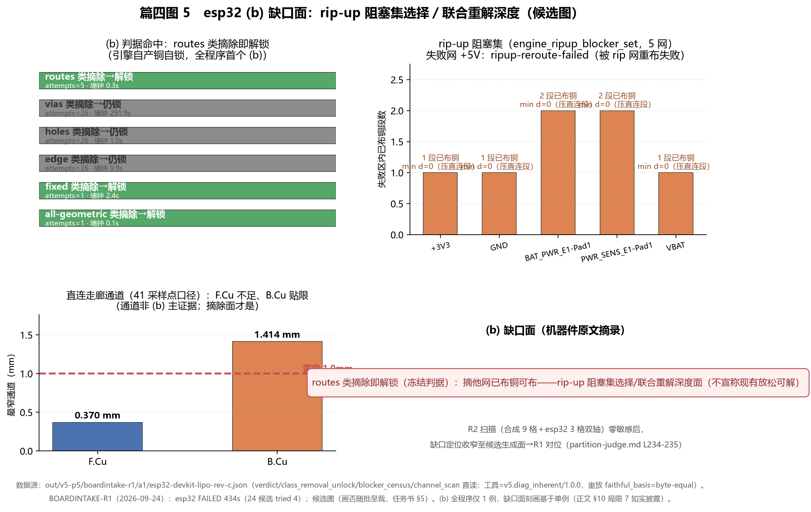
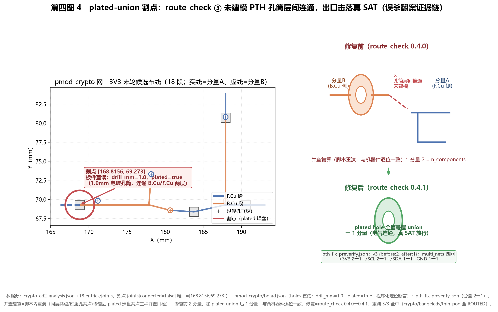
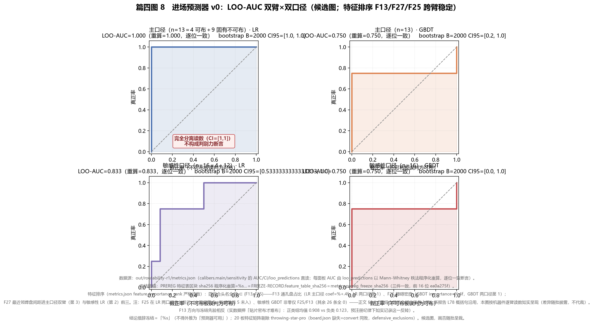
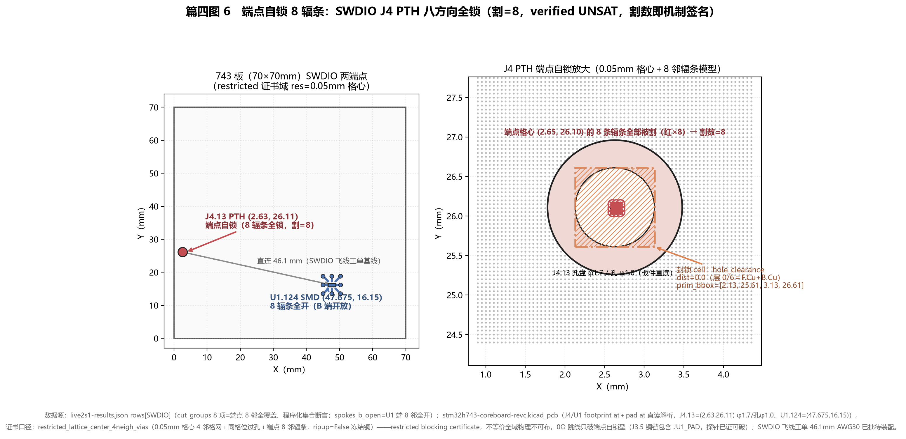
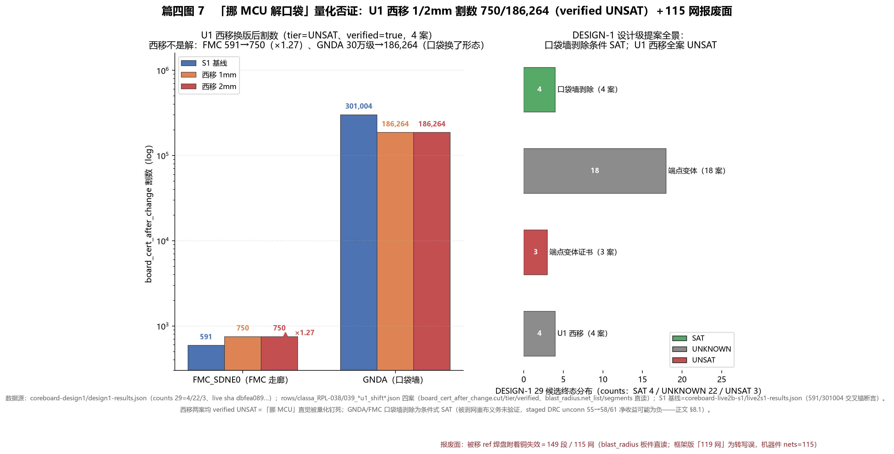

# 篇四《PCB 可布性归因与不可布性证明——(a)/(b)/(c) 三分类、witness、进场预测与真实板证书收口》定稿 R2

**发布说明（2026-10-30 收线归档）**：本文是 pcbflow 项目的中文技术报告（R2 内部定稿），**未经同行评审，未投稿**。文中形如 `<ENGINE_ROOT>/out/...`、`<WORKSPACE>/...` 的证据路径指向作者本机的实验证据目录，这部分没有公开；代码与核心板设计见仓库 `engine/`、`tools/`、`design/`。"主审""席位"等术语见 `TERMINOLOGY.md`。作者：赵丹琪。许可：CC BY 4.0。

---

## 摘要

自动布线研究长期只报成功率：失败要么沉默（不进入论文），要么被默认为「引擎待修」。这使「换板、修引擎、还是放宽规则」三类完全不同的工程动作失去决策依据。本文提出并系统实证一套**可布性归因体系**：以 witness（失败现场的机器可复核证据）抽取为起点，经类摘除测试（routes/vias/holes/edge/fixed/all-geometric 六类障碍逐类移除后重解——机器口径六类〔DIAG-FAILED8 报告 L10〕，五类为省略全几何对照的简称）与放松探针矩阵（宽度/ripup 深度/逃逸细化/层释放/序前置）,把每一次 FAILED 归入三分类——**(a) 板固有**（板源几何属性决定、任何引擎都不可布）、**(b) 引擎缺口**（移走引擎自产障碍即解锁）、**(c) 规则带值**（当前规则值下不可布、真实细规则可解）——只诊断不宣称。体系在两个引擎、两类板上闭环：V5 确定性引擎 17 板语料（8 块 FAILED 板终判全 (a)、esp32 给出全程序首个 (b)、tmp108/bme280 双 (c)、审计器自身一次误杀被翻案）；真实生产板 STM32H743 核心板（743）61 行残网经证书驱动收口（13 UNKNOWN 全升 verified UNSAT 且 0 升 SAT、六网 UNSAT 割数 8–301,004、设计级否证链把终局指向布局层）。配套交付三件治理资产：豁免处置名册与记分牌多口径（现行＝可布域 4/4 双 PASS、处置名册 10 板）、进场时刻可布性预测器 v0（28 特征冻结、LOO-CV 特征排序以 F13/F27/F25 三条为四组合前三主轴而非全占——§6.4 逐臂严格读数）、合成板素材域（J1 20/20、J2 可布 10/10、J3 不可布 10/10）。核心方法论主张：**归因可信度以审计器自身被审计为前提**——三分类每一类判定都经过审计器，审计器的假阴性会把真 SAT 判成 FAILED（本工作实测一次、翻案一次、修复一次、重判 3/3 全中）；而「FAILED→SAT 引擎攻坚批不立项」这一被证据改写的工程决策，是归因先行价值的直接实证。

**关键词**：PCB 布线；可布性归因；不可布性证明；失败证书；witness 抽取；三分类；审计器有效性；预注册实验

---

## 1 引言：归因空位

布线（routing，在 PCB 上为每个电气网络生成满足间距、层、连通约束的导线几何）研究有一个约定俗成的叙事：报告布通率，失败按噪声处理。2026-09-25 景观调研（`state/pcb-routing.md` 工作方式行；纲领大纲 R2 §4）钉出的空位正在此处：**给定一块布不通的板，没有已有工作能系统回答「该怪板、怪引擎、还是怪规则带值」**。

空位主张的口径经 2026-10 两轮文献检索（`litsearch-r1`/`litsearch-r2`，累计 1864 条题录全池程序化复查）精确化为：**截至 2026-10，PCB/EDA 域尚无以布线失败归因为任务的基准**；该任务形态在 LLM 智能体域已有方法论先例（如 Seeing the Whole Elephant〔arXiv:2604.22708〕、ESPIRE〔arXiv:2603.13033〕），本工作的贡献在于**将该任务形态迁移到 PCB 布线域并给出领域化的失败原因分解**。检索证据链见 `litsearch-r2/LITSEARCH-R2-REPORT.md` §4：PCB/EDA 侧的可布性工作（CongestionNet、DATE'19 可布性驱动布局、DAC'22 DRC 热点预测等）全为**预测或优化**任务，无一条以「解释失败原因为任务标签」；「根因/归因/失败分析」检索命中 25 条全在社科与通用可解释 ML 域，EDA 侧 0 条。相邻域的三类最近邻须如实披露：PCBWorld（arXiv:2607.05915）判「布没布成」但不归因「为何布不成」、RoutePlacer（KDD'24）做端到端可布性感知布局优化、PCB-Bench（ICLR'26）解读型问答——**空位表述从「无人做基准」精确为「无归因型任务基准」，贡献从「从零开创」精确为「跨域迁移＋领域化分解」**。

这个问题为什么重要？因为三类归因对应三类完全不同的工程动作，而它们的成本结构天差地别：

| 归因 | 含义 | 对应动作 | 典型成本 |
|---|---|---|---|
| (a) 板固有 | 板源几何属性（焊盘场、边缘指、排座间距）决定不可布 | 豁免入账／换板／布局层修订建议 | 记账级（豁免）到版图级（换布局） |
| (b) 引擎缺口 | 移走引擎自产障碍（已布铜选择、重解深度）即可解锁 | 引擎攻坚批（ripup、联合重解） | 大工程（D8 同款量级） |
| (c) 规则带值 | 当前规则值下不可布，真实细规则可解 | 规则带值调参或豁免（须逐类用户确认） | 中等（世界换版＋重定基） |

没有归因体系时，「布不通」的默认动作是修引擎——这可能把钱花在不可布的板上（(a) 类盲修），也可能在规则带值面前徒劳（(c) 类）。本工作的第 3 章将给出一个直接实例：8 块 FAILED 板全部终判 (a) 后，**FAILED→SAT 引擎攻坚批因此不立项**——工程决策被证据改写，这在程序内是首例（`state/partition-judge.md:201`）。

本篇是纲领六篇中的旗舰科学篇，合并原 P-D（V5 诊断线）与原 P-E（743 战役单板案例）。743 单板案例研究撑不起独立成篇（大纲 R2 §0 裁定），但它是归因体系在**真实生产板**上的最完整演练：61 行残网、两个引擎代、三层否证链。两个引擎、两类板、同一问题——这是本篇的结构。

**术语约定**（沿 TERMINOLOGY.md §1）：**SAT**（存在满足全部约束的布线解）/**UNSAT**（证明性不可布，附失败证书 `failcert.v1` 经独立复核）/**UNKNOWN**（诚实无法判定——无证明、超时、模型开放、区域超窗一律归此，不得升格）为证书层三态；**FAILED/ROUTED** 为运行层终态，FAILED 不是三态之一。**世界**＝代码＋板集＋门判据的冻结组合（换版即换世界）。**可布域记分牌**＝把三分类判 (a) 的板豁免入账＋分母剔除后计 SAT 比，与全分母口径并记。**(a)/(b)/(c)** 三分类名如上表。**席位**＝无工具纯会话数据内嵌的 LLM 角色安排（本篇少量涉及，主引篇二/篇五）。批号命名空间：本篇 A1（V5 归因器 `v5_diag_inherent`）／A2（合成板素材域批）／A3（进场预测器批）为 V5 诊断-预测线批号，与篇三等价性保持优化件 A1–A4、篇一 P2 五臂之 A1、篇五 V5 selection 终选模块 A4 同号不同物；门号 G1–G5 为篇三 build_p5_gate 五门（本篇 §6 记分牌引用），与各实验局部门号不同物。

### 贡献

1. **C1 三分类协议与工具化**：witness 抽取→类摘除测试→放松探针矩阵→(a)/(b)/(c) 判定的冻结判据协议；产品化为 `v5_diag_inherent.py`（v1.0.0→1.1.1，双面合同）与 geom-secondary 廉价普查行（§2）。
2. **C2 八板板固有研究**：V5 世界 8/8 FAILED 板终判全 (a)，封死面逐板指认为板固焊盘场，摘除矩阵与探针矩阵全零解锁，ripup 318 attempts 全灭机理闭合（§3）。
3. **C3 (b) 首证、墙钟谱与 (c) 盲区**：esp32＝全程序首个 (b)（routes 类摘除即解锁）；ice40 96 网单候选成本超线性 ≥30× 墙钟停线；tmp108/bme280 双 (c)（换版端点盲区与组合约束带值）（§4）。
4. **C4 审计器有效性**：route_check 层连通审计未建模 PTH 孔筒层间连通（plated union），出口击落真 SAT；翻案→修复（0.4.1）→重判 3/3 全中的完整闭环；「归因可信度以审计器自身被审计为前提」（§5）。
5. **C5 记分牌治理与进场预测**：处置名册 10 板＋可布域 4/4 双 PASS 主值（2026-09-28 R1-B）；A3 进场时刻预测器 v0（特征排序 F13/F27/F25 三条为四组合前三主轴而非全占）；A2 合成板素材域三判据全 10/10（§6）。
6. **C6 真实板 61 行证书收口**：743 战役全链——13 UNKNOWN 全升 verified UNSAT 且 0 升 SAT（诚实性）、六网割数 8–301,004、3V3 唯一 SAT 逃逸窗（44 段 16.709mm）、U1 西移割数爆炸否证（750/186,264）、PROBE-1 有界探针两案 UNSAT、四行 waive，终局指向布局层（§7–§8）。

**图表位**：表 1 八板逐板终判（§3.1 已为实体表）；图 1 三分类判定树；图 2 焊盘场封死几何（逐板通道 vs 需求）；表 2 摘除×探针矩阵；图 3 tmp108 旧/新端点对照；图 4 plated-union 割点；图 5 esp32 (b) 缺口面示意；表 4 61 行残网终局状态矩阵；图 6 端点自锁 8 辐条；图 7 U1 西移割数爆炸；表 5 布局层建议清单；图 8 LOO-AUC 双臂；表 6 归因→行动映射（§9.2 已为实体表）。（图件由纲领共享图件批统一绘制；R2 统稿批已挂篇一/二/五共六张新图，本篇图件留后续图件批。）

**图 1**（`figs/FIG-P4-01-TRI-CLASS-DECISION-TREE.png`；生成脚本 `figs/scripts/FIG-P4-01-TRI-CLASS-DECISION-TREE.py` 正则直读 `tools/v5_diag_inherent.py` FROZEN_CRITERIA 冻结式原文＋`out/v5-p5/diag-failed8/summary.json`（8 板终判逐行）＋`out/v5-p5/boardintake-r1/a1/esp32-devkit-lipo-rev-c.json`（(b) 首证）＋`out/v5-p5/p5-gate/dispositions-r1-2026-09-28.json`（处置名册）；候选转正〔2026-10-05 用户裁〕；数据版改画〔2026-10-05 示意数据化批〕——实例面=四分支条宽∝计数（(a) 8／(b) 1／(c) 2／undetermined 0）＋板名列全，新增 8×6 摘除×探针解锁矩阵热图（`diag-failed8/*.diag.json` probes 直读、49 条唯一前缀落列、解锁全 0 断言））——三分类判定树：witness 抽取→类摘除测试→放松探针→(a)/(b)/(c)/undetermined 四分支（冻结判据原文照录），各分支实例计数并列（8/8 (a)＋esp32 (b)＋名册 (a)8+(c)2）；DR-2 (c) 判据域扩容截至 2026-10-03 待用户裁，图注不代裁。

**图 2**（`figs/FIG-P4-02-PADFIELD-SEAL-CHANNELS.png`；生成脚本 `figs/scripts/FIG-P4-02-PADFIELD-SEAL-CHANNELS.py` 直读 `out/v5-p5/diag-failed8/*.diag.json` 8 板逐板 witness 通道扫描，锚值与 DIAG-FAILED8-REPORT §2 逐板表断言一致（容差 0.005mm））——焊盘场封死几何：逐板最窄通道（6 板有限值 0.030/0.222/0.458/0.650/0.900/1.090mm＋2 板 witness 无有限走廊如实标注）vs 中心线走廊需求 2×R5=1.0mm，封死面指认为板固焊盘场（d=0 压直连段）——(a) 板固有判定的几何证据面（§3.1）。

---

## 2 三分类协议与工具

本节给出归因协议的完整形态。协议设计的第一原则是**只诊断不宣称**：诊断批可以给出「移走 X 类障碍后解锁」的充分性证据，但不宣称「该板物理不可布」这类全局命题——全局命题留给证书层（UNSAT＋独立复核）。

### 2.1 协议三步

**第一步：witness 抽取**。以 execute.json 末轮候选做忠实重放（8/8 板重放 negotiation_log 与引擎私有件逐字节相等，无合同缺口；`out/v5-p5/diag-failed8/DIAG-FAILED8-REPORT.md:10`），在捕获态上做四件事：端点几何归一、端点密封普查（0.25/0.125/0.0625 三档 pitch 逐层出边/换层边）、直连走廊通道扫描（41 采样点、逐层两侧最近障碍中心线间距 vs 需求 2×R5=1.0mm）、**阻塞类摘除解锁测试**。

**第二步：类摘除测试**。六类障碍逐类移除后重解：他网已布铜 **routes**／他网孔铜 **vias**／板固孔带 **holes**／板边带 **edge**／板固有固定铜 **fixed**／全几何 **all-geometric**。摘除是对捕获态快照的内存修改（A* 栅格与网级门场景同步摘除），解锁即充分性证据。三分类判据（`v5_diag_inherent` 冻结式原文）：

- **(b) 引擎缺口**：routes 类摘除解锁→引擎（障碍是引擎自己布的铜）；
- **(a) 板固有**：fixed 类摘除解锁且 routes 仍锁→板固有（封死面=板固焊盘场）；
- **(c) 规则带值**：仅宽度规则面解锁→带值（真实细规则可逃逸、板非人不可布）；
- 均未命中→undetermined（保守不归类，只披露）。

**第三步：放松探针矩阵**。宽度 0.25→0.2mm、ripup 深度 2→5（636 attempts）、逃逸细化 0.03125＋方向扩（142 attempts＝原 106＋36 新计划实跑 36-去重）、层释放、序前置（order-first）。探针全部在冻结世界内执行，不构成规则放宽。

### 2.2 工具化与版本

| 工具 | 版本 | 职责 | 锚 |
|---|---|---|---|
| `tools/v5_diag_inherent.py` | 1.0.0 | 诊断批四件套产品化、判据冻结式；m2 端到端与诊断批逐键一致 | SMALLWAVE 收口（09-23） |
| 同上 | 1.1.1 | 双面合同对齐（executor 0.9.0 主锚＋0.8.0 存档忠实重放）；witness 探针 1.1 双口径化 | DIAG-REPLAY 批（10-02），`LEAD-REVIEW-DIAG-REPLAY-R1-2026-10-02.md` sha16 `b02c59a1bb4ca6e1`（程序化重算 MATCH） |
| executor geom-secondary 行 | 0.6.1 | 每条 exhaustion-cause 行后追加 `fixed-copper-sealed|open` log-only 普查（廉价端点粗口径，深层证据仍是类摘除 witness） | SMALLWAVE 批 |
| `tools/routability_r1.py` | — | 进场时刻预测器（`--card <板名>` 出卡） | A3 批（10-01） |

### 2.3 合成板素材域（A2-SYNTHBOARD）

归因体系此前只有真实板语料——板从哪来、可布性是否构造可知，不受控。A2 批补上这一层：生成器 `boards/build_synth_boards.py`（43KB，205 测试）以**可布性构造保证**产板——可布板＝参考路径先铺后障碍（保证有解）；不可布板＝all-layer-pad-seal（全层异网固定铜密封，保证构造性无解）。归因体系自此有可控素材域（synthetic-r1 记分行，§6.3），syn-u09 的密封构造在 executor 0.9.0 下被 sealed-short-circuit 事前短路 0.6s 判 FAILED（§6.3），「生成器宣称」与「引擎终态」在三件互证（run/execute/replay）下对齐。

---

## 3 八板板固有研究（DIAG-FAILED8）

诊断批（2026-09-23，任务书 sha `7097bd10cce34e01`）面对的问题是：V5 世界 14 终态板中 8 块 FAILED——它们是引擎的耻辱还是板的属性？

### 3.1 终判：8/8 全 (a)

逐板证据（`out/v5-p5/diag-failed8/DIAG-FAILED8-REPORT.md:18-27`，主审 ACCEPT＝`route-v5/trial/LEAD-REVIEW-DIAG-FAILED8-2026-09-23.md`）：

| 板 | 卡网 | exhaustion | 封死面指认（机器件原文摘录） | 终判 |
|---|---|---|---|---|
| atmega32u4-breakout | Net-(J1-D--PadA7) | ripup-exhausted（318） | 起点出边全封（0/162 开、全 R5）；CC1 焊盘压直连段（F/B 双层 d=0）＝USB-C 焊盘场；F.Cu 最窄通道 0.03mm | (a) |
| dc-scm-rot-jumper-card | GND | — | （全网唯一封死，见报告 §2） | (a) |
| m2-pcie-adapter | /PWRGD | ripup-exhausted（318） | 直连段正压 J2-CLKREQ# 焊盘（**d=0**）＝M.2 座焊盘场；F.Cu 最窄通道 0.65mm＜需求 1.0mm；固定铜 12 入失败区 | (a) |
| om-flexgrid-v4-rigid-pcb | COL_0 | obstacle-dense | （PMOD 排座族，报告 §2） | (a) |
| pmod-i2c24io | /io01 | ripup-exhausted（318） | 直连段横穿 io02..io07 六焊盘（d=0×6）＝PMOD 排座；F.Cu 通道 0.222mm | (a) |
| stm32-ds2480-emu | /BOOT | obstacle-dense | （报告 §2） | (a) |
| thunderbolt-pcie-adapter | Net-(U3-BUSPOWERZ(GPIO10)) | obstacle-dense（106） | U3-MRESET 焊盘压直连段（d=0）；B.Cu 通道 0.458mm | (a) |
| usb-gigabit-rev-e | Net-(U2-CS) | ripup-exhausted（318） | U3-LANWAKEB Pad39 压直连段（d=0）＝网口变压器焊盘场；F.Cu 通道 1.09mm（贴限） | (a) |

统一证据链（8/8 同构）：**阻塞类摘除测试 routes/vias/holes/edge 四类摘除全部仍锁、仅 fixed 与 all-geometric 摘除解锁**——把他网已布铜全部摘掉也解不开，只有移走板固有焊盘铜才开。四块 ripup-exhausted 板的具名阻塞集均为**伴生**（其铜恰落失败走廊带，被引擎确定性选入 rip-up），rip-up 无论深化多少轮都不可解——这正是 318 attempts 全灭的机理（报告 §3）。探针矩阵（§2.1）解锁数＝0。m2 witness 由主审独立复算逐点坐实（board.json 直算：直连段压 CLKREQ# 焊盘铜 d=0；`state/partition-judge.md:200`）。

通道需求侧的口径：中心线走廊需求＝2×R5＝1.0mm（报告 §1 采样口径）；逐板实测最窄通道 0.03–1.09mm（上表）。state 档案的概括口径「典型间隙 0.15mm＜走廊需求 1.0mm」（`state/partition-judge.md:200`）与逐板值兼容，本文以机器件逐板值为准。

### 3.2 工程含义：攻坚批不立项

**FAILED→SAT 引擎攻坚批因此不立项**——(b) 引擎缺口 0、(c) 带值瓶颈 0（该时点），盲修无靶。这是程序内第一个被归因证据改写的工程决策（`state/partition-judge.md:201`）。用户同日补裁「124 按推荐，三全做」（「124」＝当日三问简编代号，即下行 Q1/Q2/Q3）：Q1＝8 板豁免入账＋分母剔除、Q2＝换板批、Q3＝A1 归因器＋A3 普查行立项——归因直接进入治理主循环（§6）。

### 3.3 翻案免疫力检验（DIAG-REPLAY 重放一致性）

判 (a) 的板在世界换版（executor 0.8.0→0.9.0）后是否翻案？V5-DIAG-REPLAY-R1 批（10-02）对此做了全量重放：**u 族 10/10 三分类全部复现为 (a)、consistency_rate=1.0**（前值 A2 W3 9/9 tool-failed 全消除；`out/v5-p5/diag-replay-r1/DIAG-REPLAY-R1-REPORT.md:57,117-118`）；D-J1 14/14 板（u 族 10＋legacy 4）exit 3 零复现、全线归因表 14 行双面出值、既有 (a) 锚 11/11 复现（11 锚构成＝synthetic u 族 10＋legacy atmega32u4-breakout；esp32 锚=(b)、tmp108/bme280 锚=(c) 三例为对象更替/判据域边界呈裁项、不入 (a) 锚分母——总复现率口径 11/14〔78.6%〕，`DIAG-REPLAY-R1-REPORT.md` D-J2）。板固有＝板源几何属性、跨世界有效，在重放合同对齐（1.1.1 双面）后得到机械确认。

---

## 4 (b) 首证、墙钟谱与 (c) 盲区

三类归因中的另两类各在本批首次落地，且各带来一个新机制发现。

### 4.1 esp32＝全程序首个 (b)（BOARDINTAKE-R1）

换板批（2026-09-24）主试板 esp32-devkit-lipo-rev-c：FAILED 434s（24 候选 tried 4；`out/v5-p5/boardintake-r1/`，CLOSEOUT :10），A1 归因＝**(b) 引擎缺口——routes 类摘除即解锁**。缺口面＝rip-up 阻塞集选择／联合重解深度：引擎自己布的铜把自己锁死。这是全程序第一个 (b)——此前 8 板全是 (a)，(b) 的存在性由换板批坐实。用户裁②「esp32 (b) 并入 R2 终稿」；R2 扫描（合成 9 格＋esp32 3 格双轴）零敏感后，(b) 缺口定位收窄至候选生成面→R1 对位（`state/partition-judge.md:234-235`）。

### 4.2 墙钟谱：ice40 单候选成本超线性

同批 ice40hx1k-evb-rev-b：96 网/4 层，execute 14400.1s **首个候选轮换未完**被 4h timeout 杀（execute.json 未落盘）。对照 esp32 72 网 4 候选仅 434s——**单候选成本超线性 ≥30×**；且 R1＋NUMBA 已在树内＝**结构性爆炸而非旧性能债**（`state/partition-judge.md:224`）。墙钟事件触发红线 7 停线，用户裁①收批转 R2（ice40＝wall-exhausted 冻结、后 3 板不跑、0/6 达标未达成如实入账）。墙钟治理此后立规（七裁⑤：墙钟看门狗规 v1.0，sha16 `96108e2de68e7030` 程序化重算 MATCH）。torxhat 同批 FAILED 38s 终判 (a)（fixed 类解锁，USB-C 焊盘场）；sdi-mipi-bridge 差分 13 对由主审独立重数坐实（12 下划线式＋AGCN/AGCP；`LEAD-REVIEW-BOARDINTAKE-R1-WALL-2026-09-24.md`）。

### 4.3 (c) 盲区：tmp108 换版端点缺席与 bme280 组合约束

**(c) 规则带值**类的两个实例给出了「世界换版暴露规则带值盲区」的完整机制。

**tmp108**（R1 世界换版首板即回归）：旧世界对 A0 网（密封环）只有 **2 端抽象**，真模型 **4 端**——主审独立坐实 ep1=(139.196,114.046) circle ⌀0.265 在旧世界 endpoints **完全缺席**（旧 [[137.16,114.615],[145.1585,114.011]] vs 新 4 端；`state/partition-judge.md:242`）。密封复算＝正交邻 0.235mm／对角走廊 0.442mm，均＜R5=0.5mm ⇒ **(c)**（真实细规则可逃逸、板非人不可布）→R7 对位（R7＝netclass-edge 任务书代号、在盘挂账；与篇六 run8 冻结围栏编号 R7 同符不同物）。注意时序细节：完整跑首败网＝GND 而非 HALT 预断的 A0（彼时截断件；A0 密封证据独立成立，勘误如实入档 `state/partition-judge.md:261`）。

**bme280**（R1 世界重跑 FAILED，GND）：诊断批给出 (c) 三件证据——R2/R4/D3/R5 **组合约束**×端点集扩张 GND 2→11（`out/v5-p5/r1/bme280-diag/` witness 三件＋LEAD-REVIEW 主审补核三面）；2026-09-28 用户裁「(c) 规则带值入册」。

### 4.4 (c) 判据域边界与 DIAG-REPLAY 三翻案裁（DR-2 挂账）

V5-DIAG-REPLAY-R1 的重放给出 (c) 判据域的精确边界（LEAD-REVIEW :17）：归因器冻结 (c) 分支**仅建模宽度解锁面**（`width_unlock_mm=[]` 即不入 (c)），组合约束不在域内→机械重放落 (a)。三翻案裁（10-02）：esp32＝对象更替非翻案；tmp108＋bme280 维持 09-28 (c) 裁定（既有 (c) 语义真实：组合约束×端点扩张）；**(c) 判据域扩容改进件（DR-2，组合约束形态建入归因器）立为候选挂账——截至 2026-10-03 待用户裁**（任务书 §F-3；`LEAD-REVIEW-DIAG-REPLAY-R1-2026-10-02.md:17` 原文「不翻案不阻收口」）。若裁立并执行，本篇 §4/§6 相应更新。

**图表位**：图 3 tmp108 旧（2 端）/新（4 端）端点对照；图 5 esp32 (b) 缺口面示意。

**图 3**（`figs/FIG-P4-03-TMP108-ENDPOINT-ABSTRACTION.png`；生成脚本 `figs/scripts/FIG-P4-03-TMP108-ENDPOINT-ABSTRACTION.py` 直读 `out/v5-p5/boards-pre-r1/tmp108/board.json` 与 `out/v5-p5/boards/tmp108/board.json`（board.partitions[PT-A0] 全量直读，禁手抄坐标）＋`state/partition-judge.md` L242 密封复算读数正则直读）——tmp108 A0 网（密封环）旧世界 2 端抽象 [[137.16,114.615],[145.1585,114.011]] vs R1 新世界 4 端对照：ep1=(139.196,114.046) circle ⌀0.265 在旧世界 endpoints 完全缺席，密封复算正交邻 0.235mm/对角走廊 0.442mm＜R5=0.5mm ⇒ (c) 规则带值；R7 对位与 DR-2 判据域扩容截至 2026-10-03 待用户裁，不代裁（§4.3）。

**图 5**（`figs/FIG-P4-05-ESP32-GAPFACE.png`；生成脚本 `figs/scripts/FIG-P4-05-ESP32-GAPFACE.py` 直读 `out/v5-p5/boardintake-r1/a1/esp32-devkit-lipo-rev-c.json`（verdict/六类摘除/阻塞网 census/通道扫描）；候选转正〔2026-10-05 用户裁〕）——esp32 (b) 缺口面：routes/fixed/all-geometric 类摘除解锁与 vias/holes/edge 仍锁的对照、5 条 route 阻塞网 min_d=0、宽度解锁面空——(b) 缺口定位收窄至 rip-up 阻塞集选择／联合重解深度（§4.1），引擎自产铜把自己锁死的几何呈现。

---

## 5 审计器有效性（方法论核心节）

三分类的每一类判定都要经过审计器（route_check 等检查面）。审计器错误会系统性污染归因：**(a) 的「摘除仍锁」可能只是审计误杀，(b) 的「摘除解锁」可能只是放走了坏解**。本节给出一次完整闭环的审计器自身被审计事件。

### 5.1 事件：route_check ③ 未建模 PTH 孔筒层间连通

R1-W6 续跑段（09-25）队列 B：crypto/thin-pod/badgeleds rc=1——布通到出口被层连通审计击落（候选 SAT 面）。诊断翻案（09-26）：**executor 无缺陷，真根因＝route_check ③ 层连通审计节点图未建模 PTH（电镀通孔）孔筒的层间连通**，把电气连通的多端网误判断链、出口击落真 SAT 候选。证据链（`out/v5-p5/r1/ed2-diagnosis/`）：crypto 首候选 CRASH-CAPTURED＋主审自建并查（不依赖执行体脚本）独立复算——现行 2 分量、加 plated union 后 1 分量，逐位对齐；**割点 [168.8156,69.273]＝1.0mm plated 孔筒连通 B.Cu↔F.Cu**，plated=true 直核（`state/partition-judge.md:269`）。

### 5.2 修复与重判

修复＝route_check 0.4.0→**0.4.1**（plated hole 全信号层 union、NPTH fail-closed 不放松；executor 零改不升版），新钉 test_r1_ed2_pth_union 5/5，全量 pytest 1280 passed+5 skipped。**误杀重判 3/3 全中**：crypto/badgeleds/thin-pod 重跑全 ROUTED，主审逐板 routes_doc 独立复审 PASS（crypto 56 entries/16 网、+3V3 18 entries 过审＝「09-25 审计误杀重判坐实真 SAT」；`state/partition-judge.md:270,275`）。此前「thin-pod/badgeleds/crypto rc=1 重判=审计误杀候选」的预判兑现。

同族缺陷连带翻案（跨线互证）：ED-X＝kicad_export.py:344-345 `len(eps)!=2` 旧 2 端硬合同（R1 世界遗留，多端网板首次走到 export 时崩）；V7 hier 排序三臂 7/9 臂被同缺口击落（PROBE-VERDICT 勘误为审计误杀；R-A 后全 9 臂重跑解锁）。

### 5.3 方法论含义

**归因可信度以审计器自身被审计为前提**。本例中若无翻案，3 板真 SAT 会被错记 FAILED——由于它们本在 SAT 面，错误方向是把可布板推向不可布，进一步会错误抬升 (a) 豁免的候选池（假阴性把真 SAT 判成 FAILED，若无翻案则 3 板会被错误豁免）。工程动作：审计器修复进入世界换版链（版本披露=审计器版本）；「全端点连通口径 N/6」判据随 R-A 联动重定基（§6.1）。

**图表位**：图 4 plated-union 割点示意（[168.8156,69.273] 1.0mm 孔筒连通 B.Cu↔F.Cu）。

**图 4**（`figs/FIG-P4-04-PLATED-UNION-CUTPOINT.png`；生成脚本 `figs/scripts/FIG-P4-04-PLATED-UNION-CUTPOINT.py` 直读 `out/v5-p5/r1/ed2-diagnosis/crypto-ed2-analysis.json`（+3V3 网 18 entries 拓扑/关节）＋`out/v5-p5/boards/pmod-crypto/board.json`（割点孔 drill/plated 板件直读）＋`ed2-diagnosis/pth-fix-preverify.json`（修复前后分量数））——plated-union 割点示意：[168.8156,69.273]=1.0mm plated 孔筒连通 B.Cu↔F.Cu（drill/plated=true 板件程序化定位），route_check ③ 未建模孔筒层间连通把电气连通多端网误判断链（并查复算 2 分量→加 plated union 后 1 分量）——审计器自身被审计事件的几何正身（§5.1）。

---

## 6 记分牌治理与进场时刻预测

归因的下游是记账。记分牌不是一行数字，而是一套口径治理——本节按时间序展开，并给出两个新增层：进场时刻预测器（事前）与合成素材域（可控）。

### 6.1 口径演化与 R1 重定基 B 版（现行）

| 时点 | 口径 | 读数 | 依据件 |
|---|---|---|---|
| wave6（09-21） | 原口径 | SAT 6/14 判据一（≥5）坐实、判据二干净板 **3/6** 未达（差口＝C 类 genuine 14 条：bme280 2＋crypto 2＋thatmicpre 10） | `out/v5-p5/trial/P5-CLOSEOUT-2026-09-21.md` L10（判据二原文「干净板 3<5，差口=C 类 genuine 14 条」——框架版「0/5」系转写误，统稿读审批按机器件修正） |
| 09-23（SMALLWAVE） | 可布域口径生效 | **可布域 6/6** PASS＋原口径 6/14 并记；豁免 8 板（09-23 用户令 Q1） | `out/v5-p5/p5-gate/smallwave-2026-09-23/gate-report.md` |
| 09-28（R1-B A 版） | R1 世界换版重定基 | 主值可布域 (c) 后 **4/5**（bme280 留分母）、并记 4/6、4/4 | `out/v5-p5/r1/R1-SCOREBOARD-REBASE-2026-09-28.{json,md}`（sha16 `9af2954c20e7d75d`/`15856fbd9efa33bb`，程序化重算 MATCH） |
| **09-28（R1-B B 版，现行）** | bme280 (c) 入册后 | **主值可布域 (c) 后 SAT 4/4 双 PASS**；处置名册 10 板（8 板固有＋tmp108＋bme280）；域内零 FAILED；并记 4/6、4/4 | `R1-SCOREBOARD-REBASE-2026-09-28B.{json,md}`（sha16 `fe90b8679dbeb3f5`/`16b02a0b6490bd47`，MATCH）；机械权威＝`p5-gate/r1-2026-09-28b/gate-report.json`＋`dispositions-r1-2026-09-28.json`（10 板） |

**判据二**（干净板，修订口径＝豁免 A/B＋微段 track_dangling<0.06mm）：干净板 **4/4 全净**（badgeleds-do-electronics、pmod-crypto、thatmicpre-v2、thin-pod；豁免 6 条微段＝crypto 0.0369×2＋thatmicpre 0.0413×2＋0.0583×2，genuine=0、residual 归零）——**仍 <require 5 属结构性**（R1 世界 SAT 恰 4 板），差口不再指向任何脏板（B 版 json `criterion_2_new.note` 原文）。判据一 SAT≥5 同因结构性未达（可布域分母已收窄到 4/4 满员）。

**裁决链**（本稿定位并核毕， TERMINOLOGY gap G-1 闭合）：七裁正本＝`out/v5-p5/r1/LEAD-REVIEW-R1W6-2026-09-28.md` §3「七裁落账（2026-09-28 用户令『7 项全按建议』）」（复核草案 sha16 `82a0254fbf9a194b` MATCH）；七裁③的 gate 机械落地＝`p5-gate/r1-2026-09-28/`（json/md sha16 `919e972453cd0add`/`167c7c418877528b` MATCH）；B 版 gate＝`r1-2026-09-28b/`。全链 8 件 sha256 前 16 位程序化重算全 MATCH（明细见 P4-RECON）。

**口径演化的治理叙事**：可布域分母随归因收窄而缩小（6/6→4/5→4/4），每次缩小都是一次三分类裁定入册——口径诚实化的代价与价值同体：分母变小不是成绩变差，而是「该怪谁」的账越算越清。

### 6.2 处置名册（10 板）

dispositions-r1-2026-09-28.json（10 板）逐行（处置类、卡网、witness 锚见 gate 报告 B 版豁免披露表）：8 板 board-inherent（09-23 用户令「124 按推荐」Q1 锚，板固有跨世界有效）；tmp108 (c)（09-25 用户三裁②锚）；pmod-bme280 (c)（09-28 用户裁，诊断批 LEAD-REVIEW-DIAG-BME280 呈裁）。torxhat 的 (a) 归因来自换板批 A1＋用户收批裁、**不在机械名册 10 板内**（LABEL-R1 边界披露 1；A3 标签表按既有终判落 inherent_a 并如实披露此边界）。豁免治理件＝dispositions json＋`build_p5_gate --dispositions` 双口径；**豁免须逐类用户确认**（修订门五条）。

### 6.3 synthetic-r1 记分行（A2）与 J3 刷新

合成板域以**独立记分行**入册（执行终态口径；真实板分母口径零变化）：

| 判据 | 内容 | 读数 | 锚 |
|---|---|---|---|
| J1 | schema | 20/20 | `audit-j1j4.json` |
| J2 | 构造可布板 SAT | **10/10**（单板 11–38s） | `run/syn-r*.json` 逐板；4/10 板 selection_verdict=UNKNOWN 系 A4 fail-closed 滤除遮蔽执行真值（口径差由 EXECUTOR-ENG-R1 W-2 收口=verdict_provenance 23/23） |
| J3 | 构造不可布板阻断终态 | **10/10**（2026-10-03 用户批字「随 u09 新终态刷新」） | A2 正本 9/10 于 0.8.0 世界历史定格（u09 TIMEOUT-4H 留档结案）；刷新后 u09＝0.9.0 世界 FAILED＋sealed-short-circuit 事前短路 **wall_s=0.6s** |

u09 三件互证（本稿逐件开件核对）：`exec-eng-r1/run/syn-u09.json`（verdict=FAILED、wall_s=0.6、guarantee_type=constructed-block:all-layer-pad-seal）＋`exec-eng-r1/boards/syn-u09/execute.json`（verdict_provenance=execute-short-circuit:sealed-short-circuit「全层异网固定铜密封构造性无解」）＋`diag-replay-r1/replay/syn-u09.json`（attribution.class='(a) 板设计固有不可布'、rc=0、engine_version=v5.executor/0.9.0）。短路三兄弟同族对照：u04/u07/u09 从 6497.4s/3673.5s/4h-TIMEOUT → **0.5/0.5/0.6s、零误杀**（E-J2；`state/partition-judge.md:3`）。LEAD-REVIEW ACCEPT sha16 `c5919188e2c3ca09`（程序化重算 MATCH）。

### 6.4 进场时刻可布性预测器 v0（A3-ROUTABILITY-R1）

治理审查档案 4-1 曾有时序批评：「豁免全出现在未达标之后」——归因是事后的。A3 批（10-01 用户 ACCEPT）补上事前通道：**进场时刻（convert 后、execute 前）可布性预测器 v0**。

**设计**：28 特征冻结（PREREG 特征表区块 sha256 前 16 位＝`ea0a275f`，程序化重算 MATCH；FREEZE-RECORD 2026-09-30T21:39:08+08:00）；标签＝LABEL-R1 21 板双口径（routable 4/inherent_a 9/exempt_b 1/exempt_c 2/other 5/unlabeled 0）；特征矩阵 20 板＝21 板剔除 throwing-star-pro（board.json 缺失＝convert 同败、特征可得性排除，`metrics.json` defensive_exclusions——`ROUTABILITY-R1-REPORT.md:131`），故下文「20 板×28 特征 560 格」与「21 板标签」分母不同、差一即此；主口径 n=13（4 可布＋9 固有不可布）＋敏感性 n=16；LOO-CV＋bootstrap B=2000。

**读数**（`out/routability-r1/metrics.json`）：

| 口径 | n | LR AUC | GBDT AUC |
|---|---|---|---|
| 主口径 | 13 | **1.0**（CI=[1,1]；完全分离读数，**不构成判别力断言**） | 0.75（CI [0.2,1.0]） |
| 敏感性 | 16 | 0.833 | 0.75 |

**特征排序跨臂跨口径收敛主轴三条**：F13 通孔盘占比（+）／F27 最近邻焊盘间距均值（+）／F25 障碍密度（−）——LR 主口径 F13 coef=+0.5025、GBDT F25 importance=0.4664；四组合（双臂×双口径）前三以这三条为主轴而非全占：F13 四组合全进前二、F25 双 GBDT 臂居首而 LR 两口径未入前三、F27 三组合进前三（metrics.json 逐臂严格读数；`ROUTABILITY-R1-REPORT.md:78-93`「全部占据」系概括口径——C-4 勘误，2026-10-05 回写）。**F13 方向与冻结先验相反**（先验押「通孔占面积−」，实数据押「贴片密布才难布」：正类组均值 0.908 vs 负类 0.123）——预注册纪律下如实记录这一反转。**结论措辞冻结＝「v0 可行性与特征排序」，不得外推为「预测器可用」**（红线 5）。

**验收链补全**：2026-10-01 用户初裁「退回修复」→主审批判性复审＋特征层独立复算（按冻结表独立重实现、不复用工具代码，从 board.json 重算 20 板×28 特征 **560/560 格一致**，最大绝对差 2.8e-14；原验收链从 features.csv 起算、该段此前无人覆盖）→复裁 ACCEPT 收口；冻结链（PREREG/labels/features/metrics）全批零触碰。三项口径披露随件：F26/F27 端点集含被跳过盘（逐板恰等 AR.pad_terminal_skipped）、F07 与 AR 孔计数两口径 11 板不等、F21≡F22 除 m2-pcie-adapter。

**图表位**：表 3 A3 特征排序（四组合）；图 8 LOO-AUC 双臂（编号自图 7 顺延——§4.4 已有图 5 esp32 缺口面示意，图 5 不重号）。

**图 8**（`figs/FIG-P4-08-LOO-AUC-DUAL-ARM.png`；生成脚本 `figs/scripts/FIG-P4-08-LOO-AUC-DUAL-ARM.py` 直读 `out/routability-r1/metrics.json`（主口径 n=13：LR AUC 1.0〔CI 1,1〕/GBDT 0.75；敏感性 n=16：0.833/0.75；四面板 Mann-Whitney 重算逐位一致）＋`PREREG-ROUTABILITY-R1.md` 特征表区块 sha256 程序化重算＋`FREEZE-RECORD.json` 冻结链三件一致；候选转正〔2026-10-05 用户裁〕）——LOO-AUC 双臂×双口径：LR 主口径 1.0 系完全分离读数、不构成判别力断言（结论措辞冻结「v0 可行性与特征排序」红线 5）；特征排序按 metrics.json 逐臂严格读数呈现（F13 四组合全进前二、F25 双 GBDT 臂居首而 LR 两口径未入前三、F27 三组合进前三），正文 §6.4 概括句已按 metrics.json 严格读数改写（C-4 回写，2026-10-05），图注与正文口径一致。

---

## 7 真实板 61 行证书收口（743 战役）

下半场切换到真实生产板：STM32H743IIT6 核心板（743），Rev-C、4 层、160 网、61 行信号断点残网（口径调和〔caliber-r1 C-1 定论，2026-10-05 回写〕：同板同网表两口径——160＝具名网〔`state/archive/pcb-routing-history-2026-09-27.md:43,104`「Rev-C 现行 70×70mm 4 层 160 网」〕、192＝全量网（含 32 个 unconnected- 前缀 NC 焊盘网）＝160+32〔篇一 §6.5〕；机器登记＝pcbflow `out/revc-a1/coverage.json` totals＋SN-2，原「快照展开」措辞证伪删除）（`out/revc-fc2/residual-certs.json`，n_rows=61）。战役全链按证书驱动展开；本稿对 state 双档案（`state/pcb-routing.md`＋`state/archive/pcb-routing-history-2026-09-27.md`）与 live 板逐件重核——**live 板 sha256 前 8 位重算＝dbfea089（MATCH，全长 dbfea0895301ade8）**，全链数字以原始结果件为准。

### 7.1 战役链与 61 行演化

| 阶段 | 动作 | 结果（机器件） | 61 行状态 |
|---|---|---|---|
| 基线（FD3/FC2） | 冻结布局逐网三态＋证书 | 61 行表（`residual-certs.json` counts） | SAT 8/UNSAT 40/UNKNOWN 13 |
| **WIN-1**（09-11） | 13 条 region_over_window UNKNOWN 渐进窗全窗重解 | **13 全升 verified UNSAT、0 升 SAT**（`win1-results.json` counts_win1＝UNSAT 13/SAT 0/UNKNOWN 0；割数 8–**5,839**）——扩窗不自动改判；0 升 SAT＝诚实 | 8/53/0 |
| FB-1（09-11） | staged 副本三臂配对（臂0 重放/臂1 重放+轻 ripup/臂2 重放+ripup 深挖） | **55/56/60**（61 分母；臂2 关 5 行 RPL-038/039/052/054/056；`three-arm-summary.json`）——staged 正结果 | — |
| LIVE-1（09-11） | FB-1 结论迁 live 三门检验 | 门 A（live 全断连且端点吻合）过；门 B（live 上 5 网全 UNKNOWN，封堵者=live 演进代他网已落铜）**前提不成立**；门 C 同——**诚实零写入**（live pre=post=8029f5ff） | — |
| RIPUP-1（09-11） | live 受控 ripup（6 网） | **0/6 诚实负结果**：SWDIO/LTDC_VSYNC/FMC_SDNE0=GND 墙级封堵、VBAT=端点落铜失败、GNDA/3V3=拆集可解锁但拆网在 FMC 走廊重布不可行；live 零写入（`final-gate.json`：new_errors=0、sha 前后均 8029f5ff） | — |
| **LIVE2B-S1**（09-11） | 6 网 live 快照渐进窗全窗重解 | **6/6 verified UNSAT、0 SAT**；六网割数（下表）；**端点自锁机制**＝SWDIO J4 PTH 8 辐条全锁（割=端点几何非他网铜）；5/6 网证书割直方图⊇RIPUP-1 洪泛封堵者（两线互证） | — |
| **S2**（09-11） | 3V3 零拆线重解 | **唯一 SAT 逃逸窗**：搜索窗 3mm→5mm 得 witness 44 段 F.Cu/0 过孔/**16.709mm**（uuid 5329e146-93b3）；独立 Legality 44/44 全 ok、staging DRC 135→135 零新增；布局提案 0/5 诚实负结果；端点自锁类扩员 SWDIO/LTDC_VSYNC/VBAT 三网同机制 | 3V3 待批 apply |
| **APPLY-1**（09-11） | 首次真实 live 落线（用户批「1，2全落」） | 3V3＋GPIO_PE2（新求解 SAT 66 段＋3 埋孔/48.439mm）单批落 live（2 网≤10 网红线；批 DRC 硬门 refill=10 new_err=0＋快照回滚）；**live sha 8029f5ff→dbfea089**；t0=135/57→post **135/55** | 2 行落线 |
| **DESIGN-1**（09-11） | 设计级提案（29 候选） | 4 SAT/22 UNKNOWN/3 UNSAT；GNDA/FMC 口袋墙剥除条件 SAT（被剥网重布义务未验证）；**U1 西移 1/2mm verified UNSAT 否证**（§8） | — |
| **VERIFY-1**（09-11） | 两条件 SAT 前置验证 | **双双否证**（§8）；副产品＝route_one 假闭合缺陷立案（ETH_REF_CLK ok=True 但端点落异层铜，postcheck 连通证伪） | — |
| JUMPER-1＋MAINT-1（09-11） | 0Ω 跳线 staging＋锚刷新 | LTDC_VSYNC/VBAT 0Ω staging 门全 FAIL 诚实零落板（live dbfea089 零写）；SWDIO 飞线工单交付；89 条锚分类 35 可修＋54 冻结耦合 | — |
| 封档（09-11） | 收档文档 | 终态 live=dbfea089/55 unconn/套件 2151+5F+49E | 55 unconnected |
| 三决策销账（09-13，S53） | ①重注册 ②联合重解 ③waive | ①S52/D1–D8（S52/S53＝743 线收口批次号：S52 重注册批、S53 三决策销账批）；②**PROBE-1 两案 UNSAT＋硬阻塞证书 verified**；③四行 WAIVED（RPL-052/056 P-2＋RPL-038/039 比照同式）；live dbfea089 **全程零写** | 4 行 waive |

### 7.2 六网割数表（LIVE2B-S1）

（`out/coreboard-live2b-s1/live2s1-results.json`，逐行读数）

| 网 | 割数（restricted_lattice_center_4neigh_vias） | 证书 | 机制注 |
|---|---|---|---|
| GNDA | **301,004** | verified UNSAT | 口袋墙（U1 引脚场围死） |
| VBAT | 300,864 | verified UNSAT | 端点自锁（B 端 8 辐条） |
| LTDC_VSYNC | 3,088 | verified UNSAT | 端点自锁 |
| 3V3 | 729（corridor） | verified UNSAT（S1 时点） | S2 换 5mm 窗后 SAT 逃逸 |
| FMC_SDNE0 | 591（board） | verified UNSAT | FMC 走廊 |
| SWDIO | **8** | verified UNSAT | 端点自锁（J4 PTH 8 辐条全锁，割=端点几何） |

割数谱 8–301,004 跨四个数量级——同为 UNSAT，机制完全不同：割=8 的端点自锁是「几何上八个方向全被锁死」的小证书，割=301,004 的铜墙口袋是「整板级洪泛封堵」的大证书。**割数本身就是机制签名**。

**图表位**：表 4 61 行残网终局状态矩阵；图 6 端点自锁 8 辐条。

**图 6**（`figs/FIG-P4-06-SWDIO-SPOKE-LOCK.png`；生成脚本 `figs/scripts/FIG-P4-06-SWDIO-SPOKE-LOCK.py` 直读 `coreboard-live2b-s1/live2s1-results.json` rows[SWDIO]（cut/cut_groups/spokes_b_open）＋743 live 板 `stm32h743-coreboard-revc.kicad_pcb` footprint/pad 坐标直读（J4.13=(2.63,26.11) φ1.7/孔 1.0、U1.124=(47.675,16.15)）；743 战役机器件实盘于 `<WORKSPACE>/tools/pcbflow/out/`（route-v5/out/ 下无 coreboard-*，本批按实盘绝对路径直读））——端点自锁 8 辐条：SWDIO J4 PTH 八方向全锁（割=8＝端点几何非他网铜，集合断言 8 邻全覆盖）、B 侧 8 辐条全闭；restricted blocking certificate 不等价全域物理不可布（SPEC §10.3 restriction_note 原文口径注）；对照飞线工单 J4.13↔U1.124 46.1mm（§7.2/§8.3）。

---

## 8 设计级归因与全板终局

61 行收口后，剩余断点的归因层级上移：从「布线层怪谁」到「设计层怪谁」。

### 8.1 DESIGN-1：口袋几何与「挪 MCU」的量化否证

DESIGN-1（29 候选）的核心交付是两个否证：

**GNDA/FMC 口袋墙剥除条件 SAT**：剥 U1.37/U1.44 端点邻域铜（GNDA 7 段＋1 孔/4 网；FMC 22 段/7 网）后 SAT——但被剥网重布义务未验证（staged DRC unconn 55→58/61，净收益可能为负）＋新埋孔 vs In1.Cu 孔距冲突待解＝**条件式 SAT**。

**U1 西移 1/2mm＝verified UNSAT 否证**：「挪 MCU 解口袋」的直觉被量化钉死——西移 1mm/2mm 两案均 board_cert_after_change cut=**750**（FMC_SDNE0 行）/ **186,264**（GNDA 行）、tier=UNSAT、verified=true，被移 ref 焊盘附着铜全部失效＝**149 段（115 网）需重布**（`design1-results.json` decision_matrix 29 候选＋rows/classa_RPL-038/039_*；本稿逐件核对——**框架版「119 网」为转写误，机器件 nets=115**）。报废面 115 网与否证割数并读：西移不是解，是把口袋问题变成 115 网重布问题。

### 8.2 VERIFY-1：条件 SAT 双否证

两条件 SAT 的前置验证（`out/coreboard-verify1/verify1-results.json`）双双否证、不可进 APPLY-2：

- **GNDA 案**：剥墙后重布 3/4——VDDA 不可闭合：**再入口孔 (23.6,30.85) 与 witness 孔同点＝坐标级互斥**，终态 unconn 55 目标 53 不可达；
- **FMC 案**：4/7——QSPI_IO1（witness 铜封死走廊）＋VDDA 不可闭合：**witness 逃逸斜段 (22.4,34.8)-(22.75,35.15) 距 VDDA 必需孔 (22.5,34.95) 仅 0.0354mm——几何互斥**；终态 57 反升；
- 合并板 FAIL：两 witness 同点孔 2 处＋同层相交 8 处＝物理互斥。

**PROBE-1**（09-13 有界探针，`out/coreboard-probe1/verdicts/`）：沿 VERIFY-1 线索联合重解最后一搏——GNDA 案（5 网批，core=(23.6,30.85)，restricted_cert cut=1378）与 FMC 案（8 网批，core=0.0354mm 斜段）**两案 UNSAT＋硬阻塞证书 verified**。联合重解路线就此穷尽。

### 8.3 JUMPER-1：0Ω 的机制边界＋飞线工单

0Ω 跳线只破**端点自锁型**（SWDIO cut=8 型，J3.5⊃JU1_PAD 铜链探针已证可破），**破不了异网铜连续墙口袋**（LTDC_VSYNC/VBAT 真实形态，verified 证书）——两网 staging 门全 FAIL 诚实零落板。飞线处置的机制边界由此清晰。**SWDIO 飞线工单**交付：J4.13 (2.63,26.11)↔U1.124 (47.675,16.15)、46.1mm 直线/AWG30 60±5mm，known-open 行改记「飞线已批待装配」。

### 8.4 求解器侧穷尽：V4.1 与 FG-P0 三重证据

743 板同一时期由 V4.1 布线内核线（细格点求解器）独立攻坚，终局（`state/archive/pcb-routing-history-2026-09-27.md:183`）：**主支 E4 五级穷尽改善 0/57＝0.0%**（Rev-C 51 行；57−51＝2+4〔caliber-r1 C-2 定论，2026-10-05 回写〕：2＝APPLY-1 封存战役先落、4＝GND 行按 65=61+4 先例排除，数字不变）＋**备用支 E7 外部板 challenger 8 批全回滚**（freerouting unconnected 口径反而劣）＋**FG-P0 细格点 0/10**（B 臂局部 0.05mm 窗可达性 0/10 含最宽走廊组；43 行不可达域最宽 corridor_halfwidth 仅 0.000904mm 亚微米；10% 带需 ≥13.26% 全域可达率而实测 0%＝数学不可达）——**布线侧任何格点不可达的三重独立证据**，V4.1 终局登记 `not_viable_for_full_board`（R38 用户接受；对外披露义务＝引述须并引触发-驳回-再触发-接受全史）。终局定位＝审计局部编辑工具＋模型排序/诊断位。

### 8.5 布局层结论与宽度先验

**布局层结论**（归因体系的最终交付物＝设计变更建议）：GNDA 走廊 ≥0.6mm（U1 模拟列出口走廊加宽或 VDDA 逃逸孔北移——PROBE-1 证实走廊中心距需求 ≥0.6mm＞最大 ~0.5mm）；FMC pocket 重排（U1 焊盘 41-43 列开口与 QSPI/VDDA 走廊）；与 U1↔U2 饱和修订（1.07mm）并包（`state/pcb-routing.md:5,28`）。**route_one 假闭合缺陷**（postcheck 兜底价值）与 **G 线宽度先验**（G 线＝宽度先验校准线；PREREG r2 冻结 sha `95d180a0`、首个 preregistered 结果批 ACCEPT-WITH-NOTES；协商区间骨架成立、语料配对行=0 需先物化——如实披露）随案入档。

**图表位**：图 7 U1 西移割数爆炸（750/186,264 vs 基线）；表 5 布局层建议清单。

**图 7**（`figs/FIG-P4-07-U1-SHIFT-CUT-EXPLOSION.png`；生成脚本 `figs/scripts/FIG-P4-07-U1-SHIFT-CUT-EXPLOSION.py` 直读 `coreboard-design1/design1-results.json`（counts 29 候选/live_board_sha256/decision_matrix）＋`rows/classa_RPL-038/039_*u1_shift*.json` 4 案＋`coreboard-live2b-s1/live2s1-results.json`（S1 基线割数 591/301,004 交叉锚）；743 件实盘口径同图 6）——U1 西移割数爆炸：西移 1mm/2mm 两案 board_cert_after_change cut=750（FMC_SDNE0 行）/186,264（GNDA 行）、全部 tier=UNSAT 且 verified=true；被移 ref 焊盘附着铜全部失效=149 段（115 网）需重布（机器件 nets=115，框架版 119 系转写误）——「挪 MCU 解口袋」直觉的量化否证（§8.1）。

---

## 9 跨引擎统一讨论

两个引擎、两类板的归因证据在此汇合。本节回答：三分类是否跨引擎稳定？归因如何映射到行动？

### 9.1 归因一致性（跨引擎）

- **(a) 板固有的跨引擎稳定复现**：V5 8 板的封死几何（焊盘场 d=0 压直连段〔(a) 判定主依据〕＋逐板最窄通道 0.03–1.09mm〔usb 板 1.09 系贴限超出 1.0mm 需求侧，其 (a) 证据为 d=0 焊盘场压直连段而非通道不足——逐板主表 §3.1〕）与 743 端点自锁（8 辐条）、GND 墙同族——「板固有」在确定性 A* 引擎（V5）与格点求解器（pcbflow ④/V4.1，④＝pcbflow 第四代编译器/求解器代号）语义下都成立；743 布线侧穷尽三重证据（§8.4）在第三引擎面（FG-P0 细格点）复现同一结论。V4 窗级 failed（篇一）无 UNSAT 判定，其不可布性归因移交本篇三分类（TERMINOLOGY §1.1 跨篇注意③）。
- **(b) 引擎缺口的表现形态**：esp32 routes 类摘除即解锁与 743 S2 搜索窗 3mm→5mm 逃逸同族——「引擎缺口」表现为**窗口/重解深度缺失**，而非算法根本不行。两个引擎各给出一个可操作的修复面（ripup 阻塞集选择／搜索窗参数化，后者 WIN-1 批即落地为 route_grid.py 窗口参数化＋哨兵回退）。
- **(c) 规则带值的双面性**：tmp108 换版端点盲区与 743 的 R5 带值先验对照——(c) 既可能被世界换版暴露（旧世界 2 端抽象），也可能被换版引入（R1 后 SAT 面变化）。豁免因此必须逐类用户确认＋带日期锚（§6.1 口径演化表）。

### 9.2 归因→行动映射

**表 6　归因→行动映射**（§1 图表位计划项，本节实体表）

| 归因 | 治理动作 | 实例 |
|---|---|---|
| (a) 板固有 | 豁免入账＋分母剔除（逐类用户确认）；换板；布局层修订建议 | 8 板豁免（09-23）；743 布局层结论（§8.5） |
| (b) 引擎缺口 | 引擎攻坚批（ripup/联合重解/搜索窗） | esp32→R2 扫描→R1 对位；743 WIN-1 窗口参数化、S2 5mm 窗 |
| (c) 规则带值 | 规则带值调参或豁免（逐类用户确认）；改进件 | tmp108→R7 netclass-edge 挂账；bme280 (c) 入册；DR-2 判据域扩容候选（待裁） |
| undetermined | 只披露不归类 | 诊断协议保守分支 |

### 9.3 预测与归因的分工

进场预测器（事前分流）↔ witness 归因（事后定责）构成时间轴闭环：A3 预测器把「固有不可布」的识别从「跑完才知道」前移到 convert 后（v0 级、完全分离读数不可外推），治理审查「豁免全出现在未达标之后」的时序批评由此闭合（`out/routability-r1/ROUTABILITY-R1-REPORT.md` §对治理审查 4-1 的回应）。预测给分流、归因给定责、证书给证明——三者不可互替（solver_status/verdict/status 分离铁律，`state/pcb-routing.md:46`）。

### 9.4 证书的诚实性设计

WIN-1 的 0 升 SAT 是本战役最重要的「负读数」：13 条 UNKNOWN 扩窗后全部升 UNSAT、无一条变 SAT——扩窗只增加证明力、不制造解。与之配套的诚实性设计还有：UNKNOWN 资源耗尽＝操作者裁定、无限运行不构成完成态（V5.0 v3.2 封口条款）；FAILED 板无导出件时 gate 逐板表如实写「FAILED 无导出件」；弃板无证书（post5 先例排除分子）。

### 9.5 相关工作（跨域迁移来源与邻域对照）

**本节文献口径**（2026-10-06 文献回写批）：以下条目全部取自本纲领文献检索批候选池 `<ENGINE_ROOT>/out/paper-program-r2/litsearch-r3/refs/P4-candidates.jsonl`（r2/r3 两批，按主题打分排序后分配给本篇）；题名／作者／年份／venue／DOI／arXiv 编号／链接一律原样转录该池 JSON 字段，候选池未给的字段如实留空、不以记忆补写。**编号声明**：[A1]–[A24] 为**文献编号**，与本篇批号命名空间中的 A1（V5 归因器 `v5_diag_inherent`）／A2（合成板素材域批）／A3（进场预测器批）**同号不同物**（承 §1 术语约定段的同类声明，本节不动 §1）。[A4] 即 §1 已挂的 arXiv:2604.22708（Seeing the Whole Elephant），与 §1 同源同号不另计；§1 另挂的 arXiv:2603.13033（ESPIRE）不在本批候选池内，按零编造纪律不在本节另编号，其引用口径仍以 §1 为准。本节置于 §9 讨论节内而非插为新的编号章，是为避免 §2–§11 及全文交叉引用的重编号。

#### 9.5.1 PCB/EDA 域可布性与拥塞预测（预测/优化类）

- 以多尺度特征注意力＋Transformer 做拥塞预测、并以前置可达性驱动 FPGA 宏单元放置 [A1]；属**预测**任务——标签是拥塞程度与可达性，不解释「为何布不通」。
- 用可解释 AI 同时做可布性预测与优化，是本池中少见的「预测＋解释」合一形态 [A2]；其解释面面向可布性判别依据与设计决策，不产出「板／引擎／规则」的责任划分。
- RouteRepair 是本池唯一在**路由**语境下做实例级失败诊断＋定向修复的条目 [A3]；其「实例级诊断→定向修复」形态与本篇 witness→类摘除→修复面（§2.1、§9.2）同构，但路由对象是抽象路由优化设计问题，非 PCB 物理可布性。

三条共同确认 §1 的空位口径：PCB/EDA 侧的可布性工作止于预测与优化，无一条以「解释失败原因为任务标签」。

#### 9.5.2 跨域迁移来源：LLM 智能体失败归因/根因分析

- **任务形式化**：把「哪个 agent、哪一步该为失败负责」显式形式化为独立研究问题 [A5]；把失败归因做成多智能体系统基准 [A4]（＝§1 所挂 arXiv:2604.22708）。本工作贡献正在于把该任务形态迁到 PCB 布线域。
- **分类学**：智能体故障的「类型—症状—根因」三段式分类学 [A6] 是与本篇 (a)/(b)/(c) 最可比的方法论模板——症状与根因分离，正对 (a) 板源几何症状与 (b)/(c) 责任面的分离。
- **误归因的负面实证**：「误归因缺口」指出表层症状与真实根因可以不同源 [A7]；这是本篇 §5「归因可信度以审计器自身被审计为前提」的方法论前提的外部坐标——审计器误杀会把真 SAT 推成 FAILED，并进一步错误抬升 (a) 豁免候选池。
- **反事实与干预式归因**：因果回放＋反事实归因 [A8]、面向静默失败的干预式归因 [A9]、溯因—行动—预测的因果推断脚手架 [A10]——与本篇「类摘除测试＝对捕获态快照做受控反事实修改，解锁即充分性证据」直接同构（§2.1 第二步）。
- **因果图与级联**：扁平日志升为因果图再分层归因 [A11]、异常→失败两段式因果误差图 [A12]、先检测再归因的级联失败归因 [A13]、把根因归因显式建模为搜索问题并持续搜索 [A14]——其中 [A12] 的两段式与本篇 (a)/(b) 两分法同构，[A13] 的级联性与本篇「他网已布铜级联封堵」（§3.1）同形。
- **漂移与带值**：分布漂移下把不确定度转化为失败归因的自诊断模型 [A15] 直指 (c) 规则带值类「世界换版即分布漂移」的诊断需求（§4.3 tmp108 换版端点盲区／bme280 组合约束）。
- **基准与标注协议**：170 条人工标注失败轨迹的诊断基准 [A16]、把轨迹建成依赖图再归因 [A17]——标注协议是归因基准最可移植的部分；本篇合成板素材域以「构造可布性保证」产板属同类思路（§2.3）。

#### 9.5.3 形式化验证/UNSAT 证明邻域

- 本批候选池在该邻域**零命中**：池内 70 条覆盖 EDA 调试/DRC 与智能体失败归因两面，未覆盖 SMT/SAT/UNSAT 求解与形式化验证的可布性下界工作。据此如实登记——本篇 §7–§8 的 verified UNSAT 证书链（割数谱 8–301,004、证书分层、独立复核）在候选池内无同族可比件。此为**检索覆盖面的事实陈述**，不是本文对该邻域全貌的断言，也不构成「该邻域无人工作」的主张。

#### 9.5.4 EDA 调试/DRC 检查邻域

- AI 驱动的设计规则违例预测与检查以加速详细布线 [A18]；其 DRC 面是**违例检测**，与本篇 §7.1 staging DRC 硬门（135→135 零新增）同族，但「检测违例」与「出具不可布证书」是两件事。
- DRC 检查脚本生成（关键信息抽取）[A19] 是 DRC 修复链的上游一环；本篇 route_check 属同族「规则检查器」，但其修复面是连通审计缺口而非规则脚本生成（§5.2 plated union）。
- 以 DRC 设置做 PCB 布局持续改进的概念分析 [A20] 直接触及「规则值作为可调参数」，与本篇 (c) 规则带值类同一话题面（§4.3）。
- 开源 EDA/HDL 流的 LLM 自动调试与修复闭环三件：HDL 调试 [A21]、RTL-to-GDS 设计流失败的诊断与修复 [A22]、FPGA CAD 流多智能体自动调试 [A23]——与本篇「执行体—审计器—归因器」调试链同族；但其修复目标是让设计流重新通过，而非划分不可布的责任面。
- 复用 PCB 装配的机械臂视觉伺服故障诊断 [A24] 属 PCB 实物域的故障定位邻域，任务形态是物理缺陷定位，与设计期可布性归因不同层。

**四组对照小结**：①④ 两组（PCB/EDA 侧）全部为预测／检测／优化／修复类任务，② 组为跨域任务形态与方法论先例，③ 组零命中。三者合并独立支持 §1 的空位口径——本文贡献是**跨域迁移＋领域化分解**，而非「从零开创」。

---

## 10 局限

1. **板规模**：V5 真实板最大 thatmicpre-v2 57 网（243 entries）；中等规模（145–557 网）主战役在队待排期（任务书 §F-4）。743 为单板（160 网 61 行残网）——其案例研究属性由三分类体系＋V5 17 板研究补齐（大纲 R2 §4 并入裁定）。
2. **(c) 判据域待扩容**：归因器 (c) 分支仅建模宽度解锁面，组合约束形态未建入——DR-2 改进件候选截至 2026-10-03 待用户裁（§4.4）。
3. **预测器 v0 边界**：主口径 LR AUC=1.0 为完全分离读数（n=13、正类 4），不构成判别力断言；结论措辞冻结「v0 可行性与特征排序」；特征两口径不等（F07/F26/F27 端点集含跳过盘）已披露。分布外（合成域增广）为 v1 候选。
4. **审计器覆盖面**：plated union 修复（0.4.1）只关一个缺口；审计器自身的系统性审计（不止于事后翻案）是方法论遗留项。
5. **torxhat/esp32 归因源**：换板批 A1 归因不在 R1 gate 机械名册内（LABEL-R1 边界披露 1/2），双源并存如实登记。
6. **743 遗留**：zone 重灌（制造前）、copper-loop 深审可选、54 冻结耦合锚——全板重开须新决策件。
7. **样本量**：A3 n=13/16、(b) 类全程序仅 1 例（esp32）——(b) 的缺口面刻画（ripup 阻塞集选择/联合重解深度）基于单例，扩样本依赖换板批。

---

## 11 Conclusion

三分类归因体系（(a) 板固有／(b) 引擎缺口／(c) 规则带值）在两个引擎、两类板上闭环：V5 世界语料 8 块 FAILED 板终判全 (a) 且 **FAILED→SAT 攻坚批因此不立项**（工程决策被证据改写的程序内首例）；esp32 给出全程序首个 (b)；tmp108/bme280 双 (c) 暴露换版盲区；审计器自身一次误杀被翻案（route_check 0.4.1 修复＋重判 3/3 全中）——**归因可信度以审计器自身被审计为前提**。真实生产板 743 的 61 行残网经证书驱动收口：13 UNKNOWN 全升 verified UNSAT 且 0 升 SAT（诚实性）、割数谱 8–301,004 跨四个数量级（割数即机制签名）、U1 西移否证与 PROBE-1 联合重解穷尽把终局指向布局层（GNDA 走廊 ≥0.6mm 等设计级建议）。配套三件治理资产（处置名册与多口径记分牌〔现行＝可布域 4/4 双 PASS〕、进场预测器 v0〔特征排序 F13/F27/F25 三条为四组合前三主轴而非全占〕、合成板素材域〔三判据 10/10〕）使归因进入治理主循环：预测给分流、归因给定责、证书给证明，三者不可互替。挂账项（DR-2 判据域扩容、换板/加板批排期、R7 netclass-edge）截至 2026-10-03 待用户裁，不代裁。

## References

**[A1]–[A24]＝本篇 §9.5 引用条目**（题名｜作者｜年份｜venue｜DOI/arXiv｜链接；全部标识符原样取自检索批候选池 `<ENGINE_ROOT>/out/paper-program-r2/litsearch-r3/refs/P4-candidates.jsonl`，未手工补写、未凭记忆写 ID；候选池未给 DOI/arXiv 或 PDF 直链者如实标注，不以推测填补）。**编号声明**：[A1]–[A24] 为文献编号，与本篇批号 A1（V5 归因器）／A2（合成板素材域批）／A3（进场预测器批）同号不同物（承 §1 术语约定段）。

- [A1] Gu H., Zheng X., Wang Y., Peng K., Zhu Z., Yang J. 2025. Multiscale Feature Attention and Transformer Based Congestion Prediction for Routability-Driven FPGA Macro Placement. DATE 2025 proceedings｜DOI 10.23919/date64628.2025.10993276｜候选池未给 PDF 直链（§9.5.1）
- [A2] Park S., Kim D., Kwon S., Kang S. 2023. Routability Prediction and Optimization Using Explainable AI. 2023 IEEE/ACM International Conference on Computer Aided Design (ICCAD)｜DOI 10.1109/iccad57390.2023.10323630｜候选池未给 PDF 直链（§9.5.1）
- [A3] Ji, Binghao; Huang, Di; Fang, Jiahui.（候选池未给年份）. RouteRepair: Instance-Level Failure Diagnosis and Targeted Repair in LLM-Based Automated Heuristic Design for Routing Optimization. arXiv preprint｜候选池未给 DOI｜arXiv 2609.11452：https://arxiv.org/pdf/2609.11452（§9.5.1）
- [A4] Chen M., Wang J., Mu F. 2026. Seeing the Whole Elephant: A Benchmark for Failure Attribution in LLM-based Multi-Agent Systems. arXiv (Cornell University)｜候选池未给 DOI｜arXiv 2604.22708：https://arxiv.org/pdf/2604.22708（§9.5.2；§1 已挂同一 ID，同源同号不另计）
- [A5] Zhang S., Yin M., Zhang J., Liu J., Han Z., Zhang J. 2025. Which Agent Causes Task Failures and When? On Automated Failure Attribution of LLM Multi-Agent Systems. arXiv｜候选池未给 DOI｜arXiv 2505.00212：https://arxiv.org/pdf/2505.00212（§9.5.2）
- [A6] Shah M. B., Morovati M. M., Rahman M. M., Khomh F. 2026. Characterizing Faults in Agentic AI: A Taxonomy of Types, Symptoms, and Root Causes. arXiv (Cornell University)｜候选池未给 DOI｜arXiv 2603.06847：https://arxiv.org/pdf/2603.06847（§9.5.2）
- [A7] Ahad T., Hossain I., Alam M. J., Puppala S., Alam S. B., Talukder S. 2026. The Misattribution Gap: When Memory Poisoning Looks Like Model Failure in Agentic AI Systems. arXiv｜候选池未给 DOI｜arXiv 2605.22842：https://arxiv.org/pdf/2605.22842（§9.5.2）
- [A8] Shah J. 2026. Causal Agent Replay: Counterfactual Attribution for LLM-Agent Failures. arXiv (Cornell University)｜DOI 10.48550/arxiv.2606.08275｜arXiv 2606.08275：https://arxiv.org/pdf/2606.08275（§9.5.2）
- [A9] Lin X., Wang Y., Kwok T. S. T. 2026. REFLECT: Intervention-Supported Error Attribution for Silent Failures in LLM Agent Traces. arXiv (Cornell University)｜DOI 10.48550/arxiv.2606.09071｜arXiv 2606.09071：https://arxiv.org/pdf/2606.09071（§9.5.2）
- [A10] West A., Weng Y., Zhu M., Lin Z., Ning Z., Zhang Y. 2025. Abduct, Act, Predict: Scaffolding Causal Inference for Automated Failure Attribution in Multi-Agent Systems. arXiv｜候选池未给 DOI｜arXiv 2509.10401：https://arxiv.org/pdf/2509.10401（§9.5.2）
- [A11] Wang Y., Wu W., Wang J., Wang Q. 2026. From Flat Logs to Causal Graphs: Hierarchical Failure Attribution for LLM-based Multi-Agent Systems. arXiv (Cornell University)｜候选池未给 DOI｜arXiv 2602.23701：https://arxiv.org/pdf/2602.23701（§9.5.2）
- [A12] Yang S.-X., Wang Y., Feng Z., Wen B., Gui J. 2026. From Anomalies to Failures: Constructing Causal Error Graphs for Agentic Trace Diagnosis. arXiv (Cornell University)｜候选池未给 DOI｜arXiv 2609.32514：https://arxiv.org/pdf/2609.32514（§9.5.2）
- [A13] Zhang J., Wang Z., Sun D., Pei C., Sun F., Xie G. 2026. Detect Before You Attribute: Cascade Failure Attribution for Multi-Agent Systems. arXiv｜候选池未给 DOI｜arXiv 2608.29646：https://arxiv.org/pdf/2608.29646（§9.5.2）
- [A14] Raj H., Lee D., Mahmoud A., Wang R., Dumitru R.-G. 2026. Root-Cause Attribution Is a Search Problem: Continual Search for Long-Horizon Agent Failures. arXiv (Cornell University)｜候选池未给 DOI｜arXiv 2609.13463：https://arxiv.org/pdf/2609.13463（§9.5.2）
- [A15] Yang Y. 2026. From Uncertainty to Failure Attribution: Self-Diagnosing Models for Failure Attribution under Distribution Shift. arXiv｜候选池未给 DOI｜arXiv 2608.07953：https://arxiv.org/pdf/2608.07953（§9.5.2）
- [A16] Barke S., Goyal A., Khare A., Singh A., Nath S., Bansal C. 2026. AgentRx: Diagnosing AI Agent Failures from Execution Trajectories. arXiv｜候选池未给 DOI｜arXiv 2602.02475：https://arxiv.org/pdf/2602.02475（§9.5.2）
- [A17] Deng B., Zheng X., Wei Y., Zhou K., Tao C. 2026. DeFA: Dependency-Guided Failure Attribution for LLM Agents. arXiv (Cornell University)｜候选池未给 DOI｜arXiv 2610.01256：https://arxiv.org/pdf/2610.01256（§9.5.2）
- [A18] Li Y., Liu R. G., Zeng Z., Huang Z., Huang Z. 2025. AiDRC: Accelerating Detailed Routing by AI-Driven Design Rule Violation Prediction and Checking. ACM Transactions on Design Automation of Electronic Systems｜DOI 10.1145/3769306｜https://dl.acm.org/doi/pdf/10.1145/3769306（§9.5.4）
- [A19] Zhu B., Zhang X., Lin Y. 2023. DRC-SG 2.0: Efficient Design Rule Checking Script Generation via Key Information Extraction. ACM Transactions on Design Automation of Electronic Systems｜DOI 10.1145/3594666｜https://dl.acm.org/doi/pdf/10.1145/3594666（§9.5.4）
- [A20] Naidu R. K. K., Amlus M. H., Jusoh M. S., Rahim H. A., Hidzir P. A. M. 2025. Continuous Improvement (CI) on PCB Layout using DRC (Design Rule Check) Settings Conceptual Analysis. International Journal of Research and Innovation in Social Science｜DOI 10.47772/ijriss.2025.91100068｜https://rsisinternational.org/journals/ijriss/uploads/vol9-iss11-pg835-839-202511_pdf.pdf（§9.5.4）
- [A21] Yao X., Li H., Chan T. 2025. HDLdebugger: Streamlining HDL debugging with Large Language Models. ACM Transactions on Design Automation of Electronic Systems｜DOI 10.1145/3735638｜https://dl.acm.org/doi/pdf/10.1145/3735638（§9.5.4）
- [A22] Dong K., Wang R., Yuan F., An B., Zhang X. 2026. FlowFixer-EDA: A Tool-Feedback-Augmented Large Language Model Agent for Automated Diagnosis and Repair of Open-Source RTL-to-GDS Design Flow Failures. IEEE Access｜DOI 10.1109/access.2026.3730896｜候选池未给 PDF 直链（§9.5.4）
- [A23] Elgammal M. A., Wu J., Liu K. 2026. VTR-LLM: Multi-Agent LLM Framework for Automated Debugging of FPGA CAD Flows. ACM Transactions on Reconfigurable Technology and Systems｜DOI 10.1145/3829373｜候选池未给 PDF 直链（§9.5.4）
- [A24] Tipary B., Erdős G., Kemény Z. 2025. Constellation-based robotic visual servoing method for fault diagnosis of used printed circuit board assemblies. CIRP Annals｜DOI 10.1016/j.cirp.2025.04.080｜https://eprints.sztaki.hu/10955/1/Tipary_43_36186807_ny.pdf（§9.5.4）

**未入表说明**（候选池 70 条，入表 24 条，其余按四类排除）：（i）PCB 表面缺陷图像检测族——视觉域命中、与可布性归因不同层（PCBVisionNet、FHIM-YOLO、MEE-DETR、CD-Mosaic、CEF-DETR、ESI-YOLOv11n、TRIBRID-Optimized MobileNetV3 等 score=4 条目）；（ii）通用程序修复/代码调试件——与「智能体失败归因」任务形态不同，更适合篇二/篇五/篇六引用面，本篇不占编号（如 DebugBench、MdEval、CUDABeaver、DebugRepair、PracRepair、DREAM、NL-Debugging、UniDebugger、RESKILL、Repair or Resample、Debugging the Debuggers、Diagnosis Before Recovery、From Code to Correctness、Self-Debugging AI、Explainable automated debugging、Towards Practical and Useful Automated Program Repair、CUADebug、Chat Debugging 等）；（iii）与本篇主题弱相关或更贴近篇六（直接操控）的 DSL/自动调试条目；（iv）doi 与 arxiv_id **双空**、无法成规范条目的命中（如 Hardware Checkpointing、Scalable Machine Learning for Fault Prediction in Digital Circuits）。§1 已挂的 arXiv:2603.13033（ESPIRE）不在本批候选池，按零编造纪律不补条目、亦不并入本表。

**r4 中文轴补充条目（2026-10-06 litsearch-r4·浏览器批回写）**：以下 [C1]–[C2] 为中文文献编号，与本篇批号 A1/A2/A3 及文献编号 [A1]–[A24] 同号不同物（承 §1/§9.5 同类声明）。条目全部取自 r4 中文候选池 `litsearch-r3/refs/P4-r4-cn.jsonl`（源＝《计算机辅助设计与图形学学报》站点检索接口题录，r4 批 60 检索词枚举 1762 条去重后按轴打分唯一分配；PDF 全部落盘、sha16 逐件对账、fitz 首页题名核验 OK/OK_PARTIAL，52 件 CMap 损坏件未入池待 OCR）；题名/作者/年份/卷期页原样转录池字段（题名含期刊平台 HTML 标记者去标记、文字不变），池未给 DOI 者如实标注、不造标识符。两条均为跨域近邻（中文电路故障诊断域），归入 §9.5.2「跨域迁移来源」面的中文侧补充。
- [C1] 王飞, 胡瑜, 李晓维. 2009. 扫描链故障确定性诊断向量生成算法[J]. 计算机辅助设计与图形学学报, 2009, 21(1): 6-12.｜DOI：候选池未给｜https://www.jcad.cn/cn/article/exportPdf?id=1cdf268a-9b64-4d1a-a649-98c621569aee（§9.5.2 邻域·中文）
- [C2] 周龙甫, 师奕兵, 李焱骏. 2009. 容差条件下PSO算法诊断模拟电路单软故障方法[J]. 计算机辅助设计与图形学学报, 2009, 21(9): 1270-1274.｜DOI：候选池未给｜https://www.jcad.cn/cn/article/exportPdf?id=7c44e520-67de-4a4e-abf3-55c7c5067479（§9.5.2 邻域·中文）

**r4 加厚补充条目（2026-10-06 litsearch-r4b，用户裁「全面加厚」）**：[C3]–[C3] 续接上段编号；题录全部原样取自增量池 `litsearch-r3/out/r4b-additions.jsonl`（镜像 `refs/P4-r4b-cn.jsonl`；阈值 2.0、封顶上调后的最优轴唯一分配；题名含平台 HTML 标记者去标记、文字不变，未给 DOI 如实标注）；verdict=OK_OCR 者为 r4 批 CMap/扫描件经本地 RapidOCR 题名对账（覆盖度≥0.75）升级件。
- [C3] 罗克龙, 何怡刚, 祝文姬, 方葛丰. 2012. 大规模直流模拟电路软故障区间诊断方法[J]. 计算机辅助设计与图形学学报, 2012, 24(2): 271-278.｜DOI：候选池未给｜https://www.jcad.cn/cn/article/exportPdf?id=6511ea13-62cc-455d-822b-ec8559a963ec（§9.5.2 邻域·中文（续）；OK_OCR）

**r4 中文语料覆盖面事实（补 §9.5.3 同类登记）**：r4 中文批对该刊 60 检索词枚举 1762 条、入库 463 件（可引 408 件）中，以「解释布线失败原因/可布性归因」为任务标签的中文工作**零命中**——中文布线文献止于算法优化（布通/时序/拥塞驱动的布线算法族，见篇三 r4 补充条目）与测试域故障诊断，无 failure-explanation 标签条目。此为检索覆盖面的事实陈述（单一期刊语料，不外推全貌），作用方向＝为 §1 空位口径补上中文语料侧证据（此前 §9.5 仅有英文池支撑）。

## 对账与成文记录（本稿=篇四 R2 对账升级全文）

- 本稿以 r1 框架（2026-10-03，冻结零回改）为底，按大纲 R2 §4 章节大纲扩为全文；对账范围＝任务书 §C 四项，全部完成：①R1-B 七裁正本链定位＋8 件 sha256 前 16 位程序化重算全 MATCH（TERMINOLOGY §5 gap G-1 闭合）；②743 下半对 state 双档案＋live dbfea089（live 板 sha256 重算 MATCH）＋11 个原始结果件逐件重核；③A3/A2/DIAG-REPLAY 逐件开件（PREREG 特征表区块 sha、批③④ LEAD-REVIEW sha、u09 三件互证、D-J3 consistency_rate=1.0）；④DR-2 按「截至 2026-10-03 待用户裁」挂账口径写入 §4.4/§10。
- 两处按机器件修订（框架版数字误）：①WIN-1 割数上限实为 5,839（`win1-results.json` rows 逐行 max），301,004 属 LIVE2B-S1 GNDA（`live2s1-results.json`）；②U1 西移报废面=149 段（**115** 网）（`design1-results.json` blast_radius.nets=115），框架「119 网」误。
- 一处口径澄清：§3「典型间隙 0.15mm」为 state 档案概括口径，正文主表改用机器件逐板实测通道值（0.03–1.09mm）。
- synthetic 域 J3 按 2026-10-03 最新落账写为 10/10（u09=FAILED sealed-short-circuit 0.6s 三件互证；A2 正本 9/10 于 0.8.0 世界历史定格）。
- 零实验、零模型调用、零历史证据件改动（paper-program-r1 与 state 档案零回改）。

## 读审处置批注记（2026-10-03，纲领 R2 统稿席·独立读审回修）

独立读审 44 条中涉本篇 9 条全部处置（数字修一处、其余为口径注/结构补齐）：①§6.1 wave6 判据二「0/5」系转写误，按机器件 `P5-CLOSEOUT-2026-09-21.md` L10 修正为「干净板 3/6 未达（差口 C 类 genuine 14 条）」——与篇三 §9.1「3/6 差口 14 条」就此一致；②摘要类摘除「五类」按机器口径改六类（+all-geometric）；③§7 补 160 网（板源网表）与篇一 192 网口径调和注〔后经 caliber-r1 C-1 定论闭合：192＝160+32 同板同网表两口径——§7 现行注已按定论改写（2026-10-05）〕；④§9.1 通道区间压缩表述改「d=0 主依据＋通道逐板值（usb 1.09 贴限）」消矛盾；⑤§6.4 补 21 板标签/20 板特征差一（throwing-star-pro convert 同败剔除）注；⑥§3.3 补 11 锚构成（u 族 10+atmega）；⑦§3.2/§7.1/§8.5/§9.1 补「124」/S52/S53/G 线/pcbflow④ 括注；⑧R7 与篇六围栏 R7 同符异义双向声明；⑨图表编号修复（图 5 重号→图 8 顺延、表 1/3/5 补入计划、§9.2 实体表编为表 6）＋补 §11 结论章。

## 统稿批注记（2026-10-03，纲领 R2 统稿席）

统稿动作（数字零改动）：①§1 术语约定段补批号命名空间声明（A1/A2/A3＝V5 诊断-预测线批号，与篇三 A1–A4 优化件、篇一 A1 臂、篇五 A4 终选同号不同物——TERMINOLOGY C-2/C-3）；②§1 图表位行注明图件批归属（本篇图件留后续批，R2 批已挂篇一/二/五六张）；③披露段五挂接全纲领 token 聚合总表。本篇三态分层、(a)/(b)/(c) 定义、可布域记分牌双口径与挂账口径（DR-2/换板批/R7）逐项对 TERMINOLOGY 校验一致，无需改动。

---

## AI 参与披露（篇四专项段）

**口径来源**：现行披露正本 v4（2026-09-19 批内签发，`<WORKSPACE>/tools/pcbflow/out/v4-exec/paper-ai-disclosure-r4.md`；r1/r2/r3 承前零改写，冲突处以 v4 为现行口径；INC 台账现行至 INC-27）。以下按 v4 框架＋篇四线（V5 诊断/SMALLWAVE/BOARDINTAKE/R1-W6/R1-B 重定基/A2/A3/DIAG-REPLAY 及 743 战役档案面，v4 签发之后 2026-09-21~10-03 闭合的增量）如实登记。

**一、执行形态**。篇四线全部实验由 AI 智能体基础设施执行：主智能体派发＋子智能体执行＋独立复核验收（审查才是验收门）；743 战役（2026-09-11~13）同模式（主审亲验 sha/失败集差集亲算/DRC 原始 JSON 亲读）。A2/A3/批③④为动态工作流形态（用户令切换）。本稿（R2 对账批）零模型调用、零实验，全部数字对机器件只读转录/程序化重算（python hashlib sha256 前 16 位，共 13 件锚全部重算）。

**二、模型身份缺口**。历史实验 planner/reader 模型版本/provider 100% 未记录的既有人格事实不变（v4 §5.1 承前）；篇四线实验主体为确定性引擎与离线计算（无判读模型窗），涉模型的席位面（席位 C 投票等）归篇二/篇五披露。

**三、incident 台账（v4 承前至 INC-27，篇四线增量如实开列）**。v4 之后篇四线新增事件按机器件登记如下（未编 INC 号、以各批 deviations/LEAD-REVIEW 件为准，吸收进下一版披露汇编时统一编号）：

1. **诊断批 token 无上路（DIAG-FAILED8 D-1，09-23）**：诊断任务书未设 token 上路，子智能体会话实耗 10.84M（零外呼纯本地但预判错误）——立规：引擎重放/诊断类任务书须设上下文纪律＋token 里程碑条款（`state/partition-judge.md:203`）。
2. **后台 shell 被杀子进程存活（DIAG-FAILED8 D-2，09-23）**：后台 bash 收 kill（exit 137，原因不明）其 python 子进程存活并完整跑完 5 探针配置，本方未察觉、按白名单限量重跑并覆盖检查点（seq375/376 双条披露收账）；两跑引擎确定性一致、width-0.2 明细行以 seq375 台账为准。
3. **SMALLWAVE token 条款结构性不可执行（D-1，09-23）**：自报「远低于 1.5M」vs 会话累计 12.86M/126 调用——子智能体对累计计费零可见；token 纪律二修为可自测代理（工具调用数上限+单次回读上限；V2 按 prompt 计次=回合数才是真金）。
4. **pyc 竞态（ED-0，09-25）**：同字节长源改动+同秒 mtime+同 size 令旧 pyc 被判有效，两进程同刻一读旧一读新——批量重跑前先清 __pycache__（`state/partition-judge.md:252`）。
5. **W-D 完工监听死胎（D-N3，09-26）**：主审所挂 watcher 脚本首行 `while(){` 语法错 parse 即死、pid 即死胎，中文注释无 BOM 被 GBK 误读再崩；执行体修 _watcher2.ps1（唯一语义改动+纯 ASCII、原件留证）主审追认三核过。另有 D-N1 披露件双重笔误、D-N2 幽灵态文件（间歇恢复）两起，均勘误收账。
6. **EDX 开工门槛四次拦截（含 D-4 漏记第四次）**：用户派发令三次早于 W-D 完工被开工门槛正确拦截（19:39/10:44/20:32/20:35:05 四次，LEAD-REVIEW-R1W6 D-4 勘误统一）。
7. **A2 编排方 workspace 相对路径 bug 早退（09-30）**：dwfrun-45d93ba6 首跑一次早退修正后续跑（Windows Python 不解析 /e/ MSYS 路径——脚本纪律入档 `state/partition-judge.md:7`）。
8. **E-3 三车道 kicad-cli DRC 并发踩踏（D8 批，09-22）**：违反 wave6 drc 单 worker 纪律，bme280/thin-pod 补链全过（`state/partition-judge.md:172`）。
9. **hier 探针 7/9 臂被审计误杀连带（跨线，09-26）**：route_check ③ 同缺口击落 V7 排序三臂，PROBE-VERDICT 定性勘误为审计误杀（跨线互证入 §5.2 正文）。

**四、人工批准点（篇四线 09-21~10-03 裁定链，全部有登记件在案）**。P5 收口三裁定（09-21）→D7 停线四裁定（09-22）→D8 终裁 HALT=A 续跑＋席位 B 三项全补跑（09-22）→诊断分诊「由你派发」（09-23）→「124 按推荐，三全做」（09-23，8 板豁免生效）→BOARDINTAKE 三裁放行（09-24）→墙钟二裁收批转 R2（09-24）→R1 三裁「按推荐」（09-25）→ED-2 四裁 R-A「全都按推荐来」（09-26）→ED-X 三裁「中，按推荐来」（09-26）→**七裁「7 项全按建议」＋bme280「(c) 规则带值入册」（09-28，R1-B 出值）**→A2 四裁「1入 2留档结案 3都立 4立大批」（10-01，USER-RULINGS sha16 `1543dfc8`）→A3 初裁「退回修复」→复裁 ACCEPT（10-01）→批③④串行链收口（10-02）→**synthetic 域 J3 刷新批字「随 u09 新终态刷新」（10-03）**。挂账待裁（截至 2026-10-03）：DR-2 (c) 判据域扩容、换板/加板批排期、R7 netclass-edge。

**五、token 与成本面**。篇四线实验台账：诊断批 10.84M（超预判，D-1 立规）、SMALLWAVE 12.86M/126 调用（D-1 二修）、A2/A3/批③④为工作流形态（台账见各产物）；A3 明确零 LLM 外呼、零引擎跑（离线只读分析）。本稿零模型调用。743 战役 token 台账按既有归档（pcbflow 域）不在此重复。全纲领 token 聚合口径（含本篇线 10.84M/12.86M 的 harness 会话累计口径注记与其 §9-G6 gap 登记）见 `<ENGINE_ROOT>/out/paper-program-r2/TOKEN-LEDGER-AGGREGATE.md` §4。

**六、负结果与偏差同权重披露**。WIN-1 0 升 SAT、FB-1→LIVE-1 三门不触发诚实零写、RIPUP-1 0/6、S2 布局提案 0/5、JUMPER-1 两网 FAIL、PROBE-1 两案 UNSAT、FG-P0 0/10、V4.1 not_viable_for_full_board、A3 F13 方向反转、u09 4h TIMEOUT 留档——负结果全部原样入正文；全部 deviations 追加式登记、冻结件零回写；两处框架转写误（WIN-1 割数、119 网）按机器件修订并留痕。
