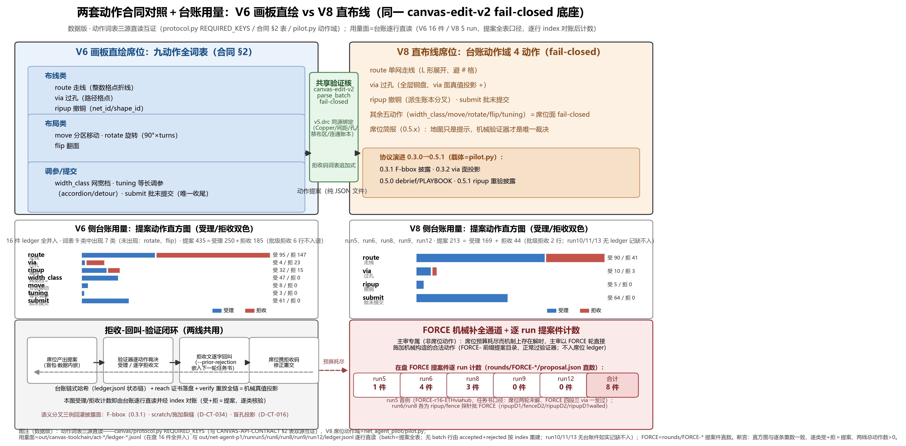
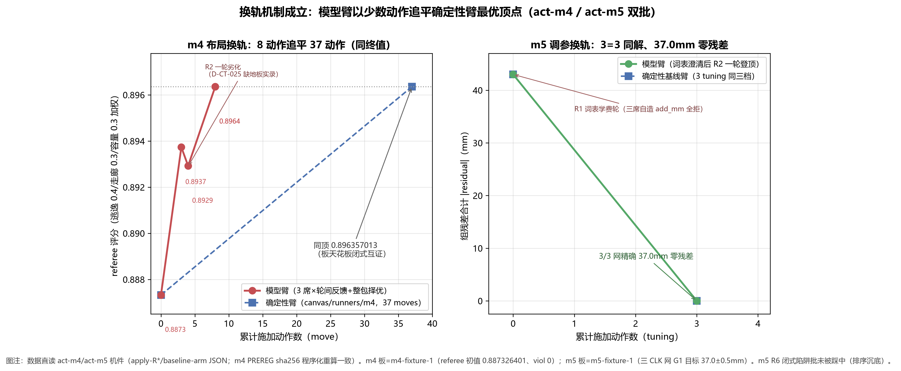
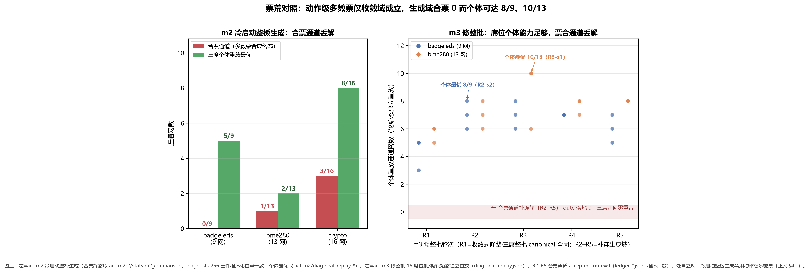
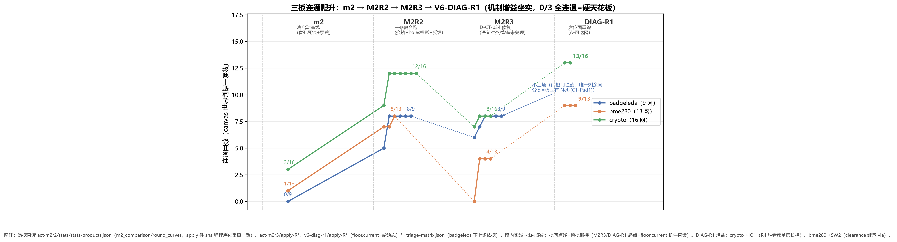
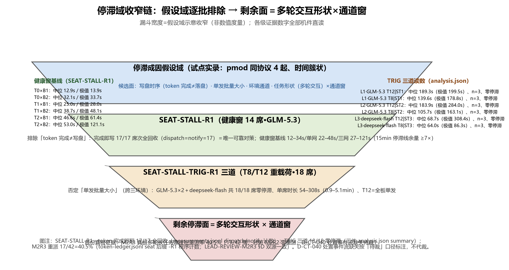
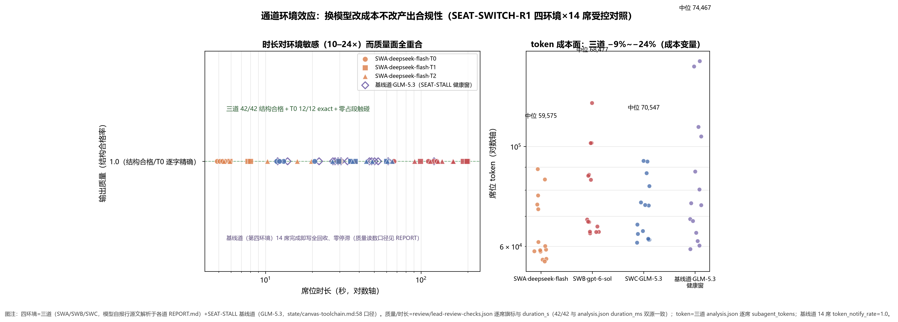
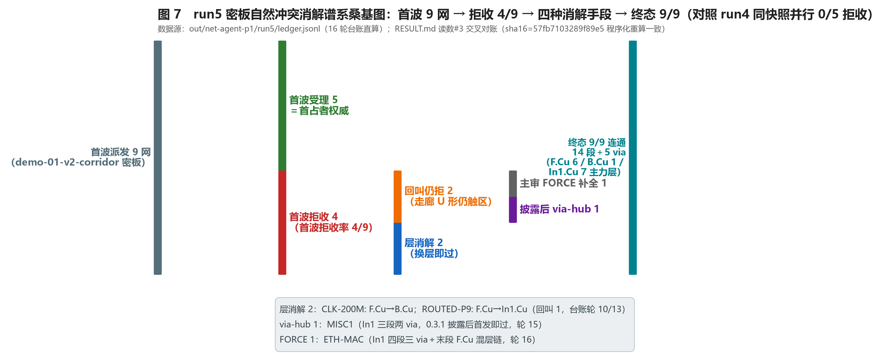
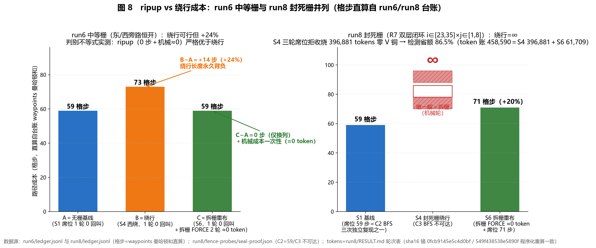
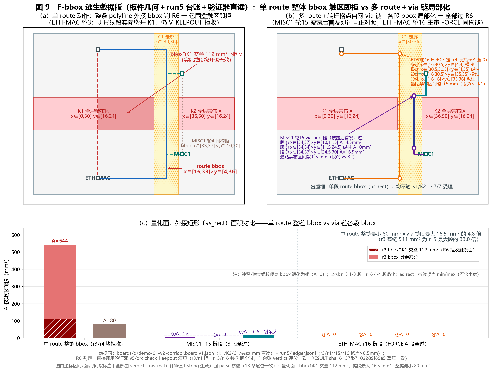
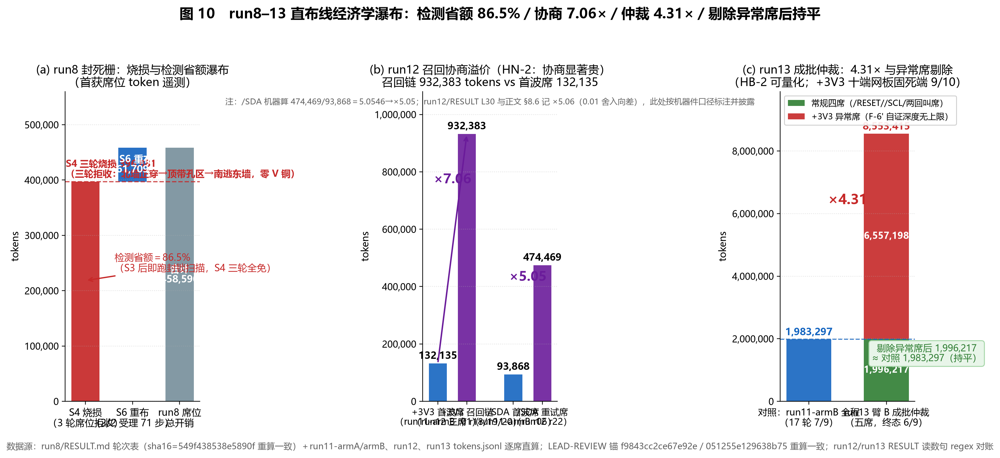

# 篇六《直接操作席位：画板直绘与直布线的动作合同、验证闭环与经济学》全文 R2

**发布说明（2026-10-30 收线归档）**：本文是 pcbflow 项目的中文技术报告（R2 内部定稿），**未经同行评审，未投稿**。文中形如 `<ENGINE_ROOT>/out/...`、`<WORKSPACE>/...` 的证据路径指向作者本机的实验证据目录，这部分没有公开；代码与核心板设计见仓库 `engine/`、`tools/`、`design/`。"主审""席位"等术语见 `TERMINOLOGY.md`。作者：赵丹琪。许可：CC BY 4.0。

**术语（首现定义，全篇统一）**：
- **席位（seat）**＝无工具纯会话、数据内嵌：LLM 以纯会话形态接收任务书（板面数据/地图内嵌于任务书文本），不持工具、不读仓库、无外部先验；其产出只写提案文件，受理与否由机械验证器裁决。V6 画板席位与 V8 布线席位同型。
- **世界（world）**＝代码＋板集＋门判据的冻结组合；跨批对照只在同世界内成立。
- **证书层三态 SAT/UNSAT/UNKNOWN＋运行层终态 FAILED**（统稿依据=`<ENGINE_ROOT>/out/paper-program-r2/TERMINOLOGY.md`）：SAT＝带机械验证的布通；UNSAT＝带不可布证书（witness/reach 证明）的不可布；UNKNOWN＝证据不足未判；FAILED＝终态未布通、待归因的工作态（**非三态之一**）。本篇 V8 侧以「N/9 连通」与 reach 证书（可达/不可达判定+落盘证明）表达同族语义。门号命名空间：本篇 M1–M4（run11 指标）、HN/HB（run12/13 判据）、G-CP1–4（canvas-pilot）等均为各 run 局部编号，与他篇同号不同物。
- **(a)/(b)/(c) 三分类**＝FAILED 的归因三分：(a) 板固有（焊盘场/孔等板面事实所致）、(b) 引擎缺口（求解器能力面）、(c) 规则带值（规范参数选择所致）——篇四主题，本篇 V6-DIAG-R1 借用其「板固有」判读。
- **可布域记分牌**＝分母剔除板固有不可布网后的连通计分（如 V8 run9 的 8/8＊，＊分母=可派网）。

---

## 摘要

与「提案权归模型、度量权归引擎」的提案席位（篇五）相对，本篇研究席位范式的另一极：**LLM 亲手动手**——逐动作直接构造几何（画板直绘/直布线），由 fail-closed 验证器逐动作裁决。两条证据线共享同一范式（动作合同＋拒收-回叫＋机械真值投影＋预注册）合并成篇：V6（canvas-edit-v2 画板直绘）出**机制结论**，V8（net-agent-pilot 直布线，run1–13）出**经济学结论**。主要结果：(1) **动作合同与验证闭环构成直接操作席位的可用性条件**——九动作词表封闭合同＋逐字拒收回叫＋FORCE 机械补全通道（区分「机制不可布」vs「席位未掌握」）；席位自评与实际能力的制度性偏差（V6 27 席全自报满额 vs 实际 1–8/N；V8 单席自证深度无上限、极值 6.56M tokens）靠回叫循环收敛。(2) **画板直绘机制面**：换轨机制成立（模型臂 8 步追平确定性臂 37 步、闭式互证同顶）；首个模型直绘板过 KiCad DRC；多数票仅收敛域成立（收敛式 31/44 全同 vs 生成域合票 0 而个体 8/9、10/13）；密集焊盘 clearance 走廊是剩余硬天花板（机制增益 0/9→8/9 等三板跳升但 0/3 全连通）。(3) **直布线经济学面**：ripup 严格优于绕行（本几何 +24% 溢价 vs 0 拆栅成本；封死围栏下绕行=∞、拆栅唯一解）；死锁口袋极罕见（18 板 132 锚点仅 1 例）；「检测先于派发」货币化（封死态未检测烧掉席位总开销 86.5%）；playbook 效应真实板延续（拒收 5/9→3/9、token −7.6%）；冲突消解存在零席位轻路径（级联撤封锁者→受害者原提案自动复活）。(4) **BFS⟺动作空间精确刻画**：封死围栏证明链中，BFS 可达性判据逐位镜像验证器八项语义，非保守超集——图论工具与席位表达空间的可判定等价。两线与篇五合流为席位范式完整地图：提案席位真实板零终解增量，直接操作席位可完成工作但有硬天花板。

**关键词**：直接操作席位；动作合同；验证闭环；拒收-回叫；画板直绘；直布线经济学；语义分叉；FORCE 机械补全

---

## 1 引言：提案席位 vs 直接操作席位

席位范式的分工问题：LLM 在 PCB 布线流程中到底应该坐在哪里。篇五回答了「只提案、不执行」的一极——模型提案排序/分配/层计划，引擎度量与执行，真实板三批复核给出**零终解增量**的一致负结果。本篇回答另一极：**直接操作席位**——模型不再提案宏观参数，而是亲手逐动作构造几何（画板元素/走线段/via/撤除），每一步提交给 fail-closed 验证器裁决，被拒则携逐字拒收文回叫重试。

这一极的可行性条件与提案席位根本不同。提案席位的接口是「参数→评分」，误差被引擎吸收；直接操作席位的接口是「动作→受理/拒收」，任何语义不对齐都会变成席位看不见的拒收。因此本篇的核心主张是三件套：**动作合同**（词表封闭、语义机械可判）、**验证闭环**（逐动作裁决＋逐字拒收回叫＋FORCE 机械补全通道区分两类失败）、**机械真值投影**（席位所见地图/简报与验证器语义逐项对拍）。两条证据线（V6 画板、V8 布线）在九个批次（V8 run1–13 中证据批 run5–13）与四个通道环境上检验了这三件套，产出机制结论（换轨、票荒、自评高估、语义分叉）与经济学结论（ripup vs 绕行、死锁普查、检测省额、playbook 回流、冲突消解路线）。

> **图表位·图 1**：两套动作合同对照图（V6 九动作画板合同 vs V8 九动作布线协议；拒收-回叫-验证闭环流程；FORCE 通道位置）。数据源：CANVAS-API-CONTRACT、net_agent_pilot pilot.py 协议段。

**图 1**（`figs/FIG-P6-01-ACTION-CONTRACT-V6-V8.png`；生成脚本 `figs/scripts/FIG-P6-01-ACTION-CONTRACT-V6-V8.py` 直读 `canvas/protocol.py` REQUIRED_KEYS＋`canvas/CANVAS-API-CONTRACT.md` §2 动作枚举表＋`net_agent_pilot/pilot.py`（席位台账动作域断言/--prior-rejection 回叫参数/简报图例），双源断言九动作数=9；数据版〔2026-10-05 示意数据化批改画〕：用量面=V6 侧 16 件台账（act-clearance-r1/m2/m2r2/m2r3/m3/m4/m5，435 提案动作直方图、受理 250/拒收 185）×V8 侧五 run 台账 run5/6/8/9/12（213 提案、受理 169/拒收 44；run10/11/13 无 ledger 如实记缺）×FORCE 逐 run 计数（合计 8，run5 首例 ETH））——两套动作合同对照：V6 九动作画板合同（canvas-edit-v2）vs V8 布线席位动作域（route/via/ripup/submit 之外 fail-closed），拒收-回叫-验证闭环（拒收文逐字嵌入下一轮任务书）与 FORCE 机械补全通道（区分「机制不可布」vs「席位未掌握」）的位置标注。

本篇结构：§2 两套动作合同与验证闭环；§3–§5 画板直绘（机制与界碑／票荒、自评与走廊天花板／停滞域与通道环境）；§6–§8 直布线（冲突消解谱系／ripup 经济学与死锁普查／语义分叉、封死围栏与 run9–13 收口）；§9 汇聚发现；§10 威胁与结论。

## 相关工作（题录级检索面）

> **本节性质**：R3 文献检索批回写面。条目全部取自 `<ENGINE_ROOT>/out/paper-program-r2/litsearch-r3/refs/P6-candidates.jsonl`（主题打分排序候选池），**标识符（DOI／arXiv／链接）原样取自该池 JSON，未新增任何来源**。共 25 条，按四组分列。**逐条为题录级定位**（依题名与候选池 relevance 标注的主题域），**未做全文复核**，故只作定位与对读，不引具体数值结论。
> **与本篇的接口**：本篇的四个承重点——①「动作合同＋工具调用载体」（§2.1/§2.2）、②「执行-验证-修复闭环与回叫」（§2.2/§2.3）、③「席位所见图面＝视觉语言空间推理」（V6 画布读图）、④「失败归因与调试」（§2.2 两类失败判别、§4.4 三分诊、§8.6/§8.7 归因表）——即下述四组的分组依据。

### （一）LLM 工具使用／计算机使用智能体

- **[B1]** *The Agent Loop* 综述以控制策略、技能、harness（载体）三面统管 LLM 智能体——与本篇「载体本身是变量」的判读同框（§5.2 四环境对照、§8.6 通道披露分列皆属该层）。
- **[B2]** *OS Agents* 综述覆盖电脑／手机／浏览器操作型 MLLM 智能体，并含载体操纵误差分析——本篇两套动作合同（V6 九动作画板合同、V8 九动作布线协议）属同类载体操纵协议。
- **[B3]** *CUADebug* 面向计算机使用智能体做失败诊断与修复——与本篇「逐动作裁决＋逐字拒收回叫」同属行动级闭环，但对象域为 GUI 通用操作而非几何构造。
- **[B4]** *Uncertainty Quantification for Computer-Use Agents* 给出跨视觉语言模型与 GUI grounding 数据集的不确定性基准——对读本篇「席位自评不可用作度量、机械重放才是」（§4.2／§9.2）的度量权归属。
- **[B5]** *GUI-Shepherd* 为长序列 GUI 任务配过程奖励与验证——贴合本篇画布多步操作的闭环需求（逐步受理/拒收的过程判据）。

### （二）执行-验证-修复闭环与自调试

- **[B6]** *SAGE* 是执行引导＋自修复的自适应智能体框架——与本篇「执行→验证→修复→再执行」环同型，差别在执行载体为代码而非几何动作。
- **[B7]** *OptiLoop* 研究优化类智能体的「协调在环内」的验证与修复——候选池标注其与布线迭代优化环同构，是本篇 V8 迭代环最近邻的跨域件。
- **[B8]** *Verify, Repair, Repeat, or Stop?* 给出噪声验证-修复环的稳健停止判定——正对读本篇回叫环的停止面：席位预算 2/网、run8 三次尝试始终未收敛到「结构性被封死」结论（§8.2「停写=不可行宣言」协议候选）。
- **[B9]** *Multi-Agent Verification* 用多验证者把测试时算力放大——候选池标注「验证闭环本身即可当算力放大器」；本篇 §4.1 票荒（合票 0 而个体 8/9、10/13）提供其反向样本：**验证/合票通道本身会丢解**。
- **[B10]** *Can Terminal Agents Trust Their Own Verification?* 诊断并改进终端智能体的自验证——与本篇 §4.2 自评高估（27 席全自报满额、实际 1–8/N）及 §8.6 F-6' 自证深度无上限同向。
- **[B11]** *Towards LLM-Powered Verilog RTL Assistant* 研究 Verilog 助手席位的自验证与自纠错——候选池标注其为 EDA 域验证闭环的直接先例。
- **[B12]** *PCBSchemaGen* 以奖励引导的 LLM 代码合成做 PCB 原理图设计并配结构化验证——同属 PCB 域「模型构造＋机械验证」，但落点在原理图侧，本篇落点在板直绘/直布线侧。

### （三）视觉语言模型空间推理（V6 画布相关）

- **[B13]** *SpatialVLM* 以大规模定量数据补齐度量空间推理——候选池标注其为 V6 画布读图的直接前置能力。
- **[B14]** *SpatialRGPT* 做视觉语言模型的接地式（grounded）空间推理——与本篇「席位所见地图必须逐语义对拍验证器」（§2.3 三类语义分叉）同属「给对图面」问题。
- **[B15]** *OmniSpatial* 覆盖多类空间关系基准并统一口径——为画布空间读数的横比提供口径参照。
- **[B16]** *Why Is Spatial Reasoning Hard for VLMs?* 从注意力机制角度解释视觉语言模型空间推理为何失效——候选池标注其指向画布引导的注意力预算问题，与本篇「密集焊盘 clearance 走廊天花板」（§4.3）是同一失效族的现象层与机制层两面。
- **[B17]** *Is A Picture Worth A Thousand Words?* 作细粒度空间任务诊断——候选池标注其区分「看得见」与「算得对」两类失败；本篇 V6 D-CT-016 盲孔死锁（席位地图不含板固孔）即「看得见但算不对」的实例。

### （四）智能体失败归因与调试邻域

- **[B18]** *RESKILL* 做显式失败归因＋结构化修复——对读本篇 §2.2 的两类失败判别（机制不可布 vs 席位未掌握）与 §4.4 的 (a)/(b)/(c) 三分诊。
- **[B19]** *Diagnosis Before Recovery* 把智能体失败转为选择性自纠错——与本篇「检测先于派发」的货币化结论同向（run7 派发前 scan、run8 未检测烧掉席位总开销 86.5%，§7.2／§8.2）。
- **[B20]** *Model or Harness?* 提出交互中心的智能体失败定位分类学——把「模型 or 载体」分开，与本篇「席位能力 vs 引擎缺口 vs 板面事实」三分同型。
- **[B21]** *Localizing Emergent Failures in Agentic AI* 用反事实重放恢复最小修复族——与本篇 run12/run13 的「撤可撤封锁者→重验受害者原提案」（F-1／HA-1，零席位成本复活）同型。
- **[B22]** *Not All Repair Helps* 区分哪些修复干预能救回失败智能体、哪些不能——正对读本篇冲突消解双路线：run12 召回协商 7.06× 溢价 vs run13 臂 A 零席位轻路径（§8.6／§8.7）。
- **[B23]** *Repair Economics for Tool-Calling LLM Agents* 讨论失败恢复的收益、副作用与代价——与本篇 §7–§8 经济学面（ripup vs 绕行判别不等式、检测省额、playbook 回流）对读。
- **[B24]** *TraceCAD* 做智能体化 CAD 生成的轨迹引导修复——与本篇「台账 replay verify 全链、reach 证书落盘」的轨迹作证据面同型。
- **[B25]** *EvoDRC* 是自动 DRC 违例修复的自演化智能体框架——与本篇 G-CP2「终态 DRC 归责面零违例＋外部复核工具独立复跑」（§3.2）同域。

## 2 两套动作合同与验证闭环

### 2.1 V6 九动作画板合同

画板直绘线的合同是 canvas-edit-v2：九个动作（含画板元素增删改与提交）＋四个新拒收码，席位对 v5 四模块只读、禁 import canvas_pilot——即席位能「看」引擎态但不能调用引擎工具，产出只能是动作提案。合同正文=`canvas/CANVAS-API-CONTRACT.md`。每批实验预注册冻结（PREREG sha 锚定）先于执行，终态以 VERDICT/LEAD-REVIEW 独立复核收口；决策偏差逐条入 D-CT 台账（§4 表 1）。

### 2.2 V8 九动作布线协议与拒收-回叫

直布线协议是九动作布线合同（route/via/ripup/submit 等），载体=route-v5/net_agent_pilot/pilot.py（0.3.0→0.5.1 演进：0.3.0=scan〔锚点死锁口袋＋密度，验证器同款 v5.metrics.clearance 原语〕+ripup〔派生账本分叉〕+禁布区 advisory 投影+load_board 双格式；0.3.1=F-bbox 披露+via 格点 attach 规则+禁布区语义段；0.3.2=via 面真值投影〔地图 `+`＝走线可过、放 via 不可〕；0.5.0=debrief/PLAYBOOK 插槽；0.5.1=ripup 重验对照披露+slice 轮号防呆）。

回叫机制的关键设计：`--prior-rejection` 将上一轮拒收文**逐字**嵌入下一轮任务书；且回叫件不带 applied 态的 result 作 prior-rejection——已受理轮本无拒收，带上只会渲染误导性的「请修正」节。每 run 以 RUN.md 预注册冻结（sha 锚定），轮产物、台账（ledger.jsonl 状态链）与 reach 证书（可达性判定+证明落盘）全量留痕，verify 子命令重放全链。

**FORCE＝主审机械补全通道**：席位预算耗尽而机制上存在解时，主审以 FORCE 轮直接施加机械构造的合法动作（提案文件以 FORCE- 前缀落盘、正常过验证器）。它的方法论价值是**区分两类失败**：「机制不可布」（验证器与机械工具都构造不出）vs「席位未掌握」（机制已被机械工具或同侪席位证明存在）。run5 的 ETH 网是首例：席位两轮回叫未解、主审 FORCE 四段三 via 混层链一发过——失败归席位执行方差而非协议不可布。

### 2.3 语义分叉：投影必须逐语义对拍验证器

两线共有的系统性发现：**席位所见投影（advisory 地图/简报）与验证器语义存在三类分叉**，任何一类都让席位被「看不见的拒收」训练——

1. **V8 F-bbox**（run5 发现、0.3.1 修复披露）：验证器按**每 route 动作整体 bbox** 判禁布区（R6），逐格 advisory 地图原理上表达不了「包围盒触区即拒、实际线段绕开无效」的语义（§8.1 详述）。
2. **V6 D-CT-034（scratch/施加语义裂缝）**：评估器在 apply_batch 批内累积视图上评估（前向引用合法），而施加落地是逐动作缝——同一动作集两个口径，评估/地板/停机线/反馈四件全跑在 scratch 口径上。修复后（M2R3）语义对齐兑现，但增益未兑现为连通面（§4.3）。
3. **V6 盲孔死锁（板固孔不投影，D-CT-016）**：席位地图不含板固孔，盲化无反馈通道下席位反复撞孔——用户裁①holes 投影修复后盲孔死锁消失（拒收主位 V_HOLE_TRACK→V_CLEARANCE）。

三例的共性教训写进两线合同：投影不是「画得像」而是「逐语义对拍」；每发现一类分叉即回灌披露面（F-bbox 披露后席位 via-hub 首发即过＝披露有效性正对照，run5 MISC1）。

## 3 画板直绘：机制与界碑（V6）

### 3.1 换轨机制成立

「换轨」＝不重画整板、在既有铜轨上改拓扑的编辑族。m4 批的受控对照：**模型臂以 8 个动作追平确定性臂的 37 个动作，同顶 0.896357013（板天花板闭式互证）**——即模型找到的换轨路径与确定性算法的最优顶点逐位一致，且以不到四分之一的动作数到达。m5 批三席 3=3 同解、3/3 网精确 37.0mm 零残差。配套机制：滤劣 3 轮实证（整包择优＋当前态地板）、并列按生产性 DESC 破平、闭式陷阱批被排序沉底。这是「直接操作席位能完成机制级工作」的第一组正结果。

> **图表位·图 2**：换轨 8 vs 37 对照（两臂动作序列与顶点轨迹）。

**图 2**（`figs/FIG-P6-02-TRACK-SWITCH-8VS37.png`；生成脚本 `figs/scripts/FIG-P6-02-TRACK-SWITCH-8VS37.py` 直读 `out/canvas-toolchain/act-m4/apply-R{1..5}-m4-fixture-1.json` 与 `baseline-arm-m4-fixture-1.json`（referee 轨迹/施加动作，评分 0.887326401→0.896357013）、`act-m4/VERDICT.md`+`PREREG.md`（sha256 重算比对）、`act-m5/apply-R{1..4}` 与基线臂件；断言模型臂施加 move 合计=8、确定性臂 accepted_moves=37、同顶 0.896357013、m5 三网 37.0mm 零残差）——换轨机制 8 vs 37：模型臂以 8 个动作追平确定性臂 37 个动作、终值同顶 0.896357013（板天花板闭式互证），m5 三席 3=3 同解——「直接操作席位能完成机制级工作」的第一组正结果（§3.1）。

### 3.2 界碑：首个模型直绘板过 KiCad DRC

M1 批界碑＝**首个由模型直绘（动作合同产出）并通过 KiCad DRC 的板**——直接操作席位的「能产出可用工程件」下界证明。界碑由 M1 批原始收口件直接坐实（独立产物根 `<ENGINE_ROOT>/out/canvas-pilot-r1/`，件含 VERDICT/PREREG/LEAD-REVIEW、rounds/、final/、ledger.jsonl、snapshots/）：主板 badgeleds-do-electronics（9 网/28 孔焊盘场）三门全过——**G-CP1 全连通 9/9 PASS**（3 轮收官，逐轮曲线 5→7→9 单调零回退；独立检查席盲读终态 9/9 零出旗）；**G-CP2 DRC 干净 PASS**（终态 v5.drc routes 归责面零违例；kicad-cli DRC 5 跑〔P5-UP3-aggregate-v1〕violations=0、unconnected=0，相对板基线新增违例=0——`final/badgeleds-do-electronics/drc-aggregate.json` 5 跑逐跑全零〔本篇统稿批程序化亲验〕，主审独立复跑 5/5 同判）；G-CP3 预算代理 PASS（rounds 3/40、会话 3/30、墙钟 ≈32min≤4h）。判据源 prereg sha256 前 16 位 `5cbf41f0481a4a2b`（本篇统稿批程序化重算一致）；主审验收 **ACCEPT**（`LEAD-REVIEW-PILOT-R1-2026-09-25.md`，13 面独立验证全过，附勘误 E-1..E-5、无门翻转）。对照面（G-CP4，描述性不设门）：画板直绘 383.4mm/9 段单层/**0 过孔** vs 引擎基线（D8 现树）302.5mm/15 段/24 via——以 +26.7% 线长换零过孔，两收敛点均在规范内。**限定如实**：界碑坐实于主板；条件板 pmod-bme280（13 网、排针横贯×5）G-CP1 FAIL 8/13、墙钟实耗 4h04m45s 触发停机线（FAIL(exhausted·wall-clock)，主审勘误 E-3；为预注册合格终态），未达终态连通故未导出、未跑 kicad-cli DRC。

后续 EXPORT 批（track_dangling 清零×3；主审复核四步全过 ACCEPT：三板 review 逐格吻合、pytest 364+1、EJ-5 18 件三方全等、EJ-4 网名集自跑 kicad-cli 复算 match×3）把导出面收口到外部权威可验。

### 3.3 席位信息面载体：走廊摘要兑现

CLEARANCE 批检验「给席位什么信息才有用」：以走廊摘要为载体（把密集焊盘区的可走走廊结构化投给席位），**bme280 +4、crypto +4，追平 M2R2 峰值、零净降**；via_dangling 类经用户裁 D-CT-047=A 升**通用豁免**（track_dangling 不豁免、再现照常 FAIL）。处置事件流（MANUAL v1.2）首用闭环；D-CT-045 覆写事故以 18 锚坐实恢复。

### 3.4 稳定性与挂账披露（锚定层）

本节机制结论的几何底座是锚定引擎（端点→格点的投影）。V6-DIAG-R1 三小件①坐实**锚定伪影候选**：76 端点 |Δx|max=0.239/|Δy|max=0.2468mm 的系统性偏差，C1-Pad1 校正变体 gap=0.5882/0.500767≥R5−EPS——即部分「板固有不可布」读数在锚校正下会翻为可达。**截至 2026-10-03，锚定引擎修复批 V6-ANCHOR-R1（canvas_pilot test_binding_14 红钉＋lane-k2-smoke 漂移，跨线知会在案）任务书已冻结、待派，默认用户自派**；本篇全部既有结论按现行口径书写、不预支修复结果，锚定口径的影响面集中在 §4 的剩余瓶颈归因（badgeleds 唯一目标网的 gap 0.4982mm 差临界读数），其余结论（换轨/票荒/自评/停滞/通道）不依赖该临界格。

## 4 画板直绘：票荒、自评与走廊天花板

### 4.1 多数票仅收敛域成立

动作级多数票（多席同任务、逐动作投票取多数）的适用域判别：**收敛式修整**任务上它是正面极端证据——m3 批双板三席整批 31/44 动作 canonical 全同；**生成域**（冷启动整板生成）上票荒——m2/m3 双证：三席合票的几何零重合（合票 0），而三席**个体**重放分别可达 8/9、10/13。即席位能力够、票合通道丢解。处置立规：**冷启动整板生成禁用动作级多数票**。

> **图表位·图 3**：票荒对照（合票 0 vs 个体 8/9、10/13）。**图 4**：三板连通爬升曲线（m2→M2R2→M2R3→DIAG-R1）。

**图 3**（`figs/FIG-P6-03-VOTE-FAMINE-COMPOSITE-VS-INDIVIDUAL.png`；生成脚本 `figs/scripts/FIG-P6-03-VOTE-FAMINE-COMPOSITE-VS-INDIVIDUAL.py` 直读 `out/canvas-toolchain/act-m3/diag-seat-replay.json`（15 席位批×2 板个体重放最优 8/9、10/13）＋`act-m3/ledger-{badgeleds,bme280}.jsonl`（合票补连轮 accepted route=0）＋`act-m2r2/stats/stats-products.json` m2_comparison（合票终态 0/9、1/13、3/16）＋`act-m2` 个体重放件；三件 ledger sha256 程序化重算一致）——票荒对照：生成域三席合票通道丢解（合票 0、补连零落地）而三席个体重放分别可达 8/9、10/13（m2 个体最优 5/9、2/13、8/16）——席位能力够、票合通道丢解，「冷启动整板生成禁用动作级多数票」处置的数据面（§4.1）。

**图 4**（`figs/FIG-P6-04-THREE-BOARD-CONNECTIVITY-CLIMB.png`；生成脚本 `figs/scripts/FIG-P6-04-THREE-BOARD-CONNECTIVITY-CLIMB.py` 直读 `out/canvas-toolchain/act-m2r2/stats/stats-products.json`（m2 基线 0/9,1/13,3/16＋M2R2 逐轮/终态 8,8,12＋inputs sha 锚重算）＋`act-m2r3/apply-R*`（终态 8,4,8）＋`v6-diag-r1/apply-R*`（席位面重跑 crypto 12→13、bme280 8→9）＋`v6-diag-r1/triage-matrix.json`（badgeleds 剩余网分类=板固有→门槛门拦截不上场））——三板连通爬升曲线 m2→M2R2→M2R3→DIAG-R1：机制增益方向坐实（0/9→8/9 等）但 0/3 全连通，剩余瓶颈=密集焊盘场 clearance 走廊硬天花板；M2R3 语义对齐兑现而增益未兑现为连通面（§4.3/§4.4）。

### 4.2 席位自评高估是制度性的

m2 批三板 27 个席位批全部自报满额连通，独立重放实际 1–8/N。根因＝盲化无反馈通道（自评无机械对账面）。该制度性偏差与 V8 的 F-6'（单席自证深度无上限，§8.6）同族，两线一致结论：**自评不可用作度量，机械重放才是**。

### 4.3 机制增益与硬天花板

M2R2（换轨+holes 投影+反馈通道三修复合跑）把三板连通从 m2 基线 0/9、1/13、3/16 拉到 **8/9、8/13、12/16**——机制增益方向坐实；但 **0/3 全连通**，「能跑真实板子」主张的补全跑答案＝否。剩余瓶颈＝**密集焊盘场 clearance 走廊硬天花板**：badgeleds 剩 1 网（gap 0.308–0.498 不足）、bme280 剩 5 网（IO 行被 B.Cu 已布线占）、crypto 剩 4 网（IO 场含 gap=0.0 贴焊盘失败几何）。M2R3（D-CT-034 语义裂缝修复后首跑）语义对齐兑现但增益未兑现为连通面（badgeleds 8/9 持平、bme280 4/13、crypto 8/16；下降归因＝席位抽样×行为分布×停机严格化，非机制退步），且暴露**真板多轮长任务席夜班重派率 40.5%（17/42 槽）**——「多轮交互×通道窗」的首份真板证据（§5 收窄链的终点）。

对照臂（描述性双世界口径）：Freerouting relaxed 连通 7/9、11/13 高于本跑终态；crypto DSN 导出 fail-closed（D-CT-032）。

### 4.4 剩余瓶颈的结构化解明（V6-DIAG-R1，2026-09-28 收口）

对 M2R2/M2R3 剩余网做三分类分诊（借篇四 (a)/(b)/(c) 口径）：分诊面 10 网＝**板固有 7＋域外可解 3**，热拆/深拆 0 命中（C2 热区铜全集空＝设计内退化二分类），单调性不变量全 True、零矛盾态。席位面重跑：crypto 12/16→**13/16**（+IO1：R4 胜者席单层长径）、bme280 8/13→**9/13**（+SW2：clearance 继承 via），A-可达网增益 2/3；badgeleds 8/9 不上场（门槛门正确拦截＝板固有唯一目标网）。三小件：①锚定伪影候选坐实（→§3.4 挂账）；②**declare_infeasible 协议首用 9/9=100% 吻合**（crypto R5 三席×3 网零假阴性；保留意见＝注入面复述一致性而非独立判断力）；③via 归因＝**能力缺位非提示词缺位**（信息已给、席位不对需换层网换层，反把 via 用作同层避障被拒）。此外一跨线运营教训（state 档案登记，篇二 §8.2 互证）：m3 批一检查席对 bme280 的 SVG 缺点主张被程序化复核推翻（`state/canvas-toolchain.md:54`「检查席也会算错」）——检查席（判读席）输出同样恒 untrusted，与 §4.2 自评高估结论同向。

> **图表位·表 1**：D-CT-001..047 决策台账分类统计（分奇偶节：wave1 D-CT-001..004＋wave2 D-CT-005..039＋主审登记 034..047；状态列＝已修/已裁关账/观察项/回执重写）。

## 5 画板直绘：停滞域与通道环境

### 5.1 停滞域收窄链

席位停滞（长时不产出）的成因面经三批收窄：SEAT-STALL-R1 确立**token 完成即写**（写盘动作与 token 消耗绑定）17/17 全回收＝唯一可靠对策，健康窗基线照抄 12–34s/单网 22–48s/三网 27–121s（15min 停滞线余量 ≥7×）；SEAT-STALL-TRIG-R1 三道把「单发批量大小」假设**跨三环境否定**（GLM-5.3×2＋deepseek-flash 共 18/18 席零停滞、2–5.2min、T12 全板单发）——**剩余停滞面＝多轮交互形状×通道窗**，与 M2R3 的 40.5% 真板重派率互为确证（后者是多轮长任务在真板上的形态）。

> **图表位·图 5**：停滞收窄漏斗（假设域逐批排除→剩余面）。

**图 5**（`figs/FIG-P6-05-STALL-CAUSE-FUNNEL.png`；生成脚本 `figs/scripts/FIG-P6-05-STALL-CAUSE-FUNNEL.py` 直读 `out/canvas-toolchain/seat-stall-r1/analysis.json`＋`measurements.jsonl`（14 席零停滞健康窗＋dispatch=notify=17 全回收）＋`seat-stall-trig-r1` 三道 analysis.json（三环境 18/18 零停滞）＋`act-m2r3/token-ledger.jsonl`（42 槽 17 槽 -R1 重派=40.5%））——停滞成因假设域收窄漏斗：token 完成即写（唯一可靠对策，17/17 全回收）→「单发批量大小」假设跨三环境否定（T8/T12 重载荷零停滞）→剩余面=多轮交互形状×通道窗（M2R3 40.5% 真板重派率互证）（§5.1）。

### 5.2 通道环境效应：换模型改成本不改产出合规性

SEAT-SWITCH-R1 四环境×14 席受控对照（四环境＝三道 deepseek-flash/gpt-6-sol/GLM-5.3＋SEAT-STALL 健康窗 GLM-5.3 基线道，`state/canvas-toolchain.md:58`「三道+基线=四环境」）：**时长效应 10–24×**（deepseek-flash 道 5–13s／GLM-5.3 道 12–47s／gpt-6-sol 道 116–192s）、**token −9%~−24%**、而**输出质量对环境完全不敏感**（三道 42/42 结构合格＋T0 12/12 exact＋零占段触碰）。即环境通道是成本变量不是质量变量。配套读数：GLM 同模型跨会话方差上界≈token ±16%（判读模型效应先扣此底噪）；回执谱系三形态（迟写/同刻写/重写）由 v1.1 双锚免疫。

> **图表位·图 6**：四环境时长/质量分离散点（时长轴 log，质量面全重合）。

**图 6**（`figs/FIG-P6-06-SEAT-SWITCH-DURATION-QUALITY-SCATTER.png`；生成脚本 `figs/scripts/FIG-P6-06-SEAT-SWITCH-DURATION-QUALITY-SCATTER.py` 直读 `out/canvas-toolchain/seat-switch-r1/review/lead-review-checks.json`（42 席质量旗标全 True）＋`{a,b,c}/analysis.json`（逐席时长/token，与 review 件双源互证 42/42）＋`{a,b,c}/REPORT.md` 环境自报行＋`seat-stall-r1/analysis.json` 基线道；断言 T0 exact 12/12、T1/T2 structure_ok 30/30）——四环境时长/质量分离散点（时长轴 log，全域≈4.9–199.0s；四环境=三道 deepseek-flash/gpt-6-sol/GLM-5.3＋SEAT-STALL 基线道）：时长效应 10–24×、token −9%~−24%，而输出质量对环境完全不敏感（42/42 结构合格）——通道环境是成本变量不是质量变量（§5.2）。

## 6 直布线：冲突消解谱系（run5）

run5 在密板（demo-01-v2-corridor，9 网 3 信号层、K1+K2 双禁布区单走廊）上首次观测自然冲突密度与消解手段分布。终态 **9/9 连通**（16 轮台账 verify PASS，state 4874a1fd…；RESULT sha16 57fb7103289f89e5）；首波拒收率 **4/9**（对照 run4 同快照并行 0/5——板密度把并行规划从「常态零冲突」推到「近半数首提被拒」）。

**消解谱系**（预注册读数#3）：层消解 2（B.Cu/In1.Cu 各一）／首占者权威 5／披露后 via-hub 1／主审 FORCE 补全 1。三信号层全部启用——**层自由是冲突的主要泄压阀**。最近跨网同层间隙 0.5mm 恰好合规（seg:BUS-FMC:0×seg:ROUTED-P7:4 走廊边平行擦边）——限值即工作点。终态 14 段+5 via，In1.Cu 7 段成为主力层。

**F2 在位者封锁级联**（ETH 案例解剖）：BUS 先占 i65 直柱后，ETH 的 F.Cu 西归路径被 BUS 柱封顶、B.Cu 走廊被 CLK 行封死、In1 顶被 P9 行恰好穿 ETH 锚 B 经度封口——三面封锁需 4 段 3 via 混层链（In1 走 x30.5 柱＋末段 F.Cu 接锚）。这是**级联封锁**（后到者成本随在位者累积非线性上升）的首个实测样本；席位两轮回叫未解、预算 2/2 耗尽，主审 FORCE 补全（柱落 i61、距 K1 边 0.35mm）——按 §2.2 判据归「席位未掌握」（机制已被 MISC1 同构证明存在）。

> **图表位·图 7**：消解谱系桑基图（首波 9 网→拒收→四种消解手段→终态）。

**图 7**（`figs/FIG-P6-07-RUN5-RESOLUTION-SANKEY.png`；生成脚本 `figs/scripts/FIG-P6-07-RUN5-RESOLUTION-SANKEY.py` 直读 `out/net-agent-p1/run5/ledger.jsonl`＋`RESULT.md`（RESULT sha16 57fb7103289f89e5，预注册读数#3））——run5 冲突消解谱系桑基：首波 9 网→拒收 4/9（对照 run4 同快照并行 0/5）→四种消解手段（层消解 2〔B.Cu/In1.Cu 各一〕/首占者权威 5/披露后 via-hub 1/主审 FORCE 补全 1）→终态 9/9 连通——层自由是冲突的主要泄压阀（§6）。

## 7 直布线：ripup 经济学与死锁普查（run6/run7）

### 7.1 ripup 经济学：拆栅重布严格优于绕行（本几何）

run6 在默认板（badgeleds）构造受控围栏实验：V=Net-(D1-Pad1)，F=Net-(D2-Pad1) 双层围栏，六阶段 S1–S6（S1 基线→S2 撤基线→S3 立栅→S4 栅下重布→S5 拆栅→S6 释放重布），7 轮台账 verify PASS（RESULT sha16 0fcb9145e5c4d0bf）。主读数：

| 支路 | 路径成本 | 席位成本 |
|---|---|---|
| A＝无栅基线 | 59 格步 | 1 轮 0 回叫 |
| B＝绕行（S4 西绕） | 73 步＝**+14 步（+24%）** | 1 轮 0 回叫 |
| C＝拆栅重布（S6） | 59 步＝**C−A=0 步**（仅换列） | 1 轮 0 回叫＋拆栅机械 2 轮 FORCE（≈0 token） |

**判别不等式实测：本几何下 ripup 路径（0 步＋机械≈0）严格优于绕行（+24%）**，且绕行路径永久背负长度（每条连接的固定成本）、ripup 只付一次机械成本。边界三条如实：①围栏是中等封锁（东/西旁路恒开）——封死型下绕行项=∞、判别更偏 ripup，run8 补测（§8.2）；②F 的重布费未计入（围栏是主审制造的；真实场景拆的是在位席位作品，其重布费应计入 ripup 侧——单边账）；③席位 token 无遥测（外派通道），以轮数/回叫/格步代理。原生 ripup 四轮台账撤铜全链可重放（轮 6 后全板零铜）——台账化撤铜的完全可重放性在正式 run 验证。

> **图表位·图 8**：ripup vs 绕行成本柱状（A/B/C 三支路，run6 中等栅+run8 封死栅并列）。

**图 8**（`figs/FIG-P6-08-RIPUP-VS-DETOUR-COST.png`；生成脚本 `figs/scripts/FIG-P6-08-RIPUP-VS-DETOUR-COST.py` 直读 `out/net-agent-p1/run6/ledger.jsonl`（S1/S4/S6 路径格步=waypoints 曼哈顿和直算）＋`run6/RESULT.md`＋`run8/ledger.jsonl`＋`run8/fence-probes/seal-proof.json`（C2 封栅前 BFS 最短 59 三次独立复现交叉标定）＋`run8/RESULT.md`（S4 三轮拒收 tokens 轮次表））——ripup vs 绕行成本柱状（run6 中等栅+run8 封死栅并列）：A=无栅基线 59 格步／B=绕行 73 步（+14，+24%，永久背负）／C=拆栅重布 59 步（C−A=0，仅换列）；封死栅下绕行=∞（C3 机械封锁证明）、拆栅唯一解（run8 S4 三轮烧 396,881 tokens 零 V 铜、S6 重布 61,709）——判别不等式实测（§7.1/§8.2）。

### 7.2 死锁普遍性普查：1/132，处置＝派发前 scan

run7 对本仓 18 板（合成板为主）全量扫描锚点死锁口袋（stub 强制段附着可能性）：**132 锚点仅 1 例**（默认板 C1-Pad1 [27,55]，gap 0.4982，blocker pad:Net-(C2-Pad2):1——与 run3 席位拒收 detail 逐位吻合）。三条发现：①死锁极罕见且需真实焊盘几何（唯一案例在唯一焊盘密集板，全部无焊盘合成板零死锁——是「离格焊盘+天生焊盘对」的巧合而非密度产物）；②第二病理类＝同格锚冲突（d4-escape-seal 双端点同锚，build_state 期 fail-closed 拦截，与口袋死锁分属两类）；③advisory 阻塞率与死锁无关（阻塞率最高 34.1% 的板零死锁——阻塞率度量拥塞、死锁度量附着可能性，两轴独立）。处置政策制度化＝**派发前 scan**（机械成本≈0，替代 run3 式烧 2 轮席位才发现不可布）。边界：语料为本仓 18 板非工业先验；判据只覆盖附着口袋，不覆盖运行期走廊封锁（那是 ripup-econ/编排域）。（RUN.md sha16 e76a92d9／RESULT 3cf856de。）

## 8 语义分叉与封死围栏：F-bbox、run8 终数与 run9–13 收口

### 8.1 F-bbox：图-验证器第三类语义分叉

pilot 0.3.1 机械发现（run5 首实证）：`Copper.as_rect`＝整条 polyline 顶点 min/max 外接矩形（v5/drc.py:67），check_keepout 按**每 route 动作整体 bbox** 判禁布区（R6）——包围盒触区即拒、实际线段绕开无效。推论：**端点落在禁布区 x 投影内且 y 跨带的网，单条 route 结构性不可布**（ETH x16∈K1、MISC1 x37∈K2），唯一逃生＝多 route＋转折格点自网 via 链（各段 bbox 局部化）。逐格 advisory 地图原理上表达不了 bbox 拒收——继 run3 两类之后的**第三类图-验证器语义分叉**。制度响应：0.3.1 把该语义直接披露进简报；**披露后 MISC1 via-hub 首发即过＝披露有效性正对照**（ETH 仍败于柱位选择＝席位执行方差，两网同因不同果的对照样本）。

> **图表位·图 9**：F-bbox 逃生示意（单 route bbox 触区 vs 多 route+via 链局部化）。

**图 9**（`figs/FIG-P6-09-FBBOX-ESCAPE-SCHEMATIC.png`；生成脚本 `figs/scripts/FIG-P6-09-FBBOX-ESCAPE-SCHEMATIC.py` 直读 `boards/d/demo-01-v2-corridor.board.v1.json`（K1/K2 禁布区/走廊几何）＋`out/net-agent-p1/run5/ledger.jsonl`（r3/r4 被拒单 route、r15/r16 via 链）＋直接 import `v5/drc.py` 与 `v5/metrics/clearance.py` 以验证器自身 check_keepout 判定；数据版〔2026-10-05 示意数据化批收口〕：几何坐标全部板件/台账直读禁手抄，标注串全部由 as_rect/verdicts 程序化生成（回 parse 核验 13 条），新增量化面=bbox∩K1 交叠面积 112 mm²、单 route 整体 bbox 544/80 mm² vs via 链最大段 16.5 mm² 对比）——F-bbox 逃生示意：左＝单 route 动作按整条 polyline 顶点 min/max 外接矩形（Copper.as_rect）判 R6 禁布区——包围盒触区即拒、实际线段绕开无效（ETH x16∈K1、MISC1 x37∈K2 的 U 形绕行均被拒）；右＝唯一逃生=多 route＋转折格点自网 via 链（各段 bbox 局部化；MISC1 披露后首发即过=正对照、ETH 主审 FORCE 同构链）——第三类图-验证器语义分叉（§8.1）。

### 8.2 run8 封死围栏终数（全链闭环，RESULT sha16 549f438538e5890f）

run8（V8-SEALFENCE-R1）把 run6 的中等围栏推到封死端：默认板 badgeleds（9 网 28 焊盘 28 孔，R5=0.5mm，F.Cu/B.Cu），受害网 V=Net-(D1-Pad1)（锚 (27,4)↔(54,36)），围栏网 F=Net-(D2-Pad1)（锚 (27,31)↔(55,25)）。预注册 RUN.md（sha16 d27db825e2f95c5f）＋机械基础件 fence-probes 冻结；8 轮台账 verify PASS，终态 4802d818196293f8…（V 连通、1 段 0 via、71 格步）。

**冻结围栏 R7＝i∈[23,35]×j∈[1,8] 双层闭环**（R7＝本 run 围栏编号，与篇四 R7 netclass-edge 任务书代号同符不同物）（seal-proof.json：box=[23,35,1,8]、同 waypoints 双 route＋submit、零 via、F 全网连通；outcome=SEALED、封栅后 post_reachable=false）。围栏几何由拒收轮反推的板面事实决定：D1-Pad1 矩形垫半宽 0.9；VCC ep0 圆垫 r=0.9＋孔 0.45 钉在 D1-A 正东 2.54mm 同纬、两垫禁布带重叠无缝→环东沿推到 i35（**VCC 垫圈被圈进环内反而助封**）；南沿 j1 距板边内带 0.031mm。

**BFS⟺动作空间精确刻画**：seal-proof 的 C2/C3 判据逐位镜像验证器八项语义（_scene 全铜场景＋drc._actual_gap<R5−EPS 同层＋check_edge_clearance＋hole_track_blocked/hole_via_blocked＋via=全层 pad 铜＋锚 stub 按层复核）——**BFS 可达路径⟺canvas-edit-v2 route/via 动作序列合法可连通，是席位表达空间的精确刻画而非保守超集**。标定：C2 封栅前 BFS 最短 59 格步，与 run6 S1 实测 59、本次 S1 席位 59 三次独立复现逐位同值（仪器交叉标定）；C3 封栅后 BFS 不可达，S4 终态未连通⟺C3（证伪分支未触发，证明链一致）。

**封死经济学主读数**（对 run6 成对）：

| 项 | run6 中等栅 | run8 封死栅 |
|---|---|---|
| 绕行支路 | 可行，B−A=+14 步（+24%） | **∞（C3 机械封锁证明）** |
| 唯一解 | — | 拆栅（机械轮≈0 token） |
| S4 席位烧损 | 0 回叫 | **3 轮 396,881 tokens、零 V 铜** |
| 检测省额 | — | **S4 全免＝席位总开销 458,590 的 86.5%**；S4 烧损≈6.4× S6 重布（61,709） |

即：若 S3 后即跑封锁扫描（seal-proof 工具化，0.4.0 候选），S4 的 3 轮全部可免——run7「派发前 scan」政策推广到围栏态有了**货币化数字**。轮级账：r01 S1 席位（用户外派，无遥测）applied 2/2 59 步；r02/r03/r07 FORCE 轮（撤基线/立栅/拆栅；r07 条件步正确跳过——V 残铜=0）；r04–r06 S4 三轮席位拒收（84,083/124,910/187,888 tokens：北墙 j8 正穿 V_CLEARANCE gap=0.0→顶带 j6 行压 hole:5 V_HOLE_TRACK→南逃穿东墙 i35 V_CLEARANCE gap=0.0）；r08 S6 重布 applied 2/2、71 步、61,709 tokens。

**席位发现行为**：三次尝试换了三类逃逸路，**始终未收敛到「结构性被封死」的结论**，且三次违反的格子全部是地图上已标的 #（含 r05 的 hole 带）——封死板上约束瓶颈不是地图保真（0.3.2 已画 + 面），而是席位在目标压力下对 # 的服从率。由此登记协议候选：席位协议没有「宣告不可行」的输出通道（只能写 proposal 或停写）——「停写=不可行宣言」能否作为协议信号（与 V6 declare_infeasible 首用 9/9 呼应，§9）。

其余读数：S6 71 步 vs 基线 59（+20%）——席位非决定性带宽扩为 59–71；终态全量 DRC 8 条 R5 全部为板固有 pad-pad（gap 0.22，板自带布局），零走线归因违例；0.3.2 via 面本 run 只验了渲染面（49 格 + 带）、裁决面未实战触发（零 via 提案），由 run10 补齐（§8.4）。通道披露：r01 外派无遥测 vs r04–r08 harness 派发首获 token 遥测——两通道严格说不同群体，A'=59（外派）与 C=71（harness）跨通道对照须注意。边界：单板单受害者、双层板、封死几何仅 R7 一例（VCC 垫圈入环为本板特有）。

### 8.3 run9 同板对照与复核勘误（权威口径）

run9（P9）在同一块 badgeleds 上做席位编排 0.4.0 vs v5 引擎 0.8.0 的裁决实验（board_sha256 135d0287…双臂同板锚）：席位臂 **8/8＊**（＊分母=可派网；C1-Pad1 被 reach 门拦下零派发 vs 引擎 109 次 ripup 磨通——**栅格吸附+append-only 协议是席位线的约束瓶颈而非席位能力**，H1 主读数）、13 轮 13 席 1,611,434 tokens、墙钟 2620s（含编排间隙）；引擎臂 9/9 ROUTED、纯计算。

长度对照经 2026-09-28 追溯复核（LEAD-REVIEW-RUN9，ACCEPT 带勘误）修正为**双口径权威读数**：收口件 691.741mm＝1.65×、VCC 401.0mm＝4.86× 为 seg 求和预注册口径的忠实读数（含 VCC 同层同几何×3 重复计账，复核亲证 shape_id 10/16/21 等三处重复）；**唯一物理边口径权威读数＝全网 494.000mm＝引擎 419.084mm 的 1.18×、VCC 209.500mm＝2.54×**——裁决方向不变（引擎全面占优），量级差距实为 1.18× 而非 1.65×。引擎总铜长 419.084（勘误②：收口件 419.085 为转写滑差）。首波拒收率三口径真值＝全拒轮 **2/8**／含部分拒收轮 4/8／拒收动作数 5；2026-09-28 用户裁 (a)＝**全拒轮口径钉死**（PLAYBOOK v1.1「5/8」漂移经 v1.2 勘误落账，run9 锚改 2/8）。逐网面存在反转：Earth 0.92×、C2-Pad2 0.77×、C2-Pad1 0.99× 席位更短或持平（引擎满足于首个可行解），灾难性差距集中于 VCC——**多端网是栅格协议的长度放大器**（六端网栅格阶梯树 vs 引擎离栅 Steiner 树）。

### 8.4 run10：playbook 泛化（合成板 A/B）

PLAYBOOK（席位经验回流环：席位复盘断言→机械验证滤网→结构层落地，不当散文直喂）首圈后，run10（P11）在换板（demo-01-v2-corridor，9 网/三层/2 禁布区，全 2 端网）上做 A/B：**两臂均 9/9**（A 15 轮/B 13 轮 verify 双 PASS）；首波拒收 A **4/9**（精确复现 run5 基线=同规模板复现稳定）vs B **3/9**；回叫 6→4（原始计数 −33.3%；收口件 −34% 系舍入复合＝复核勘误）；token 1,097,835→963,867（**−12.2%**，首波本身 B 略贵 +1.8%——省钱全在少回叫）；H4 无误导反例（复核补查第 4 次拒收 r11-ETH-cb 扩全量后仍成立）。机理新条目＝**「一网一 route 动作」**：席位把一条四角路径拆成 3 个 route 动作，非锚衔接点按语义必须 via 焊接，via（全层铜盘）撞 BUS-FMC 铜被拒、连带整批 route 失附着全灭（r03 双臂同构失败，机械可证）。0.3.2 via 面得双向实战铁证（拒收侧最窄口径 6 发〔复核勘误后读数：0.4071×4+0.1×2〕、放行侧 6 via 落地距外铜 ≥1.5mm）。复核 ACCEPT（LEAD-REVIEW-RUN10，12 发现全 verified＝3 medium；PLAYBOOK-BRIEF run 后合法升 v1.1、v1.2 再钉口径）。

### 8.5 run11：真实板双臂与复核挂账

run11（V8-PLAYBOOK-R2）把 A/B 推到第二真实板 pmod-crypto（board_sha256 a49d1042…，blocked 57.4% 密板；双臂同板；37 席 harness 子智能体、tokens 逐席落盘；预注册 a63fc546fca71e93）：

| 指标 | armA（无 playbook） | armB（嵌 BRIEF v1.1） | 引擎 0.8.0（对照） |
|---|---|---|---|
| 终态连通 | 6/9 | **7/9** | 9/9 ROUTED（16 网全通） |
| M1 首波拒收率（全拒轮口径） | 5/9 | **3/9** | — |
| M2 回叫数 | 11（1.22/网） | **8（0.89/网）** | attempts 内循环不可比 |
| M3 tokens（实测） | 2,147,011 | **1,983,297（−7.6%）** | 0 |
| M4 长度（同网连通子集，seg-sum／唯一边） | 232.28（1.25×）／210.00（1.13×） | 296.95（1.37×）／255.00（1.18×） | 同 6 网 185.86／同 7 网 216.64 |

FAILED 网终态（预算 2/网耗尽、零 FORCE 预注册纪律）：A＝/IO1、GND、Net-(R1-Pad2)；B＝/IO1、/SDA。判读：**H1 成立（playbook 效应真实板延续且全维度）**；H2 初判成立（无误导反例，B 臂拒收全为撞真铜）；H3 部分成立（密板预算内未全通）——根因结构＝**+3V3 十端网按字母序最先落铜 10 段、封锁主走廊**，后继 7 网首波全部 V_CLEARANCE gap=0.0 撞在位者（run9「在位者封锁」同构、真实板再证）；回叫波同快照并行互撞（cb1 新落铜又成新障碍）。reach 门 fresh 9 网＋cb1 12 网＋cb2 7 网全部证书落盘零误拦（run9 复核 F-8 教训落地）。复核 ACCEPT（LEAD-REVIEW-RUN11 sha16 051255e129638b75）带勘误 E-1..E-4（E-1＝r02 /INT 优势轮归因收窄为盘上可证的层选择，原文「一网一 route 动作」等两条不可盘证；E-2＝M3 载体偏离；E-3＝stub 口径差补披露；E-4＝归因枚举补 r17 pad 拒收）；**呈裁 R-1..R-3（大量 FAILED 阈值化／M3 落盘载体条款／优势轮归因盘上口径）截至 2026-10-03 待用户裁，本篇按挂账口径引用**。

### 8.6 run12：召回协商的机制产出与证据链教训

run12（V8-NEGOTIATE-R1，用户协议演进令「冲突时应召回在位者智能体商议变更」）从 run11-armB 分叉（pilot ripup 撤在位者 +3V3，保留 16 轮、尾态 4251d356554db1a5），4 席 1,406,852 tokens。预注册三判据：HN-1 不成立（终态 5/9、+3V3 未救活）；**HN-2 成立（协商显著贵）**——+3V3 召回链 3 席 932,383 tokens＝其首波席 132,135 的 **7.06×**、/SDA 重试席 474,469＝**其 run11-armB /SDA 首波席 93,868** 的 5.05×（474,469÷93,868＝5.0546〔C-5 勘误，2026-10-05 回写〕；基数与 +3V3 的 132,135 分属两网各自首波席——`run12/RESULT.md` L30 原记 5.06 系舍入向差，历史产物零回改仅登记）；HN-3 不成立（GND/R1 丢连通）但根因＝分叉重验固有语义而非协商动作（4 席动作面零触及 GND/R1）。**本批主要价值在四条计划外机制发现**：

- **F-1 分叉复活效应**：/IO1 的失败源于候选段被 +3V3 首波铜拒收；撤除后 pilot ripup 全量重验令该段自动落铜——**受害者零席位成本复活**。机制启示：冲突消解存在比召回协商更轻的路径＝**撤在位者→重验受害者原提案**；受害者提案往往无错，错在在位者占位。
- **F-2 在位者链**：撤第一在位者暴露次级在位者（/RESET:16、/INT:0 铜带，系当年为绕 +3V3 而落），+3V3 重布三次全撞此墙、/SDA 死端 [37,19] 同源（reach 证书 reached=false；F.Cu 57 格封闭口袋＋B.Cu 16 格盒）——单点召回不充分，冲突沿在位者链转移，需成批仲裁。
- **F-3 分叉重验非纯投影**（pilot 0.5.0 语义发现）：「保留动作重验必过」的单调性论证漏了复活动作落铜对后序轮的非单调影响（GND/R1 实例）——修复＝0.5.1 分叉重放仅重放源受理面、复活动作显式化为一等事件。
- **F-4 编排轮号错位两起**：轮 17/21 E_ROUND_MISMATCH 被 batch-rejected 占位后原样重交即受理，席位产出零改动（复核以 actions_sha256 与重交互证坐实）——流程自愈样本。

复核 ACCEPT（LEAD-REVIEW-RUN12 sha16 f9843cc2ce67e92e，11 发现全 verified＝1 high+2 medium+8 low）：**H-1 裁定＝证据链缺口而非未执行**——召回轮协商语境（冲突证据+受害锚+变更要求三要素）实际嵌于主审派发提示词层、从未随派发落盘，复核面只见 brief 故三要素全缺；处置＝四席派发提示词补录 rounds/*/dispatch-prompt.md（明标补录性质）＋勘误 E-1（机制命名收窄为「召回重布」）＋流程改进条款**「席位派发提示词随派发落盘」**并入 PLAYBOOK 下一圈。其余勘误：E-2 基线锚混标（预注册 128,770 实为 armA 数、RESULT 采用 armB 真值 132,135 口径正确但未记出处）、E-3 席位预算 3→4 与轮次偏离补记、E-4 brief 文案歧义（「允许走 ROI 外」而 ROI=全板、拒收码清单缺 E_GRID_OUT_OF_BOUNDS——r20 越界两拒 303,493 tokens 全废的候选成因，0.6.0 候选）、E-5 受理比口径统一（r19/r20 全动作口径 1/3、1/3）。

### 8.7 run13：冲突消解双路线收口（轻路径成立）

run13（V8-CONFLICT-RESOLVE-R1，用户批复「两个都做」）在 run11-armB 原始终态（尾态 66fbd6a438733b4c、7/9）上双路线并检，pilot 0.5.1 首用（ripup 重验对照披露 revived/dropped＋slice 轮号防呆；金标回归 2/2 绿零漂移——run11-armB 撤 +3V3 分叉复跑尾态 4251d356554db1a5 逐位一致、revived=8/dropped=7；本篇对账时亲跑复现 2 passed）。

**臂 A（F-1 轻路径，零席位）**：A1 撤 /RESET→6/9（/SDA 不活＝单封锁者必要非充分）；A2 撤 /SCL→5/9（GND 被挤）；A3 级联撤 +3V3→/RESET→/SCL→**4/9 且 /IO1+/SDA 双受害者复活**（算术注：4＝起点 7−撤除 3〔三网原在连通面〕＋复活 2−GND/R1 分叉附带损伤 2〔F-3 语义，见后文〕）——**HA-1 成立：撤全部可撤封锁者后，受害者原提案零席位成本复活**（F-1 轻路径实证，归因表全证实：/IO1←+3V3 纯、/SDA←+3V3+/RESET:19+/SCL:23、GND←+3V3+/SCL:22+R1 pad）。GND/R1 为分叉附带损伤（F-3 语义）。

**臂 B（成批仲裁，5 席 8,553,415 tokens）**：起点＝A3 终态；重派 +3V3（8 动作全收）//RESET//SCL→并行互撞回叫 /RESET-cb1（6/6）、/SCL-cb1（4/4）→**终态 6/9**（/INT、/IO1、/RESET、/SCL、/SDA、Net-(R2-Pad2)），verify 17 轮链全真（尾态 4fbb008059394067）。**HB-1 ≥8 目标不可达偏离如实记＝上限 7/9**（预注册乐观估计失误：A3 基线 4/9＋仲裁三网全通=7；GND/R1 附带损伤不在修复面；并行互撞耗两次回叫额度）；实际 6/9＝基线 4＋仲裁两网通，+3V3 至 **9/10** 差板固焊盘死端。**HB-2 成立（可量化）**：五席 8,553,415＝run11-armB 全程 1,983,297 的 **4.31×**；剔除 +3V3 异常席（6,557,198）后 1,996,217≈持平。分席：+3V3 6,557,198／/RESET 96,009／/SCL 201,149／RESET-cb1 165,777／SCL-cb1 1,533,282。**HB-3 部分成立（零新增受害）**：/IO1、/SDA 全程保持连通；轮 14/15 并行互撞属同侪冲突非受害。

**三条计划外发现**：(1) **F-5' 并行同侪互撞三批实证**（run9 F-10、run10 M 行、run13 轮 14/15：+3V3 轮 13 新铜 seg:36 挤掉 /RESET 唯一段与 /SCL 一段，V_CLEARANCE gap=0.0）——「高冲突网后置/回叫串行切片」候选改进证据链完备，并与 F-2 合并为编排序主张：**冲突消解＝封锁者归因→串行重布→受害者重验**。(2) **F-6' 席位自证深度无上限**：+3V3 席自建权威世界态（board+ledger replay＋同款代码再生成地图逐字符比对）做完整机械自证后交 8 动作全收，6.56M tokens/53 工具调用；同批 /RESET 席 96K tokens 亦全收——验证深度换确定性但无预算锚，「先不考虑成本」令下未拦，记为席位提示词设计教训。(3) **F-7' 板固焊盘死端**：+3V3 E2 [48,34] 密封带＝可撤铜+不可撤板固件（4 个 PMOD 通孔焊盘 r0.85 双层）混合构成，可撤部分清空后最宽缝 0.118mm<0.5mm——**不可撤障碍的终局证明：十端网在该板任何世界时点的连通上限=9/10**。正面样本同批出现：/SCL 回叫席主动核验 /RESET 轮 16 并行铜净距（最坏 ≈0.67mm≥0.5mm）——对已落铜的防御性自律与对未落铜的不可见性（F-5'）不矛盾。

> **图表位·图 10**：run8–13 经济学瀑布（S4 烧损/检测省额、协商 7.06×、仲裁 4.31×、异常席剔除后持平）。

**图 10**（`figs/FIG-P6-10-V8-RUN8-13-ECON-WATERFALL.png`；生成脚本 `figs/scripts/FIG-P6-10-V8-RUN8-13-ECON-WATERFALL.py` 直读 `out/net-agent-p1/run8/RESULT.md`（tokens 轮次表）＋`run11-armA/armB/tokens.jsonl`（20/17 行逐席，和=2,147,011/1,983,297）＋`run12/tokens.jsonl`（4 行）＋`run13/tokens.jsonl`（5 行，含 +3V3 异常席 6,557,198）＋run12/13 RESULT.md 交叉对账）——run8–13 直布线经济学瀑布三联：(a) run8 封死栅 S4 三轮烧损 396,881＝席位总开销 458,590 的 86.5%（「检测先于派发」省额）＋S6 重布 61,709；(b) run12 召回协商溢价——+3V3 召回链 932,383＝首波席 132,135 的 7.06×、/SDA 重试席 474,469＝93,868 的 5.05×〔C-5 勘误，2026-10-05〕；(c) run13 成批仲裁五席 8,553,415＝run11-armB 全程 1,983,297 的 4.31×，剔除 +3V3 异常席后 1,996,217≈持平（§8.2/§8.6/§8.7）。

## 9 汇聚发现（两线合流）

1. **验证闭环是直接操作席位可用性的充要条件**。两线一致：advisory 披露不替代验证器（run5 两席坐标已披露仍直穿禁布区；V6 盲孔死锁）；拒收-回叫是收敛通道（playbook 效应全部落在「少回叫」）；FORCE 补全区分两类失败（机制不可布 vs 席位未掌握）。
2. **席位自评与实际能力的差靠回叫循环收敛，不靠自评**。V6 27 席全自报满额（实际 1–8/N）；V8 F-6' 自证深度无上限（6.56M tokens 极值）与 /SCL 席自律核验并存——制度性偏差的解药是机械对账面（独立重放、逐字拒收、reach 证书），不是更多自评。
3. **投影必须逐语义对拍验证器**。三类语义分叉（F-bbox、D-CT-034、盲孔）教训一致：席位被「看不见的拒收」训练时，错在投影层不在席位层；每对拍出一类分叉即回灌披露面，且披露有效（MISC1 首发即过）。
4. **冲突消解有编排序，且轻路径先行**。run12/13 联合证据：封锁者归因（归因表）→撤可撤封锁者（级联）→受害者原提案零席位复活（HA-1）→剩余才上成批仲裁（臂 B）；并行派发的同侪互撞三批同构（F-5'），串行切片是直接对策。
5. **经济学五读数可并列**：ripup 严格优于绕行（+24% vs 0，封死端绕行=∞）；死锁口袋罕见（1/132，处置=派发前 scan）；检测先于派发（封死态未检测烧掉 86.5% 席位开销）；playbook 省钱全在少回叫（−12.2% 合成板/−7.6% 真实板）；多端网是栅格协议长度放大器（VCC 2.54×，两端网互有胜负）。
6. **与篇五对照构成席位范式地图的两半**：提案席位（模型提案、引擎执行）真实板零终解增量、价值兜底在 A4 终选；直接操作席位（模型亲手构造、验证器裁决）**可完成工作但有硬天花板**——机制面能追平闭式最优（换轨），经济学面有明确处置序（消解谱系/ripup/检测），但密集焊盘 clearance 走廊（V6）与板固焊盘死端（V8 F-7'）都是板面事实级的上限，非席位能力问题。

## 10 威胁与结论

### 10.1 威胁与局限

- **席位群体异质性**：席位通道历经用户外派（run1–8 r01 等，无遥测）与 harness 子智能体（run8 r04 起、run11–13 全量，工具实测逐席落盘）两形态；run8 内同 run 跨通道（A'=59 外派 vs C=71 harness）只能解读为跨群对照。run9 token 1,611,434 仅算术自洽、无逐席遥测件（复核 F-7；run10 同，仅 harness 通知留痕）——run11 起遥测落盘纪律补齐。
- **单板/单例边界**：run6/run8 经济学各为单几何（中等栅/封死栅各一例，封死仅 R7 且 VCC 垫圈入环为本板特有）；run11–13 单板（pmod-crypto）单 A/B 不做显著性主张；V6 三板域为主。冲突消解编排序（发现 4）为三批同构证据的归纳，未做受控消融。
- **口径依赖**：票荒读数依赖 canonical 全同口径；V8 长度对照双口径并报（seg-sum 预注册忠实口径 vs 唯一物理边权威口径，1.65× vs 1.18×）；首波拒收率经用户裁钉死全拒轮口径；V6 判据三的 DRC 对照为跨世界口径（track_dangling 豁免后）。
- **锚定层挂账**：V6-ANCHOR-R1 待派（§3.4）——锚定伪影校正可能翻转个别「板固有」临界读数（C1-Pad1 gap 0.4982 差临界），不影响本篇机制结论。
- **复合世界**：对照臂 Freerouting 为描述性双世界口径（relaxed 规则集），不是等价性主张。

### 10.2 结论

直接操作席位的可用性条件＝**动作合同＋验证闭环＋回叫循环**三件套，两线九批证据一致。交付双面：**机制面**——换轨追平闭式最优（8 vs 37 同顶）、首个过 DRC 模型直绘板、消解谱系（层消解为主泄压阀）、冲突消解轻路径（零席位复活）；**经济学面**——ripup 优于绕行、死锁罕见、检测先于派发（86.5%）、playbook 回流（拒收与 token 双降）、BFS⟺动作空间精确刻画（图论工具与席位表达空间可判定等价）。硬天花板同属板面事实级（clearance 走廊/板固焊盘死端），与席位能力分离——这为「席位范式地图」（篇五×篇六）给出完整分界：**提案位的价值被受控实验归零，操作位的价值被工程闭环坐实，两者的上限都由板与验证器而非模型决定**。

### 10.3 token 经济学总表

> **图表位·表 2**（数据源：state/canvas-toolchain.md token 面行、各 run tokens.jsonl/RESULT；「total=分项加总」硬校验立规后各批闭合）。全纲领 token 聚合口径（六篇多口径并记、硬校验全录、gap/散失清单）见 `<ENGINE_ROOT>/out/paper-program-r2/TOKEN-LEDGER-AGGREGATE.md`——本表 V6 侧与其层 1 十件台账（40,299,575 精确闭合）与层 2 VERDICT 批（+25,033,084）分口径对应，V8 侧与其 §5.4 有数下界 19,209,872 逐 run 一致；引用总消耗时须注明口径，严禁以单层口径冒充全线：

| 线·批 | tokens | 口径 |
|---|---|---|
| V6·M2R2 | 13,953,286 | 55 行精确闭合 |
| V6·M2R3 | 4,047,719 | 42 行闭合（badgeleds 1,809,661/bme280 1,094,410/crypto 1,143,648） |
| V6·m3 双板＋盲检 | 14,989,735＋1,024,410 | 台账 |
| V6·SEAT-STALL/TRIG | 1,412,300＋2,275,246 | 17 席全回收；三道 L1 634,478+L2 681,128+L3 959,640 |
| V6·SEAT-SWITCH | 3,059,433 | A 922,671+B 1,115,157+C 1,021,605 双轨一致 |
| V6·m5/m2 补 | 1,247,547／5,295,234 | m2 三数并记（聚合总表 §5.2 注 a）：逐席 cell 之和 **5,295,234**（立规「分项加总为准」口径）／表载小计行和 5,295,034（LEAD-REVIEW E-1 读数）／自报 5,295,194（算术错）；差 200 全源自 bme280 R1 表载小计 |
| V6·DIAG-R1 | ≈27.3M | 五阶段工作流（含 DJ-4 补登 18 行后 tokencheck 绿 8,067,869 席位面） |
| V8·run8 | 458,590 | S4 396,881＋S6 61,709（首获遥测） |
| V8·run9 | 1,611,434 | 算术自洽、无逐席件（复核 F-7） |
| V8·run10 | A 1,097,835／B 963,867 | −12.2% |
| V8·run11 | A 2,147,011／B 1,983,297 | 逐席落盘（本篇亲算复核） |
| V8·run12 | 1,406,852 | 逐席落盘（本篇亲算复核） |
| V8·run13 | 8,553,415 | 逐席落盘（本篇亲算复核；含 +3V3 异常席 6,557,198） |
| V8·PLAYBOOK 复盘 | 630,169 | 7 席 |
| V8·复核工作流 | run11 10,358,142／run12 4,409,355 | v8-batch-review 双跑 |
| V6·canvas-pilot-r1（M1 界碑） | 无 token 台账件 | gap（聚合总表 §9-G3）：pilot VERDICT/LEAD-REVIEW 零 token 记载，预算面以工具调用数代理（G-CP3：rounds 3/40、会话 3/30、工具调用 3 次/席） |

### 10.4 后续工作（挂账口径，不代裁）

- **V6 残余瓶颈三角**维持「默认不立项」：绕行腿经 run6/run8 经济学证伪不立项；ripup/贴门两腿经 V6-DIAG-R1 分诊后收敛为 **V6-ANCHOR-R1（锚定引擎修复，先行）与 V6-RIPUP-R1（域外可解 3 网双边账，开工门槛=ANCHOR 收口）两份冻结任务书在盘待派，默认用户自派**。
- **V8 冲突消解编排序立批候选**（F-5' 三批实证）与**席位自证深度上限**（F-6' 教训）——候选，待派发决策。
- **PLAYBOOK 下一圈**：席位提示词随派发落盘条款（run12 复核 H-1）＋0.6.0 候选（拒收码清单补全/ROI=全板删「允许走 ROI 外」/cmd_export 修复）＋run11/13 复盘语料回流。
- **协议候选**：declare_infeasible 已首用（V6 9/9 吻合）；「停写=不可行宣言」（run8）待协议化。
- **run11 呈裁 R-1..R-3** 截至 2026-10-03 待用户裁。

## References

> **编制口径**：全部条目取自 `<ENGINE_ROOT>/out/paper-program-r2/litsearch-r3/refs/P6-candidates.jsonl`（R3 检索批 P6 候选池），字段格式＝题名｜作者｜年份｜venue｜DOI/arXiv｜链接。**DOI／arXiv ID／链接一律原样转录自候选池 JSON，未手写、未补全、未凭记忆补充**；候选池中为空者只列题名＋作者＋年份＋venue 或仅列 arXiv ID。候选池 `authors` 为空的条目（B4、B10）如实标「作者未著录」。编号 [B1]..[B25] 与「相关工作」节一一对应、连续无重复。

**[B1]** The Agent Loop: A Survey of Control Strategies, Skills, and Harnesses for LLM Agents｜Jungseob Lee, Chanjun Park｜2026｜SSRN Electronic Journal｜DOI 10.2139/ssrn.7186738｜https://papers.ssrn.com/sol3/Delivery.cfm/7186738.pdf?abstractid=7186738&mirid=1

**[B2]** OS Agents: A Survey on MLLM-based Agents for Computer, Phone and Browser Use｜Xueyu Hu, Xiong Tao, Biao Yi, Zishu Wei, Ruixuan Xiao｜2025｜Annual Meeting of the Association for Computational Linguistics (ACL)｜DOI 10.18653/v1/2025.acl-long.369｜https://aclanthology.org/2025.acl-long.369.pdf

**[B3]** CUADebug: Diagnosing and Repairing Computer-Use Agent Failures｜Weijia Zhang, Kunlun Zhu, Zeyi Liu, Yu Chen, Tianyi Ma｜2026｜arXiv (Cornell University)｜DOI 10.48550/arxiv.2608.02643；arXiv:2608.02643｜https://arxiv.org/pdf/2608.02643

**[B4]** Uncertainty Quantification for Computer-Use Agents: A Benchmark across Vision-Language Models and GUI Grounding Datasets｜作者未著录（候选池 authors 为空）｜2026｜arXiv｜DOI 10.48550/arxiv.2606.25760；arXiv:2606.25760｜https://arxiv.org/pdf/2606.25760

**[B5]** GUI-Shepherd: Reliable Process Reward and Verification for Long-Sequence GUI Tasks｜Cong Chen, Kaixiang Ji, Hao Zhong, Muzhi Zhu, Anzhou Li, Guo Gan, Ziyuan Huang, Cheng Zou, Jiajia Liu, Jingdong Chen, Hao Chen, Chunhua Shen｜2025｜arXiv preprint｜arXiv:2509.23738｜https://arxiv.org/pdf/2509.23738

**[B6]** SAGE: A Self-Adaptive Agentic Framework for Execution-Guided Code Generation and Self-Repair｜Harshil Lodhiya｜2026｜Research Square｜DOI 10.21203/rs.3.rs-10523195/v1｜https://www.researchsquare.com/article/rs-10523195/latest.pdf

**[B7]** OptiLoop: Coordination-in-the-Loop Verification and Repair for LLM-Generated Optimization Agents｜Yujia Xu, Zhiheng Wang, Thi Dinh｜2026｜arXiv (Cornell University)｜arXiv:2605.27630（候选池 doi 为空）｜https://arxiv.org/pdf/2605.27630

**[B8]** Verify, Repair, Repeat, or Stop? Robust Stopping for Noisy Verify-Repair Loops in LLM Agents｜Yitao Wu, Si Shen, Rui Yang, Hong Peng, Bin Hu｜2026｜arXiv (Cornell University)｜arXiv:2607.17641（候选池 doi 为空）｜https://arxiv.org/pdf/2607.17641

**[B9]** Multi-Agent Verification: Scaling Test-Time Compute with Multiple Verifiers｜Shalev Lifshitz, Sheila A. McIlraith, Yilun Du｜2025｜arXiv (Cornell University)｜DOI 10.48550/arxiv.2502.20379；arXiv:2502.20379｜https://arxiv.org/pdf/2502.20379

**[B10]** Can Terminal Agents Trust Their Own Verification? Diagnosing and Improving Self-Verification｜作者未著录（候选池 authors 为空）｜2026｜arXiv｜DOI 10.48550/arxiv.2609.38812；arXiv:2609.38812｜https://arxiv.org/pdf/2609.38812

**[B11]** Towards LLM-Powered Verilog RTL Assistant: Self-Verification and Self-Correction｜Hanxian Huang, Zhenghan Lin, Zixuan Wang, Xin Chen, Ke Ding, Jishen Zhao｜2024｜arXiv preprint｜arXiv:2406.00115（候选池 doi 与 pdf_url 为空）｜（候选池 pdf_url 为空）

**[B12]** PCBSchemaGen: Reward-Guided LLM Code Synthesis for Printed Circuit Boards (PCB) Schematic Design with Structured Verification｜Huanghaohe Zou, Peng Han, Emad Nazerian, Mafu Zhang, Zhicheng Guo｜2026｜arXiv (Cornell University)｜DOI 10.48550/arxiv.2602.00510；arXiv:2602.00510｜https://arxiv.org/pdf/2602.00510

**[B13]** SpatialVLM: Endowing Vision-Language Models with Spatial Reasoning Capabilities｜Boyuan Chen, Zhuo Xu, Sean Kirmani, Brian Ichter, Danny Driess, Pete Florence, Dorsa Sadigh, Leonidas Guibas, Fei Xia｜2024｜arXiv preprint｜arXiv:2401.12168｜https://arxiv.org/pdf/2401.12168v1

**[B14]** SpatialRGPT: Grounded Spatial Reasoning in Vision Language Models｜An-Chieh Cheng, Hongxu Yin, Yang Lie Fu, Qiushan Guo, Ruihan Yang｜2024｜arXiv (Cornell University)｜DOI 10.48550/arxiv.2406.01584；arXiv:2406.01584｜https://arxiv.org/pdf/2406.01584

**[B15]** OmniSpatial: Towards Comprehensive Spatial Reasoning Benchmark for Vision Language Models｜Mengdi Jia, Zekun Qi, Shaochen Zhang, Wenyao Zhang, Xinqiang Yu, Jiawei He, He Wang, Li Yi｜2025｜arXiv preprint｜arXiv:2506.03135｜https://arxiv.org/pdf/2506.03135

**[B16]** Why Is Spatial Reasoning Hard for VLMs? An Attention Mechanism Perspective on Focus Areas｜Shiqi Chen, Tongyao Zhu, Ruochen Zhou, Jinghan Zhang, Siyang Gao, Juan Carlos Niebles, Mor Geva, Junxian He, Jiajun Wu, Manling Li｜2025｜arXiv preprint｜arXiv:2503.01773｜https://arxiv.org/pdf/2503.01773

**[B17]** Is A Picture Worth A Thousand Words? Delving Into Spatial Reasoning for Vision Language Models｜Jiayu Wang, Yifei Ming, Zhenmei Shi, Vibhav Vineet, Xin Wang, Yixuan Li, Neel Joshi｜2024｜arXiv preprint｜arXiv:2406.14852｜https://arxiv.org/pdf/2406.14852

**[B18]** RESKILL: Explicit Failure Attribution and Structured Repair for Interactive Language Agents｜Mengyi Deng, Xin Li, Duyi Pan, Zilin Wang, Zhiwei Li｜2026｜arXiv (Cornell University)｜DOI 10.48550/arxiv.2609.15684；arXiv:2609.15684｜https://arxiv.org/pdf/2609.15684

**[B19]** Diagnosis Before Recovery: Turning Agent Failures into Selective Self-Correction｜Pan Wang, Yihao Hu, Hang Wang, Zirui Lv, Xin Zhang｜2026｜arXiv (Cornell University)｜DOI 10.48550/arxiv.2608.11772；arXiv:2608.11772｜https://arxiv.org/pdf/2608.11772

**[B20]** Model or Harness? An Interaction-Centric Taxonomy for Localizing Agent Failures｜Harsh Raj, Vipul Gupta, Anas Mahmoud, Razvan-Gabriel Dumitru, Darvin Yi｜2026｜arXiv (Cornell University)｜DOI 10.48550/arxiv.2607.28802；arXiv:2607.28802｜https://arxiv.org/pdf/2607.28802

**[B21]** Localizing Emergent Failures in Agentic AI: Recovering Minimal Repair Families via Counterfactual Replay｜Bingjie Li, Yumeng Song, Zhongming Yao, Tianyi Li｜2026｜arXiv (Cornell University)｜DOI 10.48550/arxiv.2608.29228；arXiv:2608.29228｜https://arxiv.org/pdf/2608.29228

**[B22]** Not All Repair Helps: Which Interventions Recover a Failing Tool-Using Agent, and Which Cannot Reach It｜Ayush Singh｜2026｜Zenodo (CERN European Organization for Nuclear Research)｜DOI 10.5281/zenodo.21676556｜（候选池 pdf_url 为空）

**[B23]** Repair Economics for Tool-Calling LLM Agents: the Gain, the Side Effects and the Cost of Failure Recovery｜Heng Li｜2026｜Zenodo (CERN European Organization for Nuclear Research)｜DOI 10.5281/zenodo.23117824｜（候选池 pdf_url 为空）

**[B24]** TraceCAD: Trace-Guided Repair for Agentic CAD Generation｜Fengxiao Fan, Jingzhe Ni, Fan Sang, Xiaolong Yin, Yu Liu｜2026｜arXiv (Cornell University)｜DOI 10.48550/arxiv.2608.03062；arXiv:2608.03062｜https://arxiv.org/pdf/2608.03062

**[B25]** EvoDRC: A Self-Evolving Agentic Framework for Automated DRC Violation Repair｜Bing-Yue Wu, Chia-Tung Ho, Haoyu Yang, Brucek Khailany, Vidya A. Chhabria｜2026｜arXiv (Cornell University)｜DOI 10.48550/arxiv.2607.20019；arXiv:2607.20019｜https://arxiv.org/pdf/2607.20019

**r4 中文轴补充条目（2026-10-06 litsearch-r4·浏览器批回写）**：以下 [C1]–[C10] 为中文文献编号，与本篇既有文献编号命名空间并行（同号不同物，承 r3 批同类声明）。条目全部取自 r4 中文候选池 `litsearch-r3/refs/P6-r4-cn.jsonl`（源＝《计算机辅助设计与图形学学报》站点检索接口题录，r4 批 60 检索词枚举 1762 条去重后按轴打分唯一分配；PDF 全部落盘、sha16 逐件对账、fitz 首页题名核验 OK/OK_PARTIAL，52 件 CMap 损坏件未入池待 OCR）；题名/作者/年份/卷期页原样转录池字段（题名含期刊平台 HTML 标记者去标记、文字不变），池未给 DOI 者如实标注、不造标识符。

**组一·可测试性设计与测试响应压缩**——扫描测试/BIST/响应压缩——「验证基础设施先行」在 IC 测试域的中文方法族，与本篇「提案进机械验证门后才可信」的闭环纪律同精神。
**[C1]** 采用片内PLL实现实速扫描测试的方案[J]｜范小鑫, 李华伟, 胡瑜, 李晓维｜2007｜计算机辅助设计与图形学学报, 2007, 19(3): 366-370.｜DOI：候选池元数据值截断（10.3321/j.issn，期刊侧不完整，不作有效标识符转录）｜https://www.jcad.cn/cn/article/exportPdf?id=ca98d9d7-8cec-4447-9f6f-9a775745ce1a
**[C2]** 嵌入式P端口SRAM的端口间故障测试[J]｜单河坤, 陈则王, 崔江, 王友任｜2011｜计算机辅助设计与图形学学报, 2011, 23(3): 471-479.｜DOI：候选池未给｜https://www.jcad.cn/cn/article/exportPdf?id=96b08b07-e906-450f-b468-d4f2295cb270
**[C3]** 用于复杂数字系统测试的整体功能模型[J]｜刘泽坚, 陆宏达, 杨莲兴, 陈芹｜1999｜计算机辅助设计与图形学学报, 1999, 11(6): 542-546.｜DOI：候选池未给｜https://www.jcad.cn/cn/article/exportPdf?id=527d93e8-bca9-41d2-b180-3b276a9b2270
**[C4]** 用于低功耗设计和测试的自适应触发器[J]｜周锦锋, 倪光南｜2004｜计算机辅助设计与图形学学报, 2004, 16(3): 355-359.｜DOI：候选池未给｜https://www.jcad.cn/cn/article/exportPdf?id=c7b917a6-06cf-4806-8e21-fb4a83771502
**[C5]** 模拟VLSI测试的小波滤波器组方法[J]｜谢永乐｜2007｜计算机辅助设计与图形学学报, 2007, 19(11): 1459-1464.｜DOI：候选池未给｜https://www.jcad.cn/cn/article/exportPdf?id=e37469bc-7a5b-4b05-af5d-ea050464a78c
**[C6]** BIST测试激励的聚类压缩方法[J]｜涂吉, 王子龙, 李立健｜2014｜计算机辅助设计与图形学学报, 2014, 26(6): 983-990.｜DOI：候选池未给｜https://www.jcad.cn/cn/article/exportPdf?id=38ea72fa-7dde-439d-9195-fb1f493189eb
**[C7]** 扩展相容性扫描树中的测试响应压缩器设计[J]｜成永升, 尤志强, 邝继顺｜2009｜计算机辅助设计与图形学学报, 2009, 21(4): 500-504.｜DOI：候选池未给｜https://www.jcad.cn/cn/article/exportPdf?id=2c5ccd4a-7031-41fc-8a42-08c541c24861
**[C8]** 基于K近邻的数字电路自动测试向量生成方法[J]｜李文星, 王天成, 李华伟｜2023｜计算机辅助设计与图形学学报, 2023, 35(11): 1802-1810.｜DOI：10.3724/SP.J.1089.2023.20030｜https://www.jcad.cn/cn/article/exportPdf?id=ea3ad971-2d9f-41fa-826e-37ab81c740ee

**组二·故障诊断/等价性验证/ATPG**——与本篇直改-验证闭环调试面同族的中文邻域（题录级定位、未做全文复核）。
**[C9]** 基于测前迭代仿真的模拟电路故障诊断方法[J]｜胡梅, 王红, 杨士元｜2010｜计算机辅助设计与图形学学报, 2010, 22(6): 914-920.｜DOI：候选池未给｜https://www.jcad.cn/cn/article/exportPdf?id=82666324-096a-430e-b54e-f531ff5b62fc
**[C10]** 基于XMG的乘法器电路等价性验证算法[J]｜朱柏成, 储著飞, 潘鸿洋, 王伦耀, 夏银水｜2024｜计算机辅助设计与图形学学报, 2024, 36(3): 443-451.｜DOI：10.3724/SP.J.1089.2024.19949｜https://www.jcad.cn/cn/article/exportPdf?id=7b257658-9591-4320-872c-7a79ea166da0

**r4 加厚补充条目（2026-10-06 litsearch-r4b，用户裁「全面加厚」）**：[C11]–[C34] 续接上段编号；题录全部原样取自增量池 `litsearch-r3/out/r4b-additions.jsonl`（镜像 `refs/P6-r4b-cn.jsonl`；阈值 2.0、封顶上调后的最优轴唯一分配；题名含平台 HTML 标记者去标记、文字不变，未给 DOI 如实标注）；verdict=OK_OCR 者为 r4 批 CMap/扫描件经本地 RapidOCR 题名对账（覆盖度≥0.75）升级件。

**组一（续）·可测试性设计与测试响应压缩**
**[C11]** 一种面向多核处理器的通用可调试性架构[J]｜杨旭, 刘江, 钱诚, 苏孟豪, 吴瑞阳, 陈云霁, 胡伟武｜2011｜计算机辅助设计与图形学学报, 2011, 23(10): 1656-1664.｜DOI：候选池未给｜https://www.jcad.cn/cn/article/exportPdf?id=7c0c6014-a291-477c-ab0a-65f11194d081
**[C12]** 建立SDH系列芯片验证平台[J]｜杜慧敏, 曾泽沧, 孟李林, 韩俊刚, 沈绪榜｜2004｜计算机辅助设计与图形学学报, 2004, 16(5): 678-681.｜DOI：候选池未给｜https://www.jcad.cn/cn/article/exportPdf?id=e65866f6-5c81-4a79-89c4-7f0349417e8a
**[C13]** 基于内存建模的复杂结构类型测试数据自动生成方法[J]｜李飞宇, 宫云战, 王雅文｜2012｜计算机辅助设计与图形学学报, 2012, 24(2): 262-270.｜DOI：候选池未给｜https://www.jcad.cn/cn/article/exportPdf?id=c671a1b5-407b-4898-9c74-df47da945e6b
**[C14]** 随机法和Hensel Lifting联合的浮点乘测试用例生成方法[J]｜冯春阳, 杨靓, 黄士坦｜2014｜计算机辅助设计与图形学学报, 2014, 26(9): 1509-1521.｜DOI：候选池未给｜https://www.jcad.cn/cn/article/exportPdf?id=4ef7da18-5821-46e3-9f24-78bada517756
**[C15]** 处理器验证激励在线筛选技术[J]｜郭崎｜2012｜计算机辅助设计与图形学学报, 2012, 24(5): 690-698.｜DOI：候选池未给｜https://www.jcad.cn/cn/article/exportPdf?id=a5a4653e-e1dd-4e11-b390-da687ca8ef3c
**[C16]** 基于固件的系统芯片协同验证平台[J]｜李皓, 李险峰, 庞九凤, 黄侃, 郑衍松, 佟冬, 程旭｜2011｜计算机辅助设计与图形学学报, 2011, 23(9): 1593-1602.｜DOI：候选池未给｜https://www.jcad.cn/cn/article/exportPdf?id=dfbeade9-390f-4827-b197-db2d4cae466a
**[C17]** 通过分析代码覆盖提高功能覆盖率的验证输入自动生成方法[J]｜傅亮, 卢鼎, 张志敏, 孙愿｜2009｜计算机辅助设计与图形学学报, 2009, 21(4): 454-460.｜DOI：候选池未给｜https://www.jcad.cn/cn/article/exportPdf?id=7117dd18-829e-4738-946c-ae337f61a5b4
**[C18]** 用扫描链重构来提高EFDR编码的测试压缩率和降低测试功耗[J]｜方昊, 宋晓笛, 程旭｜2009｜计算机辅助设计与图形学学报, 2009, 21(9): 1290-1297.｜DOI：候选池未给｜https://www.jcad.cn/cn/article/exportPdf?id=5e69e278-2a41-410f-aea6-c75b06de958d
**[C19]** NoC中基于路径树的无冲突测试调度方法[J]｜欧阳一鸣, 杨鑫, 梁华国, 易茂祥, 高妍妍｜2015｜计算机辅助设计与图形学学报, 2015, 27(3): 533-541.｜DOI：候选池未给｜https://www.jcad.cn/cn/article/exportPdf?id=6777c96f-75d4-4091-81ac-4a1c287b7a94
**[C20]** 在形式验证和ATPG中的布尔可满足性问题[J]｜邓雨春, 杨士元, 王红, 薛月菊｜2003｜计算机辅助设计与图形学学报, 2003, 15(10): 1207-1212.｜DOI：候选池未给｜https://www.jcad.cn/cn/article/exportPdf?id=447028a2-b0e4-4093-9134-2449a59753fb
**[C21]** 数字电路多加权集随机测试生成方法[J]｜谢永乐, 陈光&#16660;｜2002｜计算机辅助设计与图形学学报, 2002, 14(6): 571-573.｜DOI：候选池未给｜https://www.jcad.cn/cn/article/exportPdf?id=86a54346-4b0c-455b-ba34-b002ae1a1552
**[C22]** 基于B/S结构的嵌入式系统测试平台及其应用[J]｜张蕊, 江建慧, 楼俊钢, 沈君华, 王艳娜｜2009｜计算机辅助设计与图形学学报, 2009, 21(1): 13-18,26.｜DOI：候选池未给｜https://www.jcad.cn/cn/article/exportPdf?id=bda22d98-64db-4cc3-bcfe-409e5fa1f3cb
**[C23]** 基于Viterbi的低功耗确定性测试方案[J]｜陈田, 易鑫, 郑浏旸, 王伟, 梁华国, 任福继, 刘军｜2016｜计算机辅助设计与图形学学报, 2016, 28(5): 821-829.｜DOI：候选池未给｜https://www.jcad.cn/cn/article/exportPdf?id=049ab5e1-0a4c-4534-84f2-683784a58e6d
**[C24]** 基于分布式游标法的2.5DIC传输线测试[J]｜卞景昌, 梁华国, 倪天明, 聂牧, 黄正峰, 易茂祥｜2017｜计算机辅助设计与图形学学报, 2017, 29(10): 1935-1940.｜DOI：候选池未给｜https://www.jcad.cn/cn/article/exportPdf?id=77d3a4f6-5c90-4c76-a8a2-3f768a09bb3f
**[C25]** 一种二叉树结构型测试数据自动生成方法[J]｜王倩, 尤枫, 赵瑞莲｜2012｜计算机辅助设计与图形学学报, 2012, 24(6): 734-740.｜DOI：候选池未给｜https://www.jcad.cn/cn/article/exportPdf?id=62f21f11-4685-478c-b5f5-08d61ed0eb15
**[C26]** 基于环形振荡器的绑定前硅通孔测试[J]｜张鹰, 梁华国, 常郝, 刘永, 李黄褀｜2015｜计算机辅助设计与图形学学报, 2015, 27(11): 2177-2183.｜DOI：候选池未给｜https://www.jcad.cn/cn/article/exportPdf?id=61b3b15a-a4da-4842-8588-37222f1f8965
**[C27]** 时序电路测试向量融合算法[J]｜牛道恒, 王红, 杨士元, 靳洋｜2010｜计算机辅助设计与图形学学报, 2010, 22(2): 247-255.｜DOI：候选池未给｜https://www.jcad.cn/cn/article/exportPdf?id=7ecc1e02-3237-44c0-828a-6fd70e33c651
**[C28]** “多塔”3D-SIC的量子粒子群测试调度方法[J]｜崔小乐, 王文明, 缪旻, 金玉丰｜2017｜计算机辅助设计与图形学学报, 2017, 29(1): 196-210.｜DOI：候选池未给｜https://www.jcad.cn/cn/article/exportPdf?id=dea5ad08-08e2-4046-927e-db8b360c77b4
**[C29]** 面向大学程序设计类课程的编程与调试行为可视分析[J]｜连远锋, 庄永琪, 高浛钊, 董华松｜2025｜计算机辅助设计与图形学学报, 2025, 37(6): 1088-1100.｜DOI：10.3724/SP.J.1089.2023-00600｜https://www.jcad.cn/cn/article/exportPdf?id=6aff9036-cd5f-44dd-9f1a-1f275e3eba73
**[C30]** 考虑热电耦合效应的缓冲器插入功耗优化[J]｜冷鹏, 董刚, 柴常春, 杨银堂｜2009｜计算机辅助设计与图形学学报, 2009, 21(9): 1264-1269.｜DOI：候选池未给｜https://www.jcad.cn/cn/article/exportPdf?id=e62ace8a-6930-449a-9d8f-57b5719b52a5
**[C31]** 重叠组合法的芯片级三维寄生电容提取及其并行实现[J]｜尹航, 喻文健, 陆涛涛, 王泽毅｜2006｜计算机辅助设计与图形学学报, 2006, 18(2): 238-244.｜DOI：候选池未给｜https://www.jcad.cn/cn/article/exportPdf?id=147599b3-03fc-4117-91c4-cbf5ed1fdc97
**[C32]** 多叉树数据流图粗粒度可重构单元阵列映射算法[J]｜陈乃金, 江建慧｜2016｜计算机辅助设计与图形学学报, 2016, 28(7): 1180-1187.｜DOI：候选池未给｜https://www.jcad.cn/cn/article/exportPdf?id=3b98a367-a7a3-4653-95eb-4ce2174335b7
**[C33]** 求解FPRM电路极性优化问题的改进多目标粒子群算法[J]｜符强, 汪鹏君, 王铭波, 童楠, 张会红｜2018｜计算机辅助设计与图形学学报, 2018, 30(3): 540-548.｜DOI：10.3724/SP.J.1089.2018.16297｜https://www.jcad.cn/cn/article/exportPdf?id=e5dc1e81-ccf7-4f11-9e94-7f814e54e800
**[C34]** VLSI晶体管级时延模拟方法[J]｜骆祖莹, 钟燕清｜2006｜计算机辅助设计与图形学学报, 2006, 18(12): 1855-1860.｜DOI：候选池未给｜https://www.jcad.cn/cn/article/exportPdf?id=1ade19f5-17b6-40e4-ba27-a04f09728641

---

## AI 参与披露（口径=现行披露 v4；本篇为 V6/V8 两线增量视图）

> 正本=`<WORKSPACE>/tools/pcbflow/exec/AI-DISCLOSURE-V4-NOTE-2026-09-19.md`（签发凭证）＋`out/v4-exec/paper-ai-disclosure-r4.md`（v4 本体，2026-09-19 批内签发；INC 台账现行至 INC-27）。本节按 v4 五节口径给出本篇两线视图；incidents 为 v4 之后的**本线增量登记**（提案随下次披露升版并入台账）。

**执行模式**：本篇全部实验以「LLM-agent-as-subject」形态执行——席位=无工具纯会话数据内嵌（任务书文件逐字读取、只写提案文件），裁决=fail-closed 机械验证器（canvas-edit-v2/net-agent-pilot），主审=ZCode 会话（切片/受理/回叫/复核），正式收口件（RESULT/LEAD-REVIEW/state）恒留主审。席位通道两形态如实分列：用户外派（run1–8 部分，无遥测）与 harness 子智能体（run8 r04 起；run11–13 全量工具实测逐席落盘）。复核载体=global 工作流 v8-batch-review（run9–12 四批复核闭环）。

**token/资源统计**：见 §10.3 表 2（实测与算术自洽口径分列；run9/run10 逐席遥测缺口如实登记）。

**审计链事实**：每批预注册 RUN.md/PREREG sha 冻结先于执行；台账 replay verify 全链；reach 证书落盘（run11 起）；sha 锚程序化重算（本篇对账时 12 件全部亲算一致）；pilot 0.5.1 金标回归 2/2 亲跑复现。

**incident 登记（本线增量）**：①run8 r08 派发转录瑕疵（width_class 行粘贴打重，prompt 内当场更正、语义无损，立「派发件以文件为准逐字读取」）；②run9 引擎总铜长转写滑差（419.085→419.084，复核勘误②）；③run9 首波拒收率口径漂移（PLAYBOOK v1.1「5/8」→用户裁 (a)、v1.2 落账 2/8）；④run10 复核勘误三件（0.3.2 拒收侧计数 5→最窄 6 发；H2 −34%→−33.3%；armA reach 副本披露瑕疵）；⑤run11 复核勘误 E-1..E-4（优势轮归因超盘上证据等）；⑥run12 派发提示词未落盘（H-1 证据链缺口；四席补录+流程条款）与勘误 E-1..E-5；⑦v8-batch-review 首跑 artifact 路径前缀 bug（崩于发布步，AmendWorkflow 零 token 重付收尾）；⑧run13 +3V3 席 6.56M tokens 自证深度无上限（「先不考虑成本」令下未拦，如实登记）；⑨V6 主审侧手抄哈希笔误 2 次（EXPORT 复核，立规②第 5/6 实例，首次主审侧）与 act-m2 两处算术错（立规②第一实证）；⑩V6 D-CT-045 覆写事故（18 锚坐实恢复）；⑪V6-DIAG-R1 五跑 amend 链前四跑故障（矩阵形状/轮号基数/world spawn cwd 漂移/发布 description 超限；R8 崩点改判环境性=run health 事故窗重合；DJ-4 token 缺口主审补登 18 行实数后 tokencheck 绿）；⑫V6 M2R3 夜班重派 17/42 槽处置事件流缺失（D-CT-040，待裁）。

**边界声明**：席位输出恒 untrusted（不进门、不改判据、零 GT 回写）；席位身份/采样参数以 harness 台账与任务书落盘为准（外派通道无遥测已披露）；「席位自评」类主张一律以独立重放/机械对账为权威；负结果与正结果同权重披露（run9 席位臂全面劣势、run12 HN-1 不成立、run13 HB-1 偏离均如实入正文）。

---

## 统稿批注记（2026-10-03，纲领 R2 统稿席）

1. **corrected 项回修（本批第一动作）**：§3.2 M1 界碑原 gap 判定（P6-RECON B3「M1 原始收口件未定位」）被独立复核推翻——M1 批原始收口件在独立产物根 `<ENGINE_ROOT>/out/canvas-pilot-r1/` 完整在盘。统稿席亲读 VERDICT（§1 三门表/§2 板固本底/§3 对照表/§10 kicad 聚合）、LEAD-REVIEW（ACCEPT＋E-1..E-5＋V8 主审复跑 5/5）、`drc-aggregate.json`（5 跑逐跑 violations=0/unconnected=0 程序化亲验），prereg sha16 `5cbf41f0481a4a2b` 程序化重算与 VERDICT 头部登记全长一致——§3.2 按复核正确读数补引原始件（三门读数＋对照表＋pmod 限定），不再降格；P6-RECON B3/C/D 同步更新（gap 1 闭合）。
2. 统稿动作（其余数字零改动）：①头部术语句改分层口径（三态 SAT/UNSAT/UNKNOWN＋运行层 FAILED）并挂接 `TERMINOLOGY.md` 与门号命名空间；②§10.3 表 2 m2 行按聚合总表注 a 改三数并记（主值 5,295,234＝逐席 cell 之和，立规口径）、补 canvas-pilot-r1 无台账 gap 行、挂接全纲领 token 聚合总表并加「严禁以单层口径冒充全线」口径警示；③头部图件行注明 R2 批六张新图归属（篇一/二/五）。
3. 与篇五互引核验：本篇摘要/§1/§9 发现 6 与篇五 §1（统稿批新增两极互引段）双向成立——席位范式两极（提案位零终解增量 vs 操作位有硬天花板）。
4. 读审处置批追加（同日）：①§1「三条线证据」笔误改「两条证据线…检验了这三件套」；②补关键词行；③§5.2 四环境构成补注（三道+SEAT-STALL 基线，state:58）；④§8.7 臂 A3 补算术前置注（4=7−3+2−2）；⑤§8.6 5.06× 补基数（/SDA 首波席 93,868，run12/RESULT.md L30）〔勘误联动：§8.6 现值已按 C-5 定论改 5.05×（2026-10-05）〕；⑥R7 与篇四任务书代号同符异义双向声明；⑦头部图表位声明改实际（表 3 移除）；⑧§4.4 末补跨线互证句（m3 检查席 bme280 SVG 缺点主张被程序化复核推翻——`state/canvas-toolchain.md:54` 在案核实，供篇二 §8.2 引用落地）。
